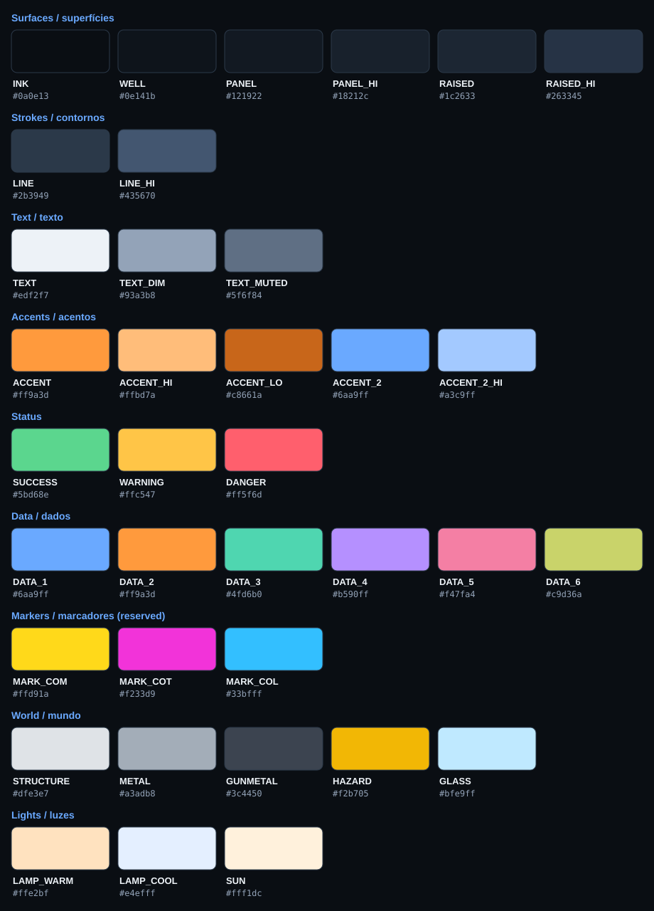

# MARGIN — paleta 2.0 e direção de arte / palette 2.0 and art direction

> Gerado por / generated by `tools/make_ui_kit.py` — não edite à mão / do not edit by hand.

Fonte única: `PALETTE`, `MARKERS` e `LIGHTS` em [`tools/make_ui_kit.py`](../../tools/make_ui_kit.py).
O script gera o UI kit (`ui/kit/*.svg`: molduras 9-patch, ícones, emblema), o **tema Godot**
[`ui/margin_theme.tres`](../../ui/margin_theme.tres) usado por todos os HUDs (hangar, mapa,
superfícies, voo), [`ui/palette.gd`](../../ui/palette.gd) (`MarginPalette.ACCENT`, …), esta
página e [`palette_swatches.svg`](palette_swatches.svg). `tools/build_vab_scene.py` importa a
mesma tabela para os materiais e luzes do hangar. Para mudar uma cor: edite a tabela, rode
`python tools/make_ui_kit.py` e reimporte no Godot.

Single source: `PALETTE` / `MARKERS` / `LIGHTS` in `tools/make_ui_kit.py`; it writes the kit,
the Godot theme, `MarginPalette`, this page and the swatch sheet.

## Tokens

Contraste medido sobre `PANEL` / contrast measured against `PANEL`.

| Token | Hex | vs PANEL | Papel / role |
|---|---|---|---|
| **Surfaces / superfícies** | | | |
| `INK` | `#0a0e13` | 1.1:1 | deepest background; text on accent fills |
| `WELL` | `#0e141b` | 1.0:1 | inset wells: inputs, tracks, tool groups |
| `PANEL` | `#121922` | 1.0:1 | panel / sheet body (surface) |
| `PANEL_HI` | `#18212c` | 1.1:1 | panel gradient top, top-bar |
| `RAISED` | `#1c2633` | 1.2:1 | raised surface: cards, buttons |
| `RAISED_HI` | `#263345` | 1.4:1 | hovered raised surface |
| **Strokes / contornos** | | | |
| `LINE` | `#2b3949` | 1.5:1 | 1 px strokes, separators, inactive outlines |
| `LINE_HI` | `#435670` | 2.4:1 | strong strokes, hovered outlines |
| **Text / texto** | | | |
| `TEXT` | `#edf2f7` | 15.7:1 | primary text, icons |
| `TEXT_DIM` | `#93a3b8` | 6.9:1 | secondary text, captions |
| `TEXT_MUTED` | `#5f6f84` | 3.4:1 | disabled, placeholders, off toggles |
| **Accents / acentos** | | | |
| `ACCENT` | `#ff9a3d` | 8.4:1 | Signal Orange: brand, selection, primary action |
| `ACCENT_HI` | `#ffbd7a` | 10.8:1 | Signal Orange lifted: hover, text on dark tint |
| `ACCENT_LO` | `#c8661a` | 4.5:1 | Signal Orange deep: pressed primary, strokes |
| `ACCENT_2` | `#6aa9ff` | 7.4:1 | Mission Blue: info, focus, progress, section labels |
| `ACCENT_2_HI` | `#a3c9ff` | 10.4:1 | Mission Blue lifted |
| **Status** | | | |
| `SUCCESS` | `#5bd68e` | 9.6:1 | go / OK / good TWR |
| `WARNING` | `#ffc547` | 11.2:1 | caution, marginal values |
| `DANGER` | `#ff5f6d` | 6.0:1 | no-go, errors, red beacons |
| **Data / dados** | | | |
| `DATA_1` | `#6aa9ff` | 7.4:1 | series 1 (blue) |
| `DATA_2` | `#ff9a3d` | 8.4:1 | series 2 (orange) |
| `DATA_3` | `#4fd6b0` | 9.7:1 | series 3 (teal) |
| `DATA_4` | `#b590ff` | 7.1:1 | series 4 (violet) |
| `DATA_5` | `#f47fa4` | 7.1:1 | series 5 (rose) |
| `DATA_6` | `#c9d36a` | 11.0:1 | series 6 (lime) |
| **Markers / marcadores (reserved)** | | | |
| `MARK_COM` | `#ffd91a` | 12.8:1 | Center of Mass (yellow) |
| `MARK_COT` | `#f233d9` | 5.3:1 | Center of Thrust (magenta) |
| `MARK_COL` | `#33bfff` | 8.4:1 | Center of Lift (cyan) |
| **World / mundo** | | | |
| `STRUCTURE` | `#dfe3e7` | 13.7:1 | VAB White: walls, ceiling, enclosures |
| `METAL` | `#a3adb8` | 7.8:1 | Light steel: columns, trusses, towers, rails |
| `GUNMETAL` | `#3c4450` | 1.8:1 | Gunmetal: grating, pad base, machinery |
| `HAZARD` | `#f2b705` | 9.7:1 | Safety yellow: crane, handrails, edges, floor lanes |
| `GLASS` | `#bfe9ff` | 13.7:1 | Cleanroom light: emissive panels, windows, glass |
| **Lights / luzes** | | | |
| `LAMP_WARM` | `#ffe2bf` | 14.2:1 | 3500 K high-bay lamps, work lights |
| `LAMP_COOL` | `#e4efff` | 15.2:1 | 6000 K fill, wall wash |
| `SUN` | `#fff1dc` | 15.9:1 | daylight sun through the door |

### Contraste de texto / text contrast (WCAG)

| Texto | sobre PANEL | sobre RAISED | sobre INK |
|---|---|---|---|
| `TEXT` | 15.7:1 | 13.6:1 | 17.2:1 |
| `TEXT_DIM` | 6.9:1 | 5.9:1 | 7.5:1 |
| `TEXT_MUTED` | 3.4:1 | 3.0:1 | 3.8:1 |
| `ACCENT` | 8.4:1 | 7.2:1 | 9.2:1 |
| `ACCENT_2` | 7.4:1 | 6.4:1 | 8.0:1 |
| `SUCCESS` | 9.6:1 | 8.3:1 | 10.6:1 |
| `WARNING` | 11.2:1 | 9.7:1 | 12.3:1 |
| `DANGER` | 6.0:1 | 5.2:1 | 6.6:1 |

`INK` sobre `ACCENT` (texto do botão primário / primary button text): 9.2:1.

## Hierarquia / hierarchy

1. **Superfícies** do mais fundo ao mais alto: `INK` (fundo) → `WELL` (campos, trilhos,
   grupos de ferramentas) → `PANEL` (painéis, gradiente até `PANEL_HI`) → `RAISED` (cartões,
   botões) → `RAISED_HI` (hover). Cada nível é ~4 % mais claro. / Surfaces step up ~4 % in
   lightness per level.
2. **Contornos** de 1 px nítidos: `LINE` (normal) e `LINE_HI` (hover / destaque). Raio
   consistente: 12 px painéis, 9 px cartões, 8 px botões e campos, 11 px pílulas.
3. **Texto**: `TEXT` (principal), `TEXT_DIM` (secundário, legendas), `TEXT_MUTED`
   (desativado, placeholders). Nunca texto `TEXT_MUTED` com informação essencial.
4. **Um acento por vez.** `ACCENT` (Signal Orange) = marca, seleção e a ação principal
   (**Lançar**). `ACCENT_2` (Mission Blue) = informação, foco, progresso, rótulos de seção. O
   Mission Blue foi deslocado para um azul-anil (`#6aa9ff`) para ficar distinto do ciano do CoL.
   / One accent at a time; Mission Blue is now an azure, clearly apart from the CoL cyan.
5. **Status**: `SUCCESS` / `WARNING` / `DANGER`, sempre acompanhados de ícone (✓ ⚠ ⛔) para
   não depender só da cor. Chips tonais: fundo = 16 % da cor sobre `PANEL`, borda 50 %.
6. **Dados**: `DATA_1…6` para séries de gráficos e cores de estágio (o mesmo estágio tem a
   mesma cor no cartão e na barra de Δv). Evitam amarelo, magenta e ciano puros.
7. **Marcadores KSP reservados**: CoM amarelo `MARK_COM`, CoT magenta `MARK_COT`, CoL ciano
   `MARK_COL` (`src/hangar/markers.gd`, materiais em `scenes/hangar.tscn`). Só os marcadores
   e sua legenda usam essas cores. / Marker colours are reserved.
8. **Brilho**: hover = halo `ACCENT_2` de 4 px; foco de campo = halo `ACCENT_2`; ação primária
   = halo `ACCENT`. Painéis têm sombra suave e um traço de luz de 1 px no topo.

## Materiais do mundo / world materials

- fechamento (paredes, teto, painéis de porta) → `STRUCTURE`
- estrutura primária (colunas, vigas, treliças, torres, garras do pad) → `METAL`
- piso de circulação e máquinas (grades, decks, base do pad, rodapé de 3,5 m) → `GUNMETAL`
- segurança (corrimãos, ponte rolante, faixas no piso, batentes da porta) → `HAZARD` (+ `INK` nas listras)
- marca (emblema, faixas da missão, pontas dos braços de acesso) → `ACCENT` / `ACCENT_2`
- luz → `LAMP_WARM` (quente) e `GLASS` / `LAMP_COOL` (frio). Equilíbrio quente/frio:
  refletor principal quente pela frente-direita, preenchimento frio pela esquerda, sol da porta.
- Texto no mundo: escuro (`GUNMETAL`) sobre parede branca, `TEXT` sobre faixa `PANEL`.
  Placas principais em inglês com subtítulo em português.

## Componentes do tema / theme components

Variações (`theme_type_variation`) disponíveis em `ui/margin_theme.tres` — veja a vitrine
`scenes/ui/ui_kit.tscn`:

| Tipo | Variações |
|---|---|
| PanelContainer | (padrão: vidro com sombra), `TopBarPanel`, `ReadoutPanel`, `FloatPanel`, `SubPanel`, `ToolGroup`, `CardPanel`, `CardFlat`, `CardHover`, `ToastPanel`, `BarTrack`, `Chip`, `ChipOk`, `ChipWarn`, `ChipDanger`, `ChipInfo`, `ChipAccent` |
| Button | (padrão), `FlatButton`, `PrimaryButton`, `SegmentButton`, `SymButton`, `IconToggle`, `PartCard`, `MarkerToggle` |
| Label | `TitleLabel`, `CardTitle`, `SectionLabel`, `CaptionLabel`, `DimLabel`, `ValueLabel`, `BigValueLabel`, `AccentLabel`, `LogoLabel`, `MonoLabel`, `KeyCap` |
| Outros | `LineEdit` (halo de foco), `CheckButton` (switch), `CheckBox`, `OptionButton`, `PopupMenu`, `PopupPanel`, `ProgressBar`, `H/VSlider` (botão redondo), barras de rolagem finas, tooltips |

## Emblema MARGIN / MARGIN emblem

`ui/kit/emblem_margin.svg` (gerado por `make_ui_kit.py`, importado a 2048 px com mipmaps).
Arte original, **sem nenhuma insígnia ou logotipo da NASA / Space Apps**: patch redondo com
aro `INK` e costura `ACCENT`, 24 marcas de relógio em `ACCENT_2` (as fases da missão), campo
de espaço profundo com estrelas de quatro pontas, o limbo azul de um planeta com uma costa em
voxels, uma órbita elíptica que cruza um foguete branco subindo (faixa laranja, aletas
laranja, janela azul) com um satélite no ponto da órbita, e uma fita laranja com a palavra
MARGIN desenhada com traços geométricos (sem `<text>`, porque o rasterizador de SVG do Godot
ignora fontes). Aparece no hangar como placa de 32 m na parede esquerda (anel de luz quente),
como decalque de 15 m no piso ao lado do pad e no topo do banner do evento.

O banner do evento traz só texto: "NASA / SPACE APPS / CHALLENGE / 2026" e
"MISSION DESIGN GAME · JOGO DE PROJETO DE MISSÕES".

## Cenas / scenes

- `scenes/environment/vab.tscn` — prédio (gerado). Porta aberta de 60 × 96 m na parede do
  fundo (x de −45 a 15, alinhada às colunas), folhas recolhidas para cima e por fora da parede.
- `scenes/environment/outside_launch_site.tscn` — planeta lá fora (gerado, instanciado pelo
  VAB): cúpula de céu com sol e nuvens (`shaders/sky_dome.gdshader`), sol direcional com
  sombras, chão de grama em pixels voxel + praia + oceano (`shaders/outside_ground.gdshader`),
  terreno voxel com montanhas e neve (MultiMesh), árvores e nuvens voxel, pátio de concreto,
  crawlerway com postes de luz, complexo de lançamento A e um pad B menor ao fundo.
- `shaders/cutaway_solid.gdshader` — colunas, vigas, passarelas e treliças do teto somem
  quando a câmera sai do prédio por aquele lado, como as paredes (vista em corte limpa).
