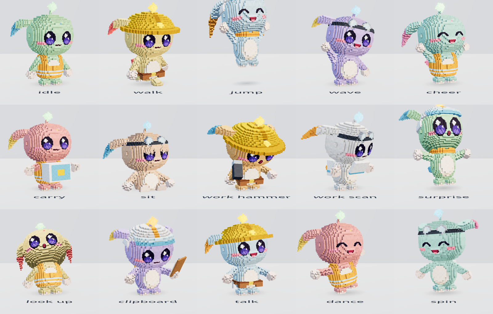

# Cometlings (PT: Cometinhos): the crew of MARGIN

> **PT:** Os **Cometinhos** são a espécie original que trabalha no hangar e tripula os
> foguetes. Nasceram do gelo da cauda de um cometa: cabeça enorme, corpinho de bala de goma,
> duas "orelhas-cauda" compridas que esvoaçam como a cauda de um cometa e uma antena com
> uma lâmpada-estrela que brilha na cor da profissão. São curiosos, corajosos e muito
> animados: pulam, acenam, comemoram, carregam caixas, martelam, escaneiam o foguete e
> conversam em pares com balõezinhos de emoji. Nada aqui copia humanos ou outras franquias.



## The species

| | |
|---|---|
| Name | **Cometling** / **Cometlings** (EN), **Cometinho** / **Cometinhos** (PT) |
| Origin story | Little beings that condensed out of the ice of a comet's tail. They love rockets because a rocket is the only way back home, so they build the best ones in the galaxy. |
| Height | ~1.05 m in model units; the hangar crowd uses 2.2x scale so they read from the hangar camera |
| Proportions | chibi: the head is ~55 % of the height, tiny gumdrop body, nub arms with round mitten paws, bean feet with toe pads |
| Species features | **tail-ears**: two long, flat ears that start on the top-sides of the head and stream backward like a comet tail (tips in the *spot colour*); **coma bulb**: a four-point star on a thin antenna, emissive, in the colour of the role; a stubby **comet tail**; three **freckle-stars** on the forehead; cream belly patch; rosy cheeks; huge glossy eyes with two sparkles |
| Personality | curious (stare at the rocket, peek through the door), brave (cheer when parts are stacked higher), chatty (pair up and gossip with emoji bubbles), helpful (carry crates to the pad), sleepy (sit down on the floor emblem for a nap) |

### Design rules

1. **Not human, not borrowed.** No noses, no hair, no human hands; silhouette = round head
   + streaming ears + star antenna. Avoid single-eye goggles over a capsule body (Minions),
   green humanoids in suits (Kerbals) and visor beans (Among Us).
2. **Voxel, but soft.** Same mesher as the parts (`tools/voxel_gen.py`, AO baked into vertex
   colours) at ~2 cm voxels for the body and ~0.9 cm voxels for the face, so eyes and
   mouths stay smooth. Shapes are super-ellipsoids (p = 2.2 to 2.4): round but voxel-friendly.
3. **One material.** Every Cometling shares `scenes/npc/creature_material.tres`. The vertex
   colour alpha marks which voxels take the per-creature tints (see *Colours*).
4. **Readable from far away.** Big heads, bright antenna, contrasting belly, oversized props
   (hammer, scanner, crate), soft rim light in the shader.

## Colours

Body colours are soft versions of the MARGIN palette (`docs/art/palette.md`) plus four
species colours. The **spot colour** paints the ear and tail tips; the **glow colour** is the
antenna bulb (and the scanner screen) and comes from the role. Source of truth:
`src/npc/cometling_looks.gd` (`CometlingLooks.VARIANTS`).

| id | EN / PT | body | spot | from |
|---|---|---|---|---|
| sky | Cleanroom Sky / Céu de Sala Limpa | `#bfe9ff` | `#f59a36` | GLASS + ACCENT |
| mint | Go Mint / Menta Liberada | `#aeeeb6` | `#5fb0d8` | SUCCESS (soft) + ACCENT_2 |
| butter | Caution Butter / Manteiga Atenção | `#ffe08f` | `#ff6b6b` | WARNING (soft) + DANGER |
| coral | Beacon Coral / Coral Sinalizador | `#ffa3a3` | `#ffcc55` | DANGER (soft) + WARNING |
| lilac | Nebula Lilac / Lilás Nebulosa | `#c9b8ff` | `#ffcc55` | species |
| peach | Re-entry Peach / Pêssego Reentrada | `#ffcaa8` | `#5fb0d8` | species |
| cloud | VAB Cloud / Nuvem do Hangar | `#eef1f4` | `#f59a36` | STRUCTURE + ACCENT |
| seafoam | Coast Seafoam / Espuma do Litoral | `#a6eadb` | `#ff8fb8` | species |
| tangerine | Signal Tangerine / Tangerina Sinal | `#ffbd7a` | `#5fb0d8` | ACCENT (soft) + ACCENT_2 |

Fixed species colours (not tinted): cream belly `#fff1de`, paw pads `#ffe2d6`, blush
`#ff8ca4`, eye ink `#1a1634` with violet iris `#463a96`/`#6e60cd`, mouth `#461e30`.

## Roles and accessories

| Role | Glow (antenna) | Head | Body | Work animation / prop |
|---|---|---|---|---|
| Pilot | ACCENT `#f59a36` | white flight helmet with an orange stripe and a flipped-up Mission-Blue visor | orange scarf whose tail flaps on a spring | `clipboard` (checklist), looks up at the rocket |
| Engineer | HAZARD `#f2b705` | safety-yellow hard hat with brim, ridge and a head lamp | leather tool belt with pouches and a tiny wrench | `work_hammer` at the pad and the workbench |
| Scientist | ACCENT_2 `#5fb0d8` | lab goggles on the forehead (glass lenses with glints) | white sample backpack with a mini dish antenna | `work_scan` with a glowing tablet |
| Ground crew | SUCCESS `#7ee08a` | none | orange safety vest with reflective stripes | `carry` crates from the stack to the pad |

## How a Cometling is built

`python tools/creature_gen.py` writes:

- `assets/voxel/creatures/*.glb`: one mesh per animated piece, **origin at its pivot**:
  `body`, `head`, `eye_l/r`, `lid_l/r` (eyelids), `eye_happy_l/r` (^ ^), `mouth_smile`
  (cat "w"), `mouth_open` (D grin with tongue), `mouth_o` (surprise), `ear_l/r`, `antenna`,
  `bulb`, `tail`, `arm_l/r` (arm + mitten), `foot`, accessories (`acc_helmet`,
  `acc_hardhat`, `acc_goggles`, `acc_scarf`, `acc_scarf_tail`, `acc_belt`, `acc_vest`,
  `acc_backpack`) and props (`item_hammer`, `item_wrench`, `item_scanner`,
  `item_clipboard`, `item_crate`).
- `assets/voxel/creatures/ui/emotes.png` (16 pixel-art speech bubbles: heart, star, !, ?,
  note, wrench, rocket, zzz, idea, sweat, happy, sparkle, chat, fire, check, planet) and the
  role / button icons (`role_*.svg`, `icon_*.svg`) used by the crew panel.
- `scenes/npc/creature.tscn`: the rig, a skeleton-free hierarchy of `Node3D` pivots
  (`Rig > Hips > Neck > EyeL…`, `ArmR > HandR > Hammer`…) placed at the same pivots, plus the
  blob shadow, the emote `Sprite3D` and a `VisibleOnScreenNotifier3D`.
- `scenes/npc/hangar_crowd.tscn`: workbench, crate stack, points of interest and 9 NPCs.

Re-running overwrites both scenes: change proportions, pivots or point positions in the
script. Triangle budget: ~22-30 k triangles for one dressed Cometling.

### Colour masks

The creature shader (`scenes/npc/creature.gdshader`) reads the vertex-colour **alpha** that
the generator writes: `0` fixed colour, `1/3` body tint, `2/3` spot tint, `1` glow tint (also
emissive). Tinted voxels are authored in light greys, so shading and AO survive the tint. The
tints are **instance uniforms** (`body_tint`, `spot_tint`, `glow_tint`, `glow_energy`,
`highlight`): one material, any number of differently coloured Cometlings.

## Animation (`src/npc/creature.gd`, class `Cometling`)

Fully procedural, no bones and no AnimationPlayer: every frame a `Pose` (about 30 numbers:
squash, lean, hip and head angles, arm and foot offsets, ear lift, eye scale, lid, mouth,
held item) is built in layers and written to the pivots.

1. **Idle**: breathing squash (`breath_rate`, `breath_depth`), head drift, tail wag, antenna
   pulse, random glances (often with a blink, like a real look), quick eye darts, blinking
   every 1.6-4.8 s (`blink_interval`, 25 % double blinks) and a slow weight shift from one foot
   to the other.
2. **Idle habits** (`fidgets`, `fidget_interval`): look around, curious head tilt, ear flick,
   antenna boing, toe bounce, happy tail wag, shy foot scuff (paws behind the back), little
   hop, yawn, stretch, sigh. `personality_seed` gives every Cometling its own tempo, curiosity
   and sleepiness, so a crowd never moves in sync.
3. **Mood** (`mood`, -1 gloomy .. 1 bubbly): ears, tail height and wag, eyelids, mouth,
   breathing speed and which habits play (bubbly ones hop and wag, gloomy ones scuff and sigh).
   The tycoon can feed morale into it.
4. **Walk / run** (`set_move_velocity(v)`): cadence follows the speed (`stride`, `run_stride`),
   feet arc and roll, squash on contact / stretch mid-step (`walk_bounce`), hip sway and twist,
   arm swing (`arm_swing`). Above `run_speed` it turns into a run: longer strides, airborne
   bounce, pumping arms, forward lean, open mouth. Turning rolls the body into the turn
   (`turn_lean`), the head leads (`head_lead`) and the tail swings out. The body lean rides a
   spring with inertia (`lean_spring_hz`, `lean_inertia`): it tips back when starting, forward
   when stopping, then rocks back.
5. **Loop actions** (`play(name)`, cross-faded over 0.3 s): `idle`, `sit`, `look_up` (with awed
   toe bounces), `work_hammer`, `work_scan`, `carry` (load bobs, re-grip hops), `clipboard`
   (ticks boxes), `talk` (emphasis nods, shared laughs), `dance` (a twirl every 8 beats),
   `sleep` (nap sitting down: eyes shut, slow breaths, nodding off and jerking awake, zZ
   bubbles when `auto_emotes`), `think` (paw on the chin, head tilts, eyes up; every few
   seconds an idea lights the bulb), `sad` (slump, droopy ears, frown, sniffles, foot scuff),
   `work_type` (typing bursts and reading pauses) and `work_wrench` (ratchet pulls, a happy
   beat when the bolt is tight). Played while walking, the stationary ones keep walking legs.
6. **One-shots on top** (eased in/out, `play(name, duration)`): `wave`, `cheer`, `jump`,
   `surprise`, `nod`, `spin`, `hop`, `clap` (paws meet; pass a duration for a long applause),
   `celebrate` (anticipation, spinning leap, landing squash, fist pumps), `startled` (jumps
   back, flails, paws to the mouth, trembles), `point`, `salute`, `bow`, `shrug`, `laugh`,
   `sigh`, `shake_head`, `yawn`, `stretch`. `play_sequence([...])` chains them, `stop_shot()`
   cancels.
7. **Faces** (`set_expression(name, duration)`, `clear_expression()`): `happy` (squint),
   `joy` (^ ^ and open mouth), `content`, `sad` (tilted lids, frown, droopy ears),
   `surprised`, `sleepy`, `grumpy` (slanted lids), `worried`. Built only from the authored
   face parts: eyes scale and squash, the lids scale and tilt, the mouth parts scale and the
   smile turns upside down for a frown.
8. **Look-at**: `look_at_point(p, weight)`; the head takes 75 % of the yaw and gets there
   first, the hips take 25 % a moment later; pupils shift a little toward the target.
9. **Secondary motion**: ears, antenna, tail, scarf tail and body lean ride damped springs
   driven by the head's velocity and the turn rate (they stream back when running, bounce
   after jumps, flop on surprises). Springs are sub-stepped so long frames stay stable.
10. **Emotes**: `show_emote("heart")` pops a bubble with an overshoot, floats and shrinks.

All tunables are exports on the `Creature` node (groups *Liveliness*, *Gait*, *Level of
detail*). `Cometling.all_actions()` / `has_action()` list the names; the full public API is
at the top of `creature.gd`.

Bench: `godot --path . --resolution 1600x900 --script res://tests/screenshot_creature_anims.gd -- <out_dir>`
saves film strips of every action (`anims_loops*`, `anims_shots_*`, `anims_gait`), the face
sheet (`anims_faces`) and an idling crowd (`anims_crowd`). Headless:
`tests/test_creature_anims.gd` plays every action, expression and reaction.

### Reacting to the hangar

```gdscript
creature.react("part_placed")   # surprise -> cheer / jump / spin, "!" or star bubble
creature.react("part_removed")  # surprise -> nod, sweat bubble
# also: vessel_cleared, launch, success, failure, hello, staged,
#       level_up, hired, good_news, bad_news, idea, tired, scared, poke
creature.poke()                 # a random cute reaction (clicks)
NpcEvents.emit("launch")        # every listening Cometling reacts (singleton-free bus)
NpcEvents.emit("part_placed", {"position": p, "radius": 30.0, "stagger": 0.4})
```

`NpcEvents` (`src/npc/npc_events.gd`) is a `RefCounted` held in a static variable: no
autoload, no node. The hangar crowd already turns `Vessel.changed` into these events (parts
added -> `part_placed`, six or more at once -> `success`, removed -> `part_removed`, emptied
-> `vessel_cleared`), so no hangar code had to change.

### Performance

- Shared material, no shadow casting (a blob-shadow quad instead), visibility range 170 m.
- Off-screen Cometlings skip the animation entirely (`VisibleOnScreenNotifier3D`); beyond
  45 m they update every 2nd frame, beyond 90 m every 4th (time accumulates, motion stays
  correct). Eye darts only run closer than `detail_distance` (24 m, times the node scale),
  idle habits up to `habit_distance_factor` (2.5x) that.
- No per-frame allocation: the pose layers reuse two `Pose` buffers, face parts and props only
  toggle visibility when they change, the bulb glow is only re-sent when it changes. Stepping
  48 Cometlings headless costs ~45-55 us each per frame, the same as before the new actions.
- Measured in the hangar (Garça loaded, 1600x900, AMD integrated GPU, other Godot
  instances running in parallel): the 9-NPC crowd adds ~50 draw calls and ~0.27 M
  triangles to a ~4.2 M-triangle frame and ~1.2-1.8 ms of physics-step CPU (navigation +
  avoidance, accumulated over the several physics ticks of a 12 fps frame). The FPS
  difference with and without the crowd was within run-to-run noise (11-13 fps both ways;
  the hangar itself is GPU-bound there). `NpcCrowd.crowd_enabled = false` turns the crowd off.

## The hangar crowd (`scenes/npc/hangar_crowd.tscn`)

Instanced by `scenes/environment/vab.tscn` (added by `tools/build_vab_scene.py`).

- **NavRegion**: `scenes/npc/hangar_navmesh.tres`, baked by
  `godot --headless --path . --script res://src/npc/bake_hangar_navmesh.gd` from the VAB
  scene itself (pad, props, service tower, crew props, wall plinths). Re-bake after moving
  props.
- **Points** (`Marker3D`, metadata `kind`): `work` (ring around the pad), `bench`, `look`,
  `rest`, `door`, `crate_pickup`, `crate_drop`, `wave`, `dance`. Move them in the editor or in
  `POINTS` in the generator.
- **NPCs**: 9 `hangar_npc.tscn` (brain `NpcWalker` + `NavigationAgent3D` with RVO avoidance
  + Cometling at 2.2x). The 6 crew NPCs wear the looks of the first roster members
  (`use_roster`); 3 stay ground crew.
- **Behaviour** (`NpcCrowd.pick_task`, weights per role): work at the pad, hammer at the
  bench, scan, check the clipboard, admire the rocket, nap on the floor emblem, look out of
  the door, carry crates from the stack to the pad, wave at the camera when it is near,
  dance, wander, and **chat in pairs** (both walk to a meeting point, face each other, talk
  with alternating emoji bubbles, and sometimes end with a jump or a spin). Points are
  claimed so two NPCs never share one. Hangar events pause walking for a moment, turn the
  crowd toward the rocket and play the reaction.

## Files

| Path | What |
|---|---|
| `tools/creature_gen.py` | voxel parts, emotes, icons, `creature.tscn`, `hangar_crowd.tscn` |
| `assets/voxel/creatures/` | generated meshes and UI textures |
| `scenes/npc/creature.tscn` · `creature.gdshader` · `creature_material.tres` · `blob_shadow.tres` | the rig |
| `scenes/npc/hangar_npc.tscn` · `hangar_crowd.tscn` · `hangar_navmesh.tres` · `creature_showcase.tscn` | crowd and studio |
| `src/npc/creature.gd` (`Cometling`) · `npc_walker.gd` (`NpcWalker`) · `hangar_crowd.gd` (`NpcCrowd`) · `npc_events.gd` (`NpcEvents`) · `cometling_looks.gd` (`CometlingLooks`) · `bake_hangar_navmesh.gd` | code |
| `tests/test_crew.gd` · `tests/test_creature_anims.gd` · `tests/screenshot_creatures.gd` · `tests/screenshot_creature_anims.gd` | tests, screenshots, animation bench, FPS benchmark |
