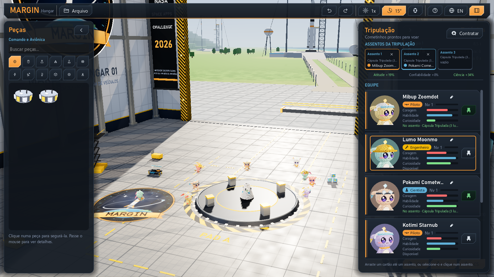

# Crew system

> **PT:** A tripulação é formada por Cometinhos (ver `docs/creatures.md`). Cada um tem
> nome, profissão (piloto, engenheiro, cientista), coragem / habilidade / curiosidade,
> experiência e situação (disponível / no assento). A equipe é salva em
> `user://crew_roster.json`. O painel `scenes/ui/crew_panel.tscn` mostra retratos 3D ao vivo,
> permite contratar, renomear e colocar cada um num assento das peças tripuladas do veículo
> (arrastando o cartão ou clicando). Pilotos melhoram o controle de atitude, engenheiros a
> confiabilidade e cientistas o retorno científico.



## Data

`CrewMember` (`src/crew/crew_member.gd`, `Resource`)

| field | |
|---|---|
| `id` | `"cm001"`… unique per roster |
| `display_name` | generated from fun syllables (`Pibo Glimwick`, `Zuli Novabean`): `CrewRoster.generate_name(rng)` |
| `role` | `pilot`, `engineer`, `scientist` |
| `variant` | colour variant (`CometlingLooks.VARIANTS`), hires pick the least used colour |
| `courage`, `skill`, `curiosity` | 0..1 (the role's main stat leans high) |
| `experience`, `missions` | XP (100 per level, levels 1-6 in the UI), mission count |
| `status` | `available` / `assigned` |
| `assigned_part`, `assigned_seat` | seat: path of the PartInstance relative to its Vessel + seat index |
| `portrait_seed` | animation rhythm of the portrait / NPC |

`CrewRoster` (`src/crew/crew_roster.gd`, `RefCounted`), persisted as JSON in
`user://crew_roster.json` (a new player gets 6 members: two of each role).

## API

```gdscript
var roster := CrewRoster.shared()                  # lazy, loaded from user://, no autoload
var seats := CrewRoster.seats_for_vessel(vessel)   # [{part, path, seat, member}] in attach order
roster.assign(member, capsule_part, 0)             # -> bool
roster.assign(member, capsule_part, 0, true)       # replace whoever sits there
roster.assign_auto(member, vessel)                 # first free seat -> bool
roster.unassign(member)
roster.prune(vessel)                               # unseat crew whose part is gone -> count
roster.bind_vessel(vessel)                         # prune automatically on Vessel.changed
roster.hire("pilot") / roster.rename(m, "Zuzu") / roster.dismiss(m)
roster.save() / roster.load_from(path)             # autosave is on for the shared roster
CrewRoster.crew_seats(part)                        # seats of a part
```

Seats per part come from the part's `crew_seats` field in `data/parts.json`; while that field
is missing, `crew_capsule` falls back to 3 seats (`CrewRoster.FALLBACK_SEATS`).

### Rules (covered by `tests/test_crew.gd`)

- a seat holds one member; assigning into a taken seat fails unless `replace = true`;
- a member sits in one seat; assigning again moves them;
- seat indices go from 0 to `crew_seats - 1`, so a vessel never carries more crew than seats;
- members whose part leaves the vessel (detach, undo, new vessel) are unseated (`prune`,
  automatic after `bind_vessel`);
- only parts inside a Vessel can be seated.

### Mission hooks

`roster.mission_modifiers(vessel)` returns multipliers for the mission simulation (1.0 = no
crew effect). Each seated member adds:

| key | who | per member | cap |
|---|---|---|---|
| `attitude_control` | pilots | +8 % + 14 % x skill + 3 % per level | 1.6 |
| `reliability` | engineers | +4 % + 10 % x skill + 2 % per level | 1.4 |
| `science_return` | scientists | +10 % + 25 % x curiosity + 5 % per level | 2.0 |
| `morale` | everyone | mean courage (0..1) | |

plus `crew_count` and `seats`. Suggested uses: scale RCS / reaction-wheel authority and
gimbal response by `attitude_control`, divide random failure rates by `reliability`, multiply
science points by `science_return`, and use `morale` for abort thresholds.
`roster.award_mission(vessel, success)` gives XP (+60 success, +25 otherwise) to the crew.

## Crew panel (`scenes/ui/crew_panel.tscn`, class `CrewPanel`)

Uses `ui/margin_theme.tres`. Header (title, *Hire*), the **crew seats** of the current vessel
(one slot per seat: seat number, part, occupant with role colour, unseat ×), the live mission
modifiers, and the **roster**: one card per member (`scenes/ui/crew_card.tscn`) with a live 3D
portrait (`scenes/ui/crew_portrait.tscn`: a Cometling in its own small World3D, re-rendered at
~20 fps and not at all when hidden), name + rename (pencil or double-click), role badge, level
+ XP bar, courage / skill / curiosity bars, status, and a seat button.

Seat a member by **dragging the card onto a seat**, by **selecting the card and clicking a
seat**, or with the card's **seat button** (first free seat; press again to unseat). Portraits
react: wave on hover, jump while dragged, cheer when seated.

### Embedding

```gdscript
var panel := preload("res://scenes/ui/crew_panel.tscn").instantiate() as CrewPanel
$UI/Root/CrewSlot.add_child(panel)       # any Container
panel.set_vessel(vessel)                  # or set `vessel_path` in the inspector
panel.crew_assigned.connect(func(m: CrewMember, part: Node, seat: int) -> void: pass)
panel.close_requested.connect(func() -> void: panel.hide())   # with show_close_button = true
```

Signals: `member_selected(member)`, `crew_assigned(member, part, seat)`,
`crew_unassigned(member)`, `member_hired(member)`, `roster_changed`, `close_requested`.
Methods: `set_vessel(v)`, `set_roster(r)`, `refresh()`, `select_member(m)`.
The panel keeps itself in sync with `Vessel.changed` and the roster's `changed`. It is 400 px
wide minimum; give it the height you have (the roster scrolls).

Strings live in `i18n/crew_strings.csv` (EN + PT). The panel registers the generated
translations at runtime (`CrewPanel.ensure_translations()`), so nothing in
`project.godot` is required; adding the two `.translation` files to
`internationalization/locale/translations` works too.
