<!--
Cometworks · Documento da Equipe (fonte editável)
Para gerar o PDF:  python tools/build_team_doc.py   (sai em docs/Cometworks_Documento_da_Equipe.pdf)

Convenções (Markdown comum + alguns blocos):
- ## Seção (entra no sumário) · ### e #### subtítulos · listas, tabelas com |, **negrito**, *itálico*, `código`.
- Imagem sozinha num parágrafo vira figura com legenda: 
  Duas ou três imagens no mesmo parágrafo ficam lado a lado. Classes no fim: {.half} {.halfl} {.wide} {.short}
- [[nome]] coloca um ícone de ui/cometworks/icons/ (rocket, star, comet, crew, coin...).
- \pagebreak quebra a página.
- Blocos abrem com "::: tipo" e fecham com ":::" (podem ficar um dentro do outro):
  ::: cover / ::: toc / ::: chapter      capa, sumário e abertura de capítulo (campos "chave: valor"; texto depois de ---)
  ::: card                              ficha de personagem: nome, grupo, papel, funcao, jeito, efeito, foto, cor, icone,
                                        inspirou, viva (sim), original (sim); depois de --- vem o texto de "Quem inspirou"
  ::: mission                           ficha de missão: titulo, tipo (sonho, corrida, ciencia, contrato, spaceapps), era,
                                        gancho, pedido, recompensa, ciencia, fonte, destino, missao, leva, proporcao, cuidado
  ::: box spoiler|inspirou|nota|dica|aviso|efeito|ciencia [título]   caixas coloridas
  ::: grid [two|three]                  grade de 2 (ou 3) colunas
  ::: story                             falas de cena (campos imagem e kicker, depois --- e uma fala por linha)
  ::: gallery [five|six]                linhas "img/arquivo.webp | legenda"
  ::: quote                             frase em destaque (campo quem, depois ---)
  ::: stats / ::: flow                  linhas "icone | número ou título | texto"
  ::: page credits                      página própria
- Cores: pessego, manteiga, menta, gelo, lilas, rosa, vermelho, violeta, nuvem ou um #hex.
-->

::: cover
kicker: NASA Space Apps Challenge 2026
tagline: Uma agência espacial de Cometinhos
imagem: img/capa_campus.jpg
cometinhos: img/c_hero.webp, img/c_celebrate.webp, img/c_hop.webp
titulo: Documento da Equipe
subtitulo: Tudo sobre o jogo num lugar só: a história, os personagens, as 27 missões, a ciência de verdade e o que vem por aí.
equipe: Kauã, Helena, João Lucas, Ryan
numeros: calendar 25 anos até o cometa, journal 27 missões, race 15 marcos, star 18 Lendas
rodape: Edição de novembro de 2026 · uso interno da equipe
:::

::: toc
titulo: Sumário
---
Este é o nosso livro do jogo. Ele junta o que está espalhado em JSON, CSV, cenas e conversas de madrugada, para qualquer pessoa da equipe conseguir explicar o Cometworks de ponta a ponta, apresentar para os jurados ou criar conteúdo novo sem quebrar nada. Os números vêm direto dos arquivos de `data/tycoon/`; quando algo é proposta (e não está no jogo ainda), o texto avisa.
:::

::: chapter
numero: 1
titulo: O jogo em uma página
cor: pessego
imagem: img/cap1_olhando.jpg
icone: comet
---
Se alguém te parar no corredor do hackathon e perguntar "tá, mas o que é o jogo de vocês?", este capítulo é a resposta.

Um minuto de leitura, e você sai daqui sabendo vender o Cometworks para um jurado, uma professora ou uma criança de onze anos.
:::

## O pitch

**Cometworks é um tycoon aconchegante de agência espacial.** Você comanda uma turma de Cometinhos, criaturinhas de voxel que nasceram da cauda de um cometa, e tem 25 anos para levá-los de volta para casa.

A Mãe-Gelo, o cometa de onde eles vieram, passa de novo no fim do ano 25. Daqui de baixo ela fica longe demais. Então o plano é o mesmo que a gente escreveria num guardanapo: **primeiro a Lua, depois o cometa.** A Lua tem pouca gravidade e gelo nos polos, que vira combustível. Quem montar a primeira base de partida lá sai na frente.

No caminho, a agência começa num galpão com foguetes de sondagem e cresce até virar um campus inteiro. Cada missão é um pequeno quebra-cabeça: um pedido conta uma história, e descobrir **para onde ir, que tipo de nave mandar, o que levar a bordo e quem vai construir** é com você.

::: quote
quem: frase da capa do nosso GDD
---
"Cada quilo tem um preço. Cada semana também."
:::

## Space Apps 2026

O Cometworks é a nossa entrega para o **NASA Space Apps Challenge 2026**, no desafio de criar um jogo de design de missões espaciais. O enunciado pede, entre outras coisas, que o jogador escolha o objetivo antes da nave, que lide com recursos reais (massa, energia, orçamento, dados, comunicação e tempo), que toda decisão tenha consequência e que os conceitos sejam ensinados dentro do jogo, sem só dizer "certo" ou "errado".

A gente respondeu a isso com três coisas:

- **Os seis medidores** do planejador de carga: massa, energia, dados, comunicação, orçamento e tempo. Massa, energia de dia ou caixa no vermelho travam o plano.
- **Missões que contam histórias reais.** As 27 fichas de pedido se apoiam em missões de verdade (Sputnik, Explorer 1, Landsat, Hubble, LCROSS, Apollo, Artemis, Rosetta...) e em desafios do próprio Space Apps, como queimadas, qualidade do ar, enchentes, gelo marinho e tempestades solares.
- **Falhar ensina.** A avaliação diz o que segurou a missão, e o Caderno de descobertas guarda isso para a próxima tentativa.

Para os jurados, existe o **modo feira**: a campanha inteira roda com o relógio acelerado (1 segundo por semana), para dar para jogar do galpão ao cometa numa sessão.

## A fantasia do jogador

> "Eu dirijo a agência espacial mais fofa da galáxia e, decisão por decisão, levo meus Cometinhos de um galpão de foguetes de sondagem até a Lua, e da Lua de volta ao cometa."

É a fantasia do Game Dev Tycoon com cheiro de querosene: projetos em fases, alavancas de foco, jornais dando nota, um escritório que cresce. Só que o escritório é uma plataforma de lançamento, a nota vem do *Boletim da Coma* e quem comemora no pátio são os Cometinhos.

::: stats
calendar | 25 anos | do ano 1 até a passagem da Mãe-Gelo
journal | 27 missões | pedidos com história e solução escondida
race | 15 marcos | a corrida contra três agências rivais
crew | 7 profissões | cada uma puxa uma barra do projeto
:::

## O que deixa o Cometworks especial

**Ciência de verdade por baixo.** Os números do jogo são números do mundo: órbita baixa a uns 7,8 km/s, a Lua a 384 400 km, uma noite lunar de duas semanas, Δv por destino tirado das cônicas do nosso mapa. Os pedidos e as fichas da enciclopédia citam missões reais com fonte conferida. Uma professora aprovaria; essa é a régua.

**Descoberta no lugar de tutorial.** Nenhum pedido diz como resolver. A proporção ideal de cada tipo de missão, os instrumentos que brilham em cada lugar e o ambiente escondido de cada destino (a noite lunar, o frio do polo, o Sol fraco no cometa) são aprendidos voando. A equipe dá palpites, os jornais reclamam do que faltou e o caderno anota.

**Arte aconchegante.** Voxel com contorno de desenho, pôr do sol cor de pêssego, Cometinhos que pulam quando o foguete sobe e choram com balõezinhos quando ele cai. A interface parece um caderno de adesivos: papel creme com bolinhas, tinta azul-marinho, botões gordinhos.

**Ninguém é vilão.** As agências rivais provocam no jornal, mas no fim todo mundo quer a mesma coisa: voltar para o cometa.

## Para quem é

- **Crianças e pré-adolescentes (10 anos ou mais)** que gostam de espaço, de bichinhos fofos e de ver as coisas crescerem. A régua do GDD: uma criança de 11 anos quer continuar jogando?
- **Famílias e salas de aula.** Tudo pode ser pausado, nada exige reflexo, e cada missão vem com um fato real que dá conversa.
- **Fãs de tycoon e de foguete** (Game Dev Tycoon, Kerbal, Mars Horizon), que vão gostar das contas por baixo do fofo.
- **Os jurados do Space Apps**, que precisam ver o jogo inteiro em pouco tempo: para eles existe o modo feira.

::: chapter
numero: 2
titulo: A lore
cor: lilas
imagem: img/cap2_cauda.jpg
icone: star
---
Os Cometinhos não estão construindo foguetes por esporte. Eles querem voltar para casa.

Aqui está a história como o jogo conta, fala por fala, mais o que a gente está propondo acrescentar: um avô astrônomo que guarda os cadernos do observatório.
:::

## A Mãe-Gelo e os Cometinhos

Muito além das nuvens viaja a **Mãe-Gelo**, um cometa velho, gelado e brilhante. Da poeira gelada da cauda dela nasceram uns floquinhos muito curiosos: os **Cometinhos** (em inglês, *Cometlings*).

Dá para reconhecer um Cometinho de longe: cabeça grande, duas **orelhas-cauda** que esvoaçam como a cauda de um cometa, uma **antena com uma lâmpada-estrela** que acende na cor da profissão e, como diz a abertura, "nenhum senso de perigo".

::: story
imagem: img/lore_maegelo.jpg
kicker: Abertura · "Uma história dos Cometinhos"
---
Muito além das nuvens viaja a Mãe-Gelo, um cometa velho, gelado e brilhante.
Da poeira gelada da cauda dela nasceram uns floquinhos muito curiosos.
Orelhas de cauda, antena de estrela e nenhum senso de perigo. Os Cometinhos!
:::

## A última passagem e a promessa

Na última passagem da Mãe-Gelo, um punhado de Cometinhos caiu aqui embaixo, no nosso mundo. Ela seguiu viagem. Eles ficaram acenando... por um bom tempo.

Mas cometa que é cometa sempre volta. **A Mãe-Gelo volta em 25 anos.** E eles prometeram: *da próxima vez, a gente vai junto!*

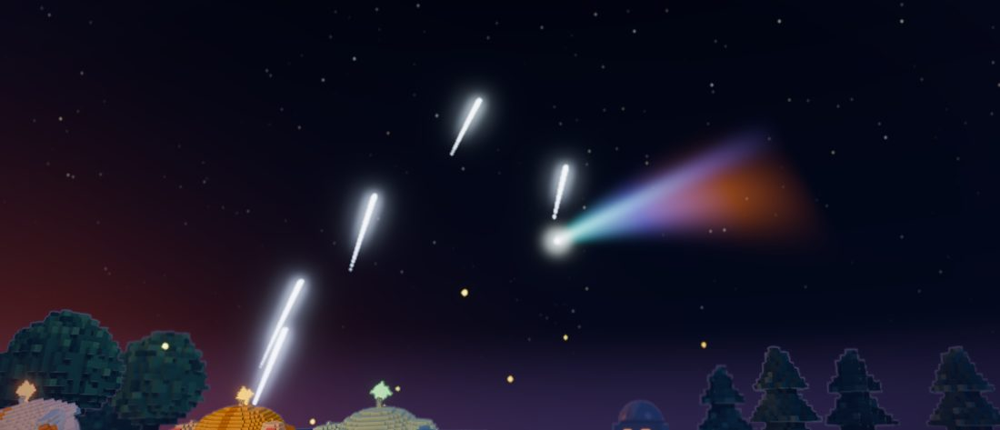 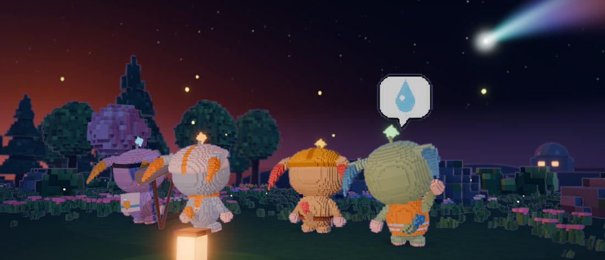

::: story
imagem: img/lore_promessa.jpg
kicker: A promessa
---
A Mãe-Gelo seguiu viagem. Eles ficaram acenando… por um bom tempo.
Mas cometa que é cometa sempre volta. A Mãe-Gelo volta em 25 anos.
E eles prometeram: da próxima vez, a gente vai junto!
:::

## Primeiro a Lua, depois o cometa

Daqui de baixo, o cometa fica longe demais: muito combustível, pouco foguete. Mas a Lua tem pouca gravidade e gelo nos polos, combustível para pular até ela. Então eles juntaram um galpão, uma plataforma e um sonho do tamanho do céu.

**O plano: primeiro a Lua. Depois, o cometa. Depois, um lanchinho.** Só faltava alguém para comandar essa bagunça. E aí entra você: "*{líder}*, a *{agência}* é sua. Vamos levar todo mundo para casa!"

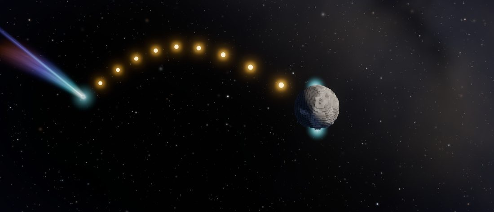 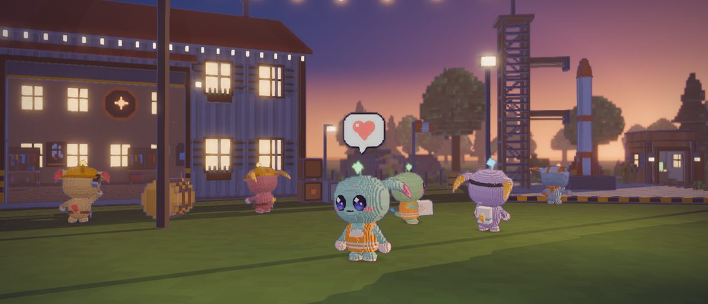

::: box ciencia A ciência por trás da ficção
Sair da Lua gasta muito menos energia que sair da Terra: a velocidade de escape lá é de uns 2,4 km/s, contra 11,2 km/s aqui. Algumas crateras perto dos polos lunares nunca veem o Sol, e o gelo de água pode ficar guardado nelas por bilhões de anos. Separado em hidrogênio e oxigênio, esse gelo vira propelente de foguete. É por isso que a corrida é pela Lua: quem tiver a primeira base de partida operacional chega mais fácil ao encontro com o cometa.
:::

A campanha começa no ano 1 ("Fundada no ano 1 · 25 anos até o cometa") e termina no fim do ano 25, quando a Mãe-Gelo passa pelo Sol. Quem quiser rever a história tem o botão **Rever abertura** nas configurações, e existe uma abertura curta de três falas para quem já conhece.

## Vovô Edmundo Halleyzinho

::: box nota Lore nova · proposta para aprovação da equipe
Este personagem ainda não está no jogo. A ideia é que ele apareça na abertura, nos pedidos com cometa e no Caderno de descobertas, sem mudar nada do que já foi contado.
:::

::: grid two
::: card
nome: Vovô Edmundo Halleyzinho
grupo: Lore e história
papel: Astrônomo do observatório
funcao: Mentor da história · narra as cenas, comenta os pedidos com cometa e assina as anotações de céu do caderno
jeito: Fala devagar, perde os óculos na testa e chama todo cometa de "minha filha". Jura que a Mãe-Gelo piscou para ele uma vez.
efeito: Os cadernos do observatório: no ano 1, o caderno já começa com o ambiente do cometa marcado como "a confirmar", e a pesquisa Encontro com cometa custa 10% menos. Uma vez por era, ele manda uma carta com a contagem regressiva e uma dica.
foto: img/lenda_halleyzinho.webp
cor: nuvem
icone: book
inspirou: Edmond Halley (1656–1742)
---
Usando as leis de Newton, o astrônomo inglês percebeu que os cometas vistos em 1531, 1607 e 1682 eram o mesmo e previu que ele voltaria em 1758. Halley morreu em 1742, antes de ver a previsão se cumprir; quando o cometa voltou, ganhou o nome dele.
:::

::: box inspirou Como ele entra na história
O Vovô Edmundo caiu aqui embaixo muitas e muitas passagens atrás, sozinho, quando ainda era um floquinho. Passou a vida no morro, olhando o céu toda noite e anotando tudo em cadernos de capa azul.

Foi ele quem percebeu que a Mãe-Gelo volta sempre, e foi ele quem fez a conta: **25 anos**. Quando o novo punhado de Cometinhos caiu na última passagem, era o Vovô quem estava lá para recebê-los, com chocolate quente e os cadernos debaixo do braço.

Ele já não tem idade para subir num foguete, e sabe disso. Diz que não precisa: "Previsão boa é a que se cumpre, mesmo que seja outro alguém a ver." Por isso ele torce por você mais do que todo mundo.
:::
:::

**Falas propostas** (para `i18n/cutscene_strings.csv`, entre as falas 6 e 7 da abertura):

- "O Vovô Edmundo, que já viu passar mais cometas do que tem estrelinhas na testa, fez a conta no caderno."
- "Vinte e cinco anos. Nem um dia a mais, nem um dia a menos."
- No final com o cometa, depois de "promessa cumprida": "Lá no morro, o Vovô Edmundo fechou o caderno e sorriu: eu sabia."

## Os dois finais

A campanha sempre termina no fim do ano 25. O que muda é se a sua agência chegou lá.

### O final do cometa

Se uma missão ao cometa da agência teve sucesso a tempo, a cena é esta:

::: story
imagem: img/final_contato.jpg
kicker: Final · "Promessa cumprida"
---
Vinte e cinco anos de foguetes, contas e alguns tropeços depois…
…uma sonda dos Cometinhos chega à Mãe-Gelo. Contato!
Ela balança a cauda, como quem diz: eu sabia que vocês vinham.
Sobre o campus, a cauda dela acende o céu inteiro.
Ninguém trabalhou naquela noite. Bom, quase ninguém.
{líder}, promessa cumprida.
Casa não é um lugar no céu. É chegar lá juntos.
:::

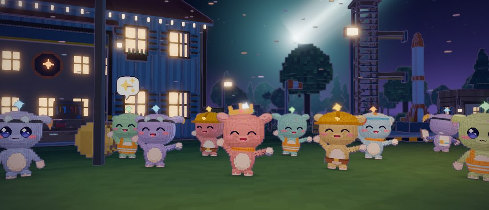 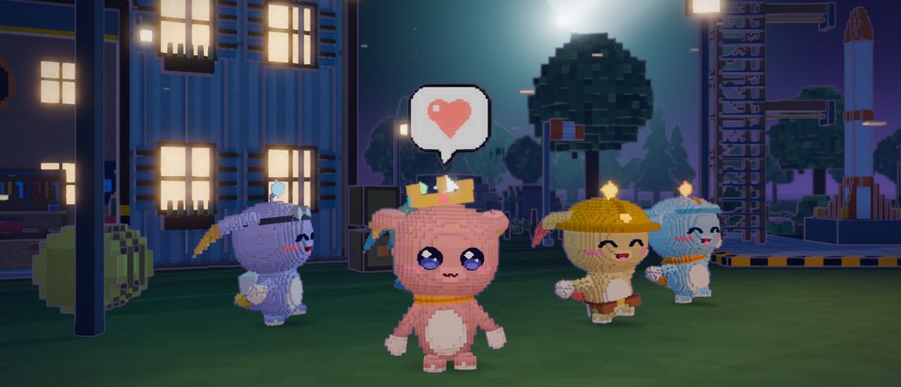

### O final agridoce

Se ninguém da agência chegou, o jogo não pune. Ele abraça:

::: story
imagem: img/final_perdido.jpg
kicker: Final · "Até a próxima, Mãe-Gelo"
---
No fim do ano 25, a Mãe-Gelo passou bem em cima do morro.
Desta vez, a gente não chegou a tempo.
Teve fungada, teve abraço e teve um pacote inteiro de biscoitos.
{líder} olhou para cima e sorriu: ela sempre volta.
E na próxima passagem, a gente vai estar pronto.
:::

Os dois finais levam para a tela **A Mãe-Gelo passa pelo Sol**, com a fila das agências ("encontrou o cometa" ou "ficou para trás") e depois para a pontuação final (capítulo 7).

## Regras da lore

Para quem for escrever qualquer coisa nova (fala, pedido, notícia, carta):

1. **A Mãe-Gelo é uma "ela"**, velha, gelada, brilhante e carinhosa. Ela nunca é ameaça.
2. **Os Cometinhos nasceram da cauda dela** e caíram aqui na última passagem. Eles amam foguetes porque foguete é o único caminho de volta.
3. **25 anos, nem mais nem menos.** A passagem é no fim do ano 25, e o relógio do cometa está sempre na barra de cima.
4. **Primeiro a Lua, depois o cometa.** A Lua é o trampolim (pouca gravidade, gelo nos polos), nunca o destino final.
5. **As rivais são Cometinhos também.** Elas querem a mesma casa. Provocação pode; maldade, não.
6. **Ciência real, sempre.** Se um fato aparece numa fala, ele tem que estar certo e, de preferência, ter fonte.

::: chapter
numero: 3
titulo: Personagens
cor: menta
imagem: img/cap3_turma.jpg
icone: crew
---
O jogo é cheio de Cometinhos, mas alguns merecem nome e sobrenome: o líder que você cria, as sete profissões da equipe e as rivais.

E tem novidade: dezoito **Lendas**, Cometinhos que homenageiam pessoas reais da aviação, da ciência e da exploração espacial, mais uma líder rival original.
:::

## Seu líder

Toda campanha começa no **criador de líder** ("Crie seu Cometinho líder · Quem vai comandar a agência até a passagem do cometa?"). São quatro abas, com um Cometinho girando na prateleira que pula e solta um balãozinho a cada mudança.

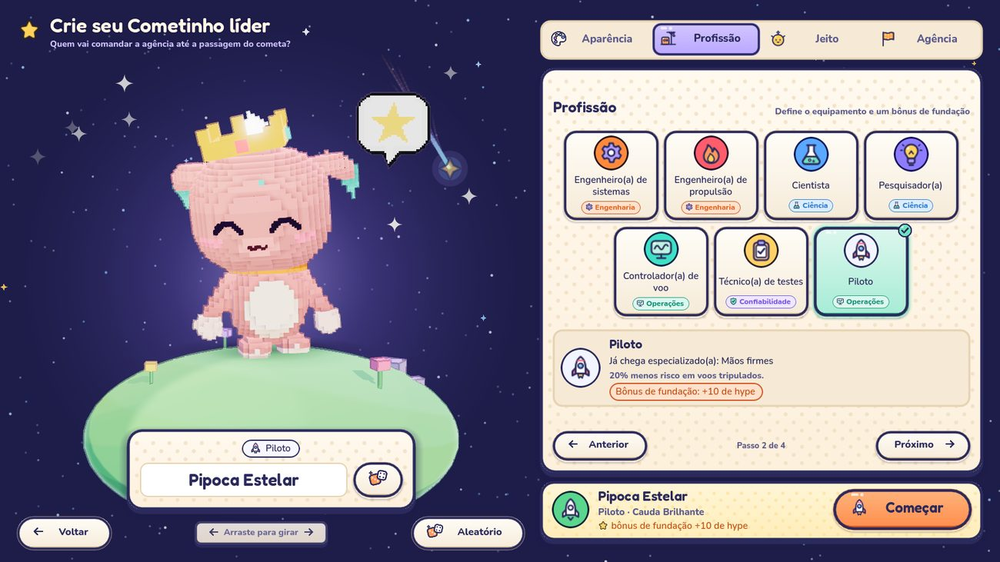 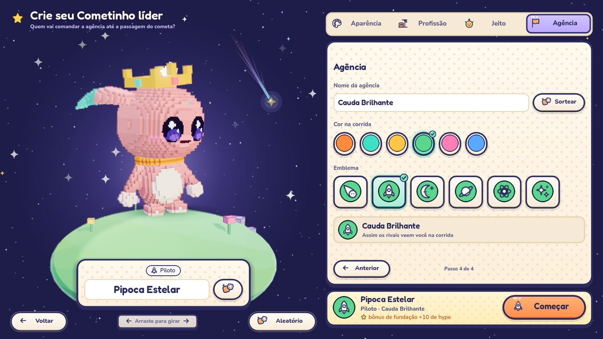

| Aba | O que se escolhe | Opções no jogo |
| --- | --- | --- |
| **Aparência** | nome, cor do corpo, cor das pontinhas, chapéu | 16 nomes sorteáveis (Pipoca, Faísca, Jujuba, Paçoca, Quindim...) e 8 sobrenomes (da Cauda, Estelar, Poeira-de-Estrela...); 12 cores de corpo, 10 de pontinhas; chapéus: da profissão, nenhum, coroa, boné-hélice, gorro, florzinha, lacinho |
| **Profissão** | uma das 7 profissões | define o equipamento, uma especialização de cara e um bônus de fundação (tabela abaixo) |
| **Jeito** | ponto forte e jeitinho | ponto forte: habilidade, curiosidade ou coragem (começa em 85, os outros em 60); jeitinho: alegre, sonhador(a), inventor(a) ou tranquilo(a) |
| **Agência** | nome, cor na corrida, emblema | nomes sorteáveis (Cometworks, Cauda Brilhante, Pipoca Orbital, Poeira de Estrela, Rabisco Lunar, Oficina da Aurora); 6 cores; emblemas cometa, foguete, lua, saturno, átomo e brilho |

O líder entra na equipe no **nível 2, com moral 90**, trabalha como qualquer Cometinho e ganha um selo de "Líder da agência". Dá para editar nome e visual depois, mas profissão e ponto forte ficam como na fundação. E não, não dá para se demitir: "O líder é você".

## As sete profissões

Cada projeto tem quatro barras de qualidade: **Engenharia (ENG)**, **Ciência (CIÊ)**, **Operações (OPE)** e **Confiabilidade (CONF)**. Cada profissão rende 100% na sua barra principal, 40% na secundária e 15% nas outras. A antena de cada Cometinho acende na cor da profissão, então dá para ver no campus quem faz o quê.

| Profissão | Barra principal | Secundária | Salário | Se for o líder: especialização e bônus |
| --- | --- | --- | --- | --- |
| Engenheiro(a) de sistemas | Engenharia | Confiabilidade | 1,0× | Líder de integração (15% menos defeitos) · +3 de reputação |
| Engenheiro(a) de propulsão | Engenharia | só a principal | 1,05× | Encantador(a) de motores (+20% de Engenharia) · +25 mil cr |
| Cientista | Ciência | Operações | 1,0× | Garimpeiro(a) de dados (+15% de ciência por dado) · +5 de hype |
| Pesquisador(a) | Ciência | só a principal | 1,0× | Teórico(a) (+25% de pesquisa no laboratório) · +15 pontos de pesquisa |
| Controlador(a) de voo | Operações | Confiabilidade | 1,0× | Diretor(a) de voo (+15% de Operações) · +3 de reputação |
| Técnico(a) de testes | Confiabilidade | Engenharia | 0,9× | Caçador(a) de defeitos (remove 25% mais defeitos) · +15 mil cr |
| Piloto | Operações | Confiabilidade | 1,3× | Mãos firmes (20% menos risco em voos tripulados) · +10 de hype |

::: box dica Regrinha que o jogo ensina
Uma barra de 25% ou mais na proporção da missão pede alguém da profissão dela na equipe. Se faltar, a avaliação avisa: "Faltou um(a) técnico(a) de testes: a Confiabilidade ficou órfã." Missões tripuladas exigem um piloto.
:::

## Especializações

No **nível 3** e no **nível 5** o Cometinho escolhe uma especialização, passando 2 semanas no centro de treinamento (nível 1 do centro para a primeira, nível 2 para a segunda) e custando um salário. As especializações que uma pesquisa abre só aparecem depois dela (a ficha avisa: "A pesquisa abre mais: ..."), e as da pesquisa tardia servem nos dois graus, para os veteranos também poderem aprender.

| Grau | Especialização | Para quem | Efeito |
| --- | --- | --- | --- |
| 1 | Enxugador(a) de massa | Eng. de sistemas | +15% de pontos de Engenharia |
| 1 | Líder de integração | Eng. de sistemas | 15% menos defeitos no seu trabalho |
| 1 | Encantador(a) de motores | Eng. de propulsão | +20% de pontos de Engenharia |
| 1 | Especialista em criogenia | Eng. de propulsão | +2% de confiabilidade nas famílias de foguete em que trabalha |
| 1 | Especialista lunar | Cientista | +20% de Ciência em alvos lunares (pesquisa Mobilidade de rovers) |
| 1 | Garimpeiro(a) de dados | Cientista | +15% de ciência por dado baixado |
| 1 | Teórico(a) | Pesquisador(a) | +25% de pontos de pesquisa |
| 1 | Mentor(a) de laboratório | Pesquisador(a) | +10% de XP para colegas, +5% de Ciência |
| 1 | Mestre de antenas | Controlador(a) | +20% de downlink (pesquisa Rede de espaço profundo) |
| 1 | Diretor(a) de voo | Controlador(a) | +15% de pontos de Operações |
| 1 | Caçador(a) de defeitos | Técnico(a) | remove 25% mais defeitos |
| 1 | Chefe da mesa de vibração | Técnico(a) | +15% de pontos de Confiabilidade |
| 1 | Piloto de testes | Piloto | +15% de Operações (pesquisa Seleção de Cometinhos) |
| 1 | Mãos firmes | Piloto | 20% menos risco em voos tripulados |
| 2 | Mentor(a) | qualquer | +25% de XP para todos no mesmo projeto |
| 2 | Incansável | qualquer | o excesso de trabalho começa 4 semanas depois |
| 2 | Otimista incorrigível | qualquer | falhas abalam a moral pela metade |
| 2 | Polímata | qualquer | afinidade da barra secundária de 0,4 para 0,7 |
| 1 ou 2 | Médico(a) de voo | Cientista, Controlador(a) | 40% menos risco para a tripulação nos voos tripulados em que trabalha (pesquisa Suporte de vida) |
| 1 ou 2 | Caminhante lunar | Piloto | nos pousos tripulados: +25% de pontos e 30% menos risco para a tripulação (pesquisa Módulo de pouso tripulado) |
| 1 ou 2 | Navegador(a) de cometas | Controlador(a), Piloto | nas missões ao cometa: +25% de pontos e +30% de downlink (pesquisa Encontro com cometa) |
| 1 ou 2 | Minerador(a) de gelo | Cientista, Eng. de sistemas | +25% de pontos nas missões ISRU, +15% em qualquer missão ao polo lunar (pesquisa Extração de gelo) |
| 2 | Diretor(a) de missão | qualquer | +10% de pontos para todos no mesmo projeto (pesquisa Automação de missões) |

Os efeitos moram em `data/tycoon/crew.json` e cada um chega a uma regra de verdade: pontos e defeitos no projeto, risco da tripulação e confiabilidade na Revisão de projeto, downlink e ciência na operação. Um efeito pode valer só num tipo de missão (`points_crewed_landing`), num destino (`points_comet`) ou em qualquer alvo lunar (`points_sci_lunar`).

## As Lendas

As Lendas são uma ideia nova, já aprovada: **Cometinhos que homenageiam pessoas reais** que abriram caminho no céu. Cada uma tem um nome-homenagem, um papel no jogo e uma caixinha amarela "Quem inspirou", com poucos fatos bem estabelecidos sobre a pessoa de verdade.

Elas entram de três jeitos:

- **Contratação lendária:** aparece uma vez no mercado de contratação, numa era específica, com uma especialização única que nenhum outro Cometinho tem.
- **Mentor(a) de briefing:** não entra na folha de pagamento; aparece no quadro de missões comentando certos pedidos, como as dicas da equipe, e dá um pequeno bônus.
- **Líder rival:** dá rosto, fala e manias a uma das três agências rivais.

::: box aviso Combinados para as Lendas
São homenagens, com respeito: nada de piada com a pessoa real, nada de política, nenhuma frase inventada atribuída a ela. Pessoas vivas estão marcadas na ficha; antes de publicar o jogo fora do hackathon, vale a gente revisar esses casos com calma. As "Propostas de efeito" são ideias de design para discutir; os números ainda não existem no código. As artes são Cometinhos do jogo com outra cor: **a arte final de cada Lenda vem depois.**
:::

### Pioneiros brasileiros

::: grid two
::: card
nome: Albertinho Dumontinho
grupo: Pioneiros brasileiros
papel: Piloto lendário
funcao: Contratação lendária · aparece no mercado na era 2, quando o primeiro Cometinho vai ao espaço
jeito: Elegante até de macacão. Inventa um chapéu novo por semana e tem certeza de que tudo voa, só falta descobrir como.
efeito: Asas do 14-Bis: 30% menos risco em voos tripulados (no lugar dos 20% de Mãos firmes) e +10% de Operações para a equipe do mesmo projeto.
foto: img/lenda_dumontinho.webp
cor: nuvem
icone: hat_propeller
inspirou: Alberto Santos-Dumont (1873–1932)
---
Inventor brasileiro nascido em Minas Gerais, voou em Paris, em 1906, com o 14-Bis, num dos primeiros voos de avião registrados diante de público e de uma comissão oficial. Antes disso já era famoso pelos dirigíveis que pilotava sobre a cidade.
:::

::: card
nome: Marquinhos Pontinha
grupo: Pioneiros brasileiros
papel: Piloto lendário
funcao: Contratação lendária · aparece no mercado na era 2
jeito: Disciplinado, sorridente e sempre com uma bandeirinha no bolso do macacão.
efeito: Missão Centenário: na primeira missão tripulada que ele voar, o hype ganho dobra e a missão recebe bônus de novidade; +15% de Operações sempre.
foto: img/lenda_pontinha.webp
cor: gelo
icone: rocket
viva: sim
inspirou: Marcos Pontes (1963–)
---
Piloto e engenheiro da Força Aérea Brasileira, tornou-se o primeiro astronauta brasileiro ao voar até a Estação Espacial Internacional em março de 2006. A viagem se chamou Missão Centenário, em homenagem aos 100 anos do voo do 14-Bis.
:::

::: card
nome: Cesinha Latte
grupo: Pioneiros brasileiros
papel: Cientista lendário
funcao: Contratação lendária · aparece no mercado na era 2, junto com a pesquisa Física espacial
jeito: Passa horas olhando chapas fotográficas com uma lupa e comemora cada risquinho como gol.
efeito: Raios cósmicos: +25% de pontos de pesquisa e +20% de ciência nas missões que levam detector de partículas.
foto: img/lenda_latte.webp
cor: lilas
icone: research
inspirou: César Lattes (1924–2005)
---
Físico nascido em Curitiba, participou em 1947 da descoberta do méson pi (píon) usando chapas fotográficas expostas aos raios cósmicos nos Andes bolivianos. Ajudou a fundar o Centro Brasileiro de Pesquisas Físicas, e a Plataforma Lattes, usada por pesquisadores de todo o Brasil, leva o nome dele.
:::

::: card
nome: Berta Luzinha
grupo: Pioneiras brasileiras
papel: Mentora de briefing
funcao: Comenta os contratos do governo (Programa Espacial Nacional, Conselho de Ciência, Serviço de Tempo e Clima)
jeito: Fala baixo e firme, anota tudo e não deixa ninguém ficar de fora da reunião.
efeito: Voz no conselho: contratos do governo pagam +10% e dão +0,5 de reputação extra quando cumpridos; nos pedidos do governo, ela aponta qual barra o cliente mais valoriza.
foto: img/lenda_luzinha.webp
cor: rosa
icone: contracts
inspirou: Bertha Lutz (1894–1976)
---
Bióloga do Museu Nacional, especialista em anfíbios, foi uma das líderes da luta pelo voto feminino no Brasil, conquistado em 1932. Em 1945, na conferência que criou a ONU, defendeu que a Carta das Nações Unidas citasse a igualdade entre mulheres e homens.
:::

::: card
nome: Dulinha da Estrela
grupo: Pioneiras brasileiras
papel: Mentora de céu profundo
funcao: Comenta os pedidos de telescópio e de observação do céu (como "Acima das nuvens")
jeito: Aponta para o céu no meio da frase e esquece o que estava dizendo. Tem um apelido para cada galáxia.
efeito: Olhos no céu profundo: revela a proporção ideal do Telescópio depois de 1 voo (em vez de 2) e dá +15% de ciência nas missões de telescópio.
foto: img/lenda_dulinha.webp
cor: lilas
icone: star
viva: sim
inspirou: Duília de Mello (1963–)
---
Astrônoma brasileira que trabalha com a NASA e é professora nos Estados Unidos. Estuda galáxias, inclusive com imagens do telescópio Hubble, e é uma das vozes mais conhecidas da divulgação de astronomia em português.
:::
:::

### Cálculo e código na NASA

::: grid two
::: card
nome: Kátia Jonsom
grupo: Cálculo e código
papel: Controladora de voo lendária
funcao: Contratação lendária · aparece no mercado na era 1
jeito: Confere a conta do computador à mão, só por garantia. E a conta dela sempre bate.
efeito: Confira os números: na Revisão de projeto, o risco de "Margem de Δv" cai pela metade nos projetos dela; +15% de Operações.
foto: img/lenda_jonsom.webp
cor: manteiga
icone: control
inspirou: Katherine Johnson (1918–2020)
---
Matemática da NASA, calculou a trajetória do voo de Alan Shepard em 1961 e conferiu à mão os números do computador para o voo orbital de John Glenn, em 1962. Também trabalhou nos cálculos da Apollo 11.
:::

::: card
nome: Dora Vonzinha
grupo: Cálculo e código
papel: Mentora da equipe
funcao: Mentora de campus · fica no laboratório e ensina todo mundo
jeito: Quando chega uma máquina nova, ela é a primeira a ler o manual, e depois dá aula para a turma toda.
efeito: Todo mundo aprende: +15% de XP para todos os Cometinhos da agência e especializações com 1 semana a menos no centro de treinamento.
foto: img/lenda_vonzinha.webp
cor: pessego
icone: training
inspirou: Dorothy Vaughan (1910–2008)
---
Liderou a unidade de cálculo West Area Computing no centro de Langley e foi a primeira supervisora negra da agência que deu origem à NASA. Quando os computadores eletrônicos chegaram, aprendeu a linguagem FORTRAN e ensinou a própria equipe.
:::

::: card
nome: Mariazinha Jequi
grupo: Cálculo e código
papel: Engenheira lendária
funcao: Contratação lendária (engenheira de sistemas) · aparece no mercado na era 2
jeito: Sopra a franja para cima e diz exatamente onde o ar vai fazer turbulência.
efeito: Túnel de vento: na Revisão de projeto, os riscos de coifa e de propulsores laterais caem pela metade nos projetos dela; +15% de Engenharia.
foto: img/lenda_jequi.webp
cor: menta
icone: build
inspirou: Mary Jackson (1921–2005)
---
Começou como matemática em Langley e, em 1958, tornou-se a primeira engenheira negra da NASA, estudando o fluxo de ar em túneis de vento. A sede da NASA, em Washington, hoje leva o nome dela.
:::

::: card
nome: Margô Hamiltinha
grupo: Cálculo e código
papel: Engenheira de sistemas lendária
funcao: Contratação lendária · aparece no mercado na era 3
jeito: Escreve listas de "e se der errado?" maiores que o próprio foguete. Quase nunca precisa delas.
efeito: Software à prova de tudo: 30% menos defeitos no trabalho dela e a alavanca Software e autonomia rende +25%.
foto: img/lenda_hamiltinha.webp
cor: menta
icone: settings
viva: sim
inspirou: Margaret Hamilton (1936–)
---
Liderou, no Laboratório de Instrumentação do MIT, a equipe que desenvolveu o software de bordo das missões Apollo. Ajudou a popularizar o termo "engenharia de software" e recebeu a Medalha Presidencial da Liberdade em 2016.
:::
:::

### Primeiros no espaço

::: grid two
::: card
nome: Comandante Iúri Gagarinho
grupo: Primeiros no espaço
papel: Líder rival · Aurora Rubra
funcao: Dá rosto à Aurora Rubra: aparece no jornal e no quadro da corrida
jeito: Sorriso enorme, coragem maior ainda. Sempre o primeiro a apertar o botão.
efeito: "Vamos lá!": a Aurora tenta os marcos tripulados com mais vontade (como já faz no jogo, ×1,5) e, quando conquista um, a manchete traz a frase dele. Quando falha, ele é o primeiro a mandar flores.
foto: img/lenda_gagarinho.webp
cor: vermelho
icone: hat_crown
inspirou: Yuri Gagarin (1934–1968)
---
Em 12 de abril de 1961, a bordo da Vostok 1, tornou-se o primeiro ser humano no espaço, dando uma volta completa na Terra em cerca de 108 minutos. Na decolagem, disse "Poyekhali!", algo como "Vamos lá!".
:::

::: card
nome: Valentina Tereskinha
grupo: Primeiros no espaço
papel: Piloto lendária
funcao: Contratação lendária · aparece no mercado na era 2 · indicativo de chamada "Gaivota"
jeito: Chama todo mundo pelo indicativo de rádio e cantarola na contagem regressiva.
efeito: Gaivota: em voos tripulados de órbita, a tripulação não perde moral com excesso de trabalho e o risco tripulado cai 20%.
foto: img/lenda_tereskinha.webp
cor: gelo
icone: hat_bow
viva: sim
inspirou: Valentina Tereshkova (1937–)
---
Em 16 de junho de 1963, na Vostok 6, tornou-se a primeira mulher no espaço, passando quase três dias em órbita e dando 48 voltas na Terra. O indicativo de chamada dela era "Chaika", que quer dizer "gaivota".
:::

::: card
nome: Nilo Braçoforte
grupo: Primeiros no espaço
papel: Piloto lendário
funcao: Contratação lendária · aparece no mercado na era 4, com o Módulo de pouso tripulado
jeito: Fala pouco e pousa bem. Ensaia o primeiro passo no tapete do galpão.
efeito: Pequeno passo: no Pouso tripulado, o risco tripulado cai 25% e a nota para "Excepcional" baixa de 8,5 para 8,0.
foto: img/lenda_bracoforte.webp
cor: menta
icone: planet
inspirou: Neil Armstrong (1930–2012)
---
Comandante da Apollo 11, foi a primeira pessoa a caminhar na Lua, em julho de 1969. Antes disso foi piloto de testes e comandou a Gemini 8, que fez a primeira acoplagem entre duas naves em órbita.
:::

::: card
nome: Sali Carona
grupo: Primeiros no espaço
papel: Mentora de missões tripuladas
funcao: Comenta os pedidos tripulados ("Nascer da Terra", "Pegadas na poeira") e visita o centro de treinamento
jeito: Explica física com uma bola de futebol e não deixa nenhuma pergunta sem resposta.
efeito: Pode perguntar: nos pedidos tripulados, ela revela a proporção do cliente; a alavanca Treino da equipe de solo dá +25% de XP aos pilotos.
foto: img/lenda_carona.webp
cor: rosa
icone: training
inspirou: Sally Ride (1951–2012)
---
Física, voou em junho de 1983 no ônibus espacial Challenger e foi a primeira mulher americana no espaço. Depois dedicou boa parte da vida a levar ciência para crianças, especialmente para meninas.
:::

::: card
nome: Maê Jeminha
grupo: Primeiros no espaço
papel: Cientista lendária
funcao: Contratação lendária · aparece no mercado na era 4, com o Suporte de vida
jeito: Médica, dançarina e engenheira nas horas vagas. Mede a pressão de todo mundo antes do lançamento.
efeito: Saúde a bordo: o risco "Nervos da tripulação" cai pela metade e a moral da tripulação não cai depois de uma falha.
foto: img/lenda_jeminha.webp
cor: lilas
icone: heart
viva: sim
inspirou: Mae Jemison (1956–)
---
Médica e engenheira, voou em setembro de 1992 no ônibus espacial Endeavour e foi a primeira mulher afro-americana no espaço. Antes da NASA, trabalhou como médica voluntária na África Ocidental.
:::
:::

### Cometas e astronomia

::: grid two
::: card
nome: Vovô Edmundo Halleyzinho
grupo: Cometas e astronomia
papel: Mentor da história
funcao: Narrador das cenas e guardião dos cadernos do observatório (veja o capítulo 2)
jeito: Perde os óculos na testa e chama todo cometa de "minha filha".
efeito: Os cadernos do observatório: ambiente do cometa anotado "a confirmar" desde o ano 1 e Encontro com cometa 10% mais barato.
foto: img/lenda_halleyzinho.webp
cor: nuvem
icone: book
inspirou: Edmond Halley (1656–1742)
---
Previu que o cometa visto em 1531, 1607 e 1682 voltaria em 1758. Morreu antes, em 1742; o cometa voltou e ganhou o nome dele.
:::

::: card
nome: Carolina Herschelinha
grupo: Cometas e astronomia
papel: Líder rival · Instituto Quietude
funcao: Dá rosto ao Instituto Quietude: aparece no jornal e no quadro da corrida
jeito: Varre o céu toda noite com uma luneta do tamanho dela. Mede duas vezes, depois mede de novo.
efeito: Caçadora de cometas: o Quietude continua quase sem falhar (confiabilidade 0,95) e, perto do fim da campanha, ganha um empurrão extra no encontro com a Mãe-Gelo. É a rival mais perigosa na reta final.
foto: img/lenda_herschelinha.webp
cor: violeta
icone: comet
inspirou: Caroline Herschel (1750–1848)
---
Astrônoma nascida na Alemanha e radicada na Inglaterra, descobriu oito cometas e foi a primeira mulher a descobrir um. Também foi uma das primeiras mulheres pagas para fazer ciência e recebeu a medalha de ouro da Royal Astronomical Society.
:::

::: card
nome: Joãozinho Keplerino
grupo: Cometas e astronomia
papel: Mentor de órbitas
funcao: Comenta os pedidos de órbita baixa, heliossíncrona e geoestacionária
jeito: Desenha elipses em qualquer guardanapo e fica ofendido quando alguém chama órbita de "círculo".
efeito: Leis do céu: a pesquisa Órbitas heliossíncronas sai 15% mais barata e, nos pedidos de órbita, ele diz qual órbita combina melhor com o pedido.
foto: img/lenda_keplerino.webp
cor: gelo
icone: planet
inspirou: Johannes Kepler (1571–1630)
---
Com as medições de Tycho Brahe, descobriu que os planetas andam em elipses e varrem áreas iguais em tempos iguais: as leis do movimento planetário, publicadas entre 1609 e 1619. São essas leis que dizem onde a Mãe-Gelo vai estar.
:::

::: card
nome: Carlito Sagão
grupo: Cometas e astronomia
papel: Mentor e narrador
funcao: Narra o pedido especial "Pálido Ponto Azul" (proposta abaixo) e comenta os pedidos de ciência
jeito: Fala de bilhões de estrelas com a mesma voz com que fala do lanche. Fica com os olhos marejados olhando a Terra.
efeito: Pálido Ponto Azul: libera um pedido de sonho na era 5 (capítulo 5) e dá +10% de hype a toda missão que leva câmera para longe da Terra.
foto: img/lenda_sagao.webp
cor: gelo
icone: star
inspirou: Carl Sagan (1934–1996)
---
Astrônomo e divulgador, apresentou a série Cosmos, de 1980. Foi ele quem sugeriu que a Voyager 1 se virasse para fotografar a Terra de longe: a foto de 1990, o Pálido Ponto Azul, mostra o planeta como um pontinho num raio de sol.
:::
:::

## As agências rivais

São três agências de Cometinhos correndo atrás dos mesmos 15 marcos. Elas não têm projetos de verdade: são simuladas uma vez por mês, cada uma com seu próprio sorteio, e aparecem no jornal, no quadro da corrida e no mapa. Elas também disputam contratos comerciais e compram tecnologia licenciada.

| Agência | Personalidade | Força | Fraqueza | Lema | Provocação no jornal |
| --- | --- | --- | --- | --- | --- |
| **Aurora Rubra** (vermelho) | Ousada: lança cedo e arrisca | Chega primeiro nos marcos tripulados | Falha muito; perde meses com acidentes | "Acende primeiro, pergunta depois." | "Cautela é palavra de quem chega em segundo." |
| **Consórcio Nimbo** (azul-claro) | Comercial e rica | Ganha contratos e licencia tecnologia | Lenta em missões tripuladas | "Toda órbita tem seu preço." | "Nossos acionistas mandam lembranças." |
| **Instituto Quietude** (violeta) | Cientista e cautelosa | Pesquisa rápida; quase não falha | Gasta demais e demora | "Devagar, mas até a Lua." | "Medimos duas vezes. Depois medimos de novo." |

Com as Lendas, cada agência ganha um rosto: **Comandante Iúri Gagarinho** na Aurora Rubra, **Carolina Herschelinha** no Instituto Quietude e uma personagem original no Consórcio Nimbo:

::: grid two
::: card
nome: Dona Cifrinha
grupo: Líder rival
papel: Líder rival · Consórcio Nimbo
funcao: Dá rosto ao Consórcio Nimbo: aparece no jornal, no quadro da corrida e quando o Nimbo assina um contrato antes de você
jeito: Antena em forma de moedinha, calculadora no bolso e um sorriso educadíssimo. Faz orçamento até da festa de aniversário.
efeito: Toda órbita tem seu preço: quando você licencia uma tecnologia, ela às vezes oferece 10% a mais que o normal, mas o Nimbo fica com a tecnologia e corre mais rápido.
foto: img/lenda_cifrinha.webp
cor: nuvem
icone: coin
original: sim
---
Dona Cifrinha não homenageia ninguém: é uma Cometinha inventada pela equipe, a única "executiva" da cauda. Ela não é vilã; só acha que um sonho fica mais bonito com a planilha em dia.
:::

::: box nota Como as rivais jogam (números do jogo)
Uma vez por mês, cada rival rola uma chance de tentar o próximo marco. A chance cresce com a capacidade e o ritmo dela, diminui com a dificuldade do marco e aumenta quando ela está atrás do líder (um "elástico" suave). Uma tentativa falha com chance maior para quem é ousada e pouco confiável, e a falha custa meses.

- **Aurora:** ousadia 1,5 · confiabilidade 0,5 · ritmo 1,1 · ×1,5 nos tripulados · tropeço de 3 a 6 meses.
- **Nimbo:** ousadia 0,8 · confiabilidade 0,8 · ×0,6 nos tripulados e um ano de atraso neles.
- **Quietude:** ousadia 0,6 · confiabilidade 0,95 · ritmo 0,85 · meio ano de atraso para começar.
:::
:::

::: chapter
numero: 4
titulo: Como se joga
cor: gelo
imagem: img/cap4_oficina.jpg
icone: build
---
Uma missão no Cometworks é um pequeno projeto, do pedido ao jornal do dia seguinte. Em volta dela gira a agência: gente, pesquisa, contratos, dinheiro e um campus que cresce.

Este capítulo segue esse caminho na ordem em que o jogador vê. Os números são os de `data/tycoon/`, então dá para usar como referência de balanceamento.
:::

## O loop de uma missão

::: flow
journal | Quadro de missões | Um pedido conta uma história. Nunca diz como resolver.
planet | Objetivo | Para onde e que tipo de missão.
research | Carga e medidores | Instrumentos, energia, antena e os seis medidores.
crew | Equipe | Quem vai construir. Cada profissão puxa uma barra.
rocket | Foguete | O projetista: sete encaixes, Δv e carga.
build | Desenvolvimento | Três fases, nove alavancas, pontos e defeitos.
shield | Revisão de projeto | Os riscos listados. Corrigir, aceitar ou cancelar.
flame | Lançamento | Contagem, ignição e o sorteio do resultado.
antenna | Operação | Semanas em voo, dados descendo, decisões.
star | Avaliação | Nota, quatro jornais e o que segurou a missão.
book | Caderno | Tudo o que o voo ensinou fica anotado.
race | Corrida | Marcos, prêmios e as rivais de olho.
:::

O tempo anda em semanas. O jogo pode ficar pausado o quanto quiser (Espaço) e tem três velocidades: 6, 3 e 1 segundo por semana. Ele pausa sozinho nas horas importantes: fim de fase, lançamento pronto, decisão de operação, marco anunciado. A campanha se salva sozinha todo mês, e há três espaços de salvamento.

## Quadro de missões e briefing

O quadro ("Alguém precisa da Cometworks") mostra **três pedidos** por vez. Cada um fica disponível de 18 a 30 semanas, e chegam novos a cada 4 semanas. Um pedido só aparece quando a agência já consegue voar o melhor tipo e destino dele e montar os módulos de que ele precisa, então o quadro acompanha a pesquisa. Sempre dá para fazer um **projeto livre**, sem cliente, pago do próprio caixa.

Cada pedido traz uma história, um objetivo em uma frase, prazo, orçamento e recompensa. São cinco tipos:

| Chip | Tipo | Quem pede | O que costuma valer |
| --- | --- | --- | --- |
| {{#ff8fb8}} rosa | **Sonho de Cometinho** | alguém da própria equipe | hype e moral; os sonhos abrem e fecham a campanha |
| {{#ff9a5c}} pêssego | **Marco da corrida** | o Comitê da Corrida | ser o primeiro; confiabilidade acima de tudo |
| {{#7cc8ff}} azul | **Pergunta científica** | o Conselho de Ciência Cometinho | muitos pontos de pesquisa |
| {{#ffd25c}} amarelo | **Cliente** | empresas e governo (Cauda Telecom, Mapa Vivo Imagens, Regolito & Cia....) | dinheiro |
| {{#6fe0be}} menta | **Desafio Space Apps** | o Desafio NASA Space Apps | problemas reais da Terra, com dados abertos |

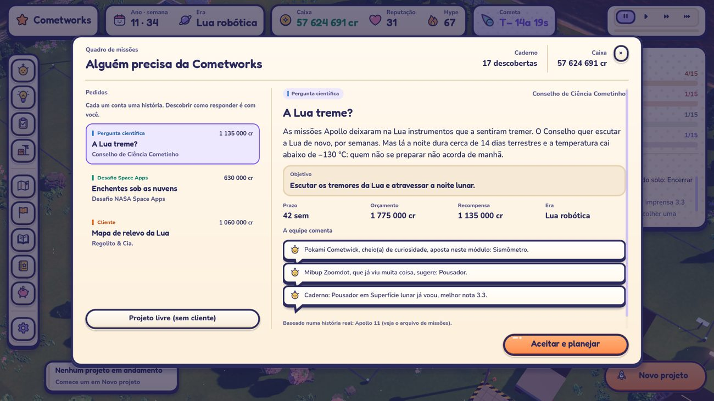

**A equipe comenta.** Cometinhos curiosos ou habilidosos (curiosidade ou habilidade a partir de 60%, ou nível 3) dão palpites no pedido: "*Fulana, cheia de curiosidade, aposta neste módulo: espectrômetro*", "*Fulano avisa: a noite na superfície lunar é bem mais longa do que em órbita*". O caderno também lembra o que já voou ali.

**Pagamento.** Missão cumprida paga tudo; nota 8,5 ou mais rende +25% de bônus. Abaixo de nota 4, a missão fica "pela metade" e paga 50%. Atraso corta o pagamento pela metade, e estourar o orçamento paga 80%.

## Objetivo: para onde e que missão

"O pedido não diz para onde nem como: isso é você quem descobre." Primeiro o destino, depois o tipo de missão. Cada par tipo × destino tem uma compatibilidade: **ótima (×1,15), boa (×1,0), ruim (×0,75) ou impossível**. Observação da Terra em órbita heliossíncrona é ótima; em geoestacionária é ruim.

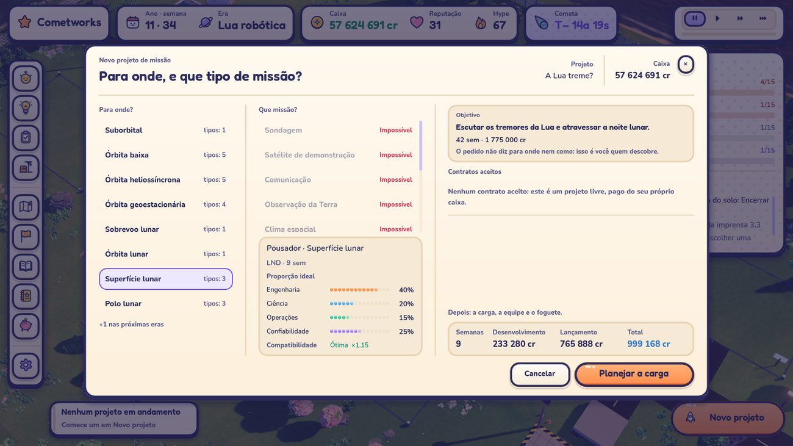

O cliente também tem um **ideal escondido**. Cada pedido lista os destinos e tipos que respondem à pergunta, com pesos: o ideal vale 100%, outros ajudam menos (70%, 60%...) e o resto não responde nada. Isso entra na nota como "objetivo" (veja as fichas do capítulo 5, que entregam a solução).

## A carga e os seis medidores

"O que vai a bordo?" O planejador de carga é onde o jogo ensina a parte mais física do enunciado. Escolhem-se os módulos (instrumentos, energia, antena, aquecimento, gravador), e seis medidores reagem na hora:

| Medidor | O que mede | No vermelho |
| --- | --- | --- |
| **Massa** | quilos de módulos contra o que a nave aguenta (70 kg por tamanho de missão, no mínimo 30) | trava o plano |
| **Energia** | painéis e baterias contra o consumo de dia, a noite e o frio | de dia, trava; noite curta ou frio só avisam |
| **Dados** | o que os instrumentos produzem contra o gravador e o que desce | avisa (dados se perdem) |
| **Comunicação** | a antena da nave × a rede de antenas × a distância | avisa |
| **Orçamento** | o custo contra o caixa e o orçamento do cliente | trava o plano |
| **Tempo** | as semanas contra o prazo | avisa |

Verde é margem de 20% ou mais, amarelo de 5% a 20%, vermelho abaixo disso. A regra mais importante do jogo inteiro está aqui: **ciência só conta quando o dado chega ao solo.** Uma câmera boa com uma antena fraca enche o gravador e perde o resto.

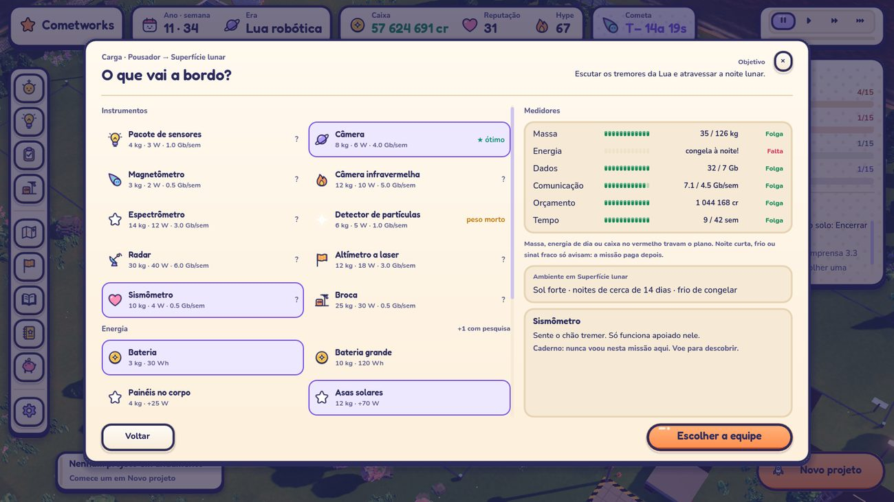 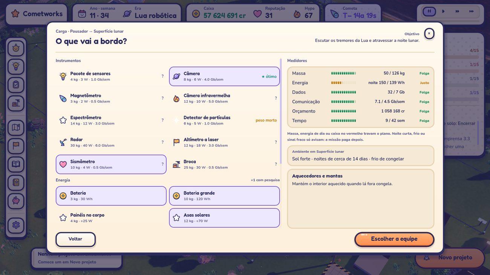

**Ambientes escondidos.** Cada destino tem Sol, noite e frio. Até a agência voar lá (ou pesquisar a tecnologia certa, ou ler uma história que conta), o planejador supõe uma órbita comum. A superfície lunar esconde uma noite de duas semanas e um frio de congelar instrumentos; o polo esconde Sol fraco e baixo; o cometa, tudo isso junto. É por isso que a primeira sonda lunar costuma voltar com a avaliação "A bateria não aguentou a noite lunar".

## A equipe da missão

"Quem vai construir?" A tela mostra no que a missão se apoia (a proporção das barras, quando já descoberta) e quem está livre. Cada Cometinho rende mais na barra da sua profissão. Um projeto de tamanho *s* tem uma equipe ideal de *s × 4* Cometinhos (arredondado para cima); cada um além disso rende só 40%.

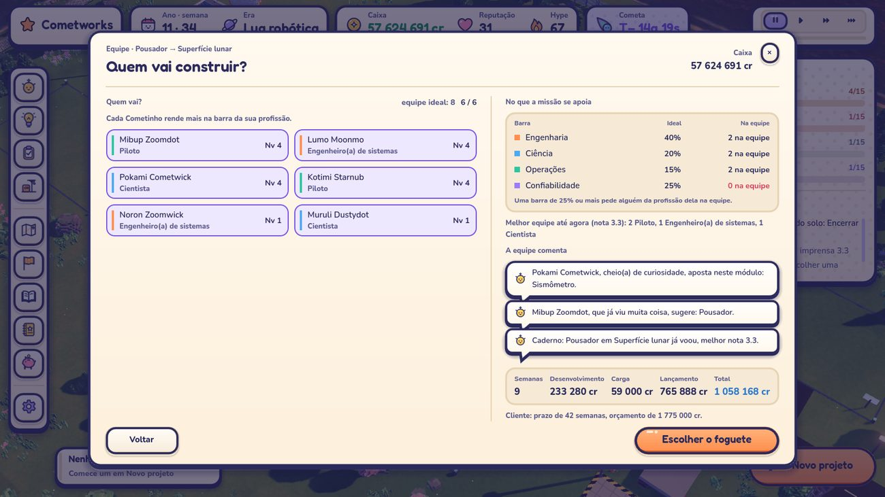

## O projetista de foguetes

Depois da carga vem o foguete. O projetista tem **sete encaixes**: estágio principal, estágio superior, tanques, propulsores laterais, coifa, aviônica e recuperação. Cada escolha muda o Δv, a força para levantar a carga, o tamanho que cabe na coifa, o custo por unidade, as semanas de montagem e a confiabilidade.

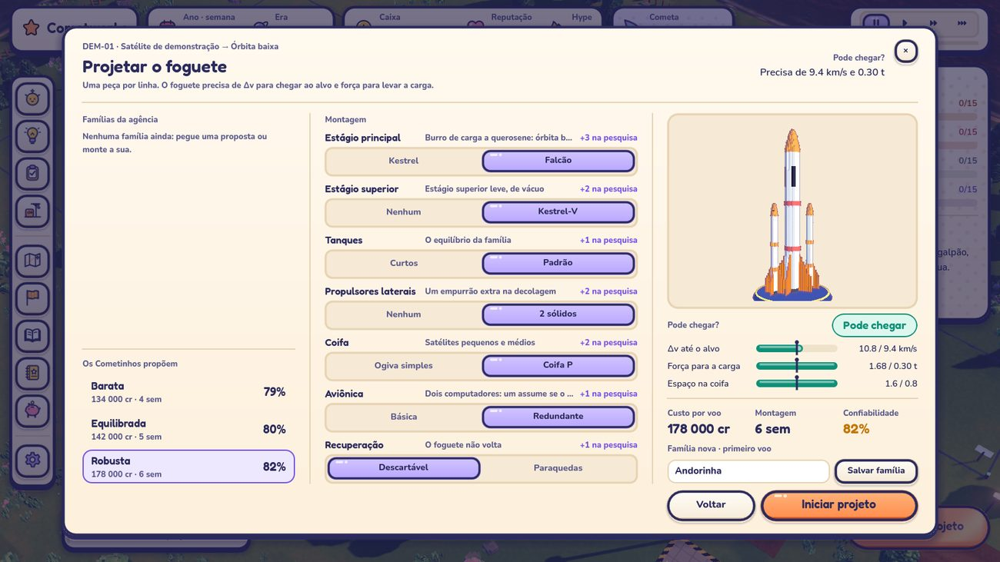

O foguete precisa de **Δv para chegar ao destino** (2 km/s para um salto suborbital, 9,4 km/s para a órbita baixa, 15,3 km/s para o polo lunar, 16,5 km/s para o cometa) e de **força para levantar a carga** (de 50 kg numa sondagem a 25 t num módulo de base). Abaixo do necessário, ele não chega; com margem fina, chega com risco. Cada desenho salvo vira uma **família**, batizada com nome de passarinho brasileiro: Andorinha, Bem-te-vi, Sabiá, Colibri, Tucano, Uirapuru, Carcará...

## Desenvolvimento: três fases, nove alavancas

O coração herdado do Game Dev Tycoon. O projeto passa por três fases; em cada uma, o tempo da equipe é dividido entre três alavancas (o total é sempre 100%). Cada alavanca alimenta barras com pesos fixos:

| Fase | Alavanca | Alimenta |
| --- | --- | --- |
| 1 · Concepção | Arquitetura da missão | Engenharia 80% · Confiabilidade 20% |
|  | Carga científica | Ciência 100% |
|  | Conceito de operações | Operações 80% · Engenharia 20% |
| 2 · Construção e integração | Estrutura e propulsão | Engenharia 100% |
|  | Instrumentos | Ciência 80% · Engenharia 20% |
|  | Testes ambientais | Confiabilidade 100% · **remove defeitos** |
| 3 · Preparação do voo | Software e autonomia | Operações 60% · Engenharia 40% |
|  | Treino da equipe de solo | Operações 100% · **XP extra** |
|  | Revisão de prontidão | Confiabilidade 70% · Ciência 30% · **remove defeitos** |

Toda semana, cada Cometinho põe pontos nas barras: uma base de 10, multiplicada pela habilidade, pela moral, pelo nível (+8% por nível) e pela afinidade da profissão. Trabalho também cria **defeitos** (os "bugs" do Game Dev Tycoon); as alavancas de teste os removem, e técnicos de testes removem o dobro.

**A nota (0 a 10)** sai de duas coisas: o volume de pontos contra o que a imprensa espera na era (55%) e o acerto da proporção das barras (45%), vezes a compatibilidade, menos os defeitos que sobraram. A expectativa sobe a cada era, e repetir o mesmo tipo de missão em pouco tempo rende cada vez menos.

Depois disso, a nota é ajustada pelo **encaixe** com o pedido: instrumentos (35%), energia (20%), dados (15%), equipe (15%) e objetivo (15%). No começo o encaixe pesa pouco (20% na era 1) e no fim pesa muito (65% na era 5): o jogo perdoa o aprendiz e cobra a veterana. Uma **combinação perfeita** (tudo alto ao mesmo tempo) multiplica a nota por 1,15 e dá +6 de hype.

## Revisão de projeto

O antigo *Design Review*, que no jogo se chama **Revisão de projeto**: "Os Cometinhos listaram o que pode dar errado. Corrija o que valer a pena, aceite o resto ou cancele o lançamento."

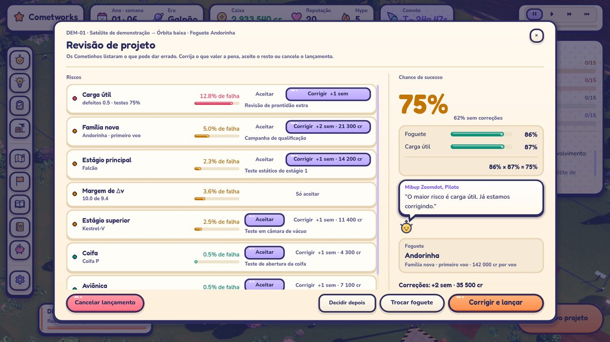

Cada linha é um modo de falha com uma chance: estágio principal, estágio superior, propulsores laterais, coifa, aviônica, família nova, margem de Δv, margem de carga, coifa pequena, carga útil e, nas tripuladas, nervos da tripulação. **Corrigir** corta o risco pela metade em troca de semanas e dinheiro (as correções correm em paralelo). Riscos abaixo de 2% ficam verdes; de 5% para cima, vermelhos. **Cancelar** custa 1 ponto de reputação.

A chance de sucesso é o produto de tudo: a confiabilidade da carga (que vem da barra de Confiabilidade e dos defeitos), a do foguete (que vem das peças e da **confiança da família**: estreia em 90%, sobe 2 pontos por voo bem-sucedido, cai 6 numa falha) e, nas tripuladas, a coragem da tripulação.

## Lançamento e operação

O lançamento acontece no campus, com cinemática: contagem regressiva, ignição, a torre ficando para trás e os Cometinhos olhando da grama. O resultado pode ser **Falha, Sucesso parcial, Sucesso pleno (nota 5,5 ou mais) ou Excepcional (8,5 ou mais)**. Na falha, "o motor tossiu e desistiu. A equipe está triste, mas toda falha ensina algo."

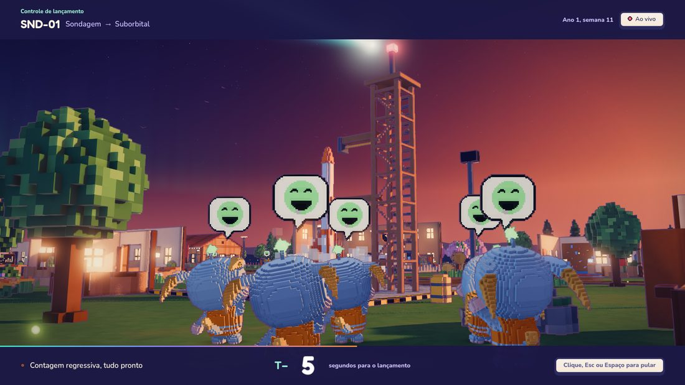 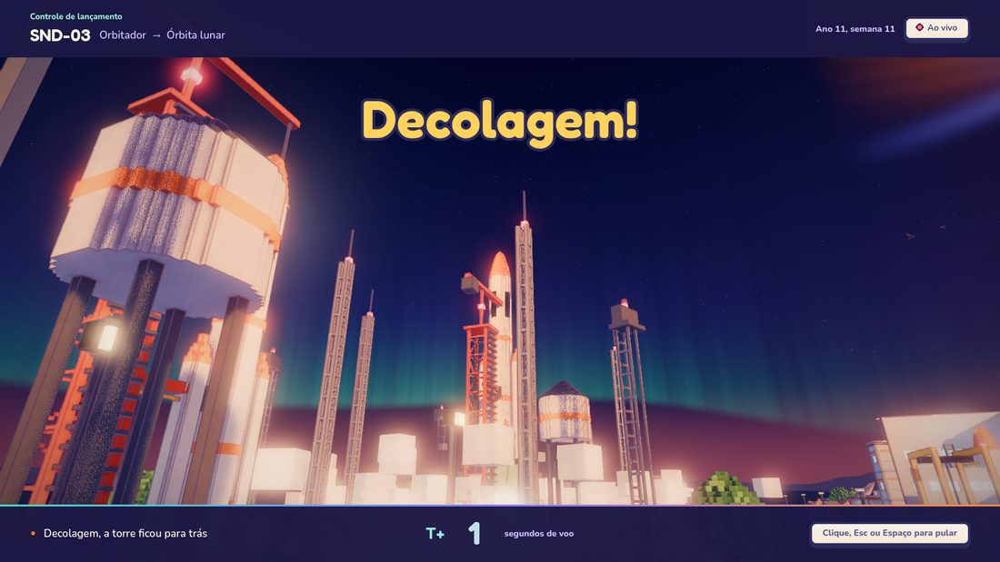 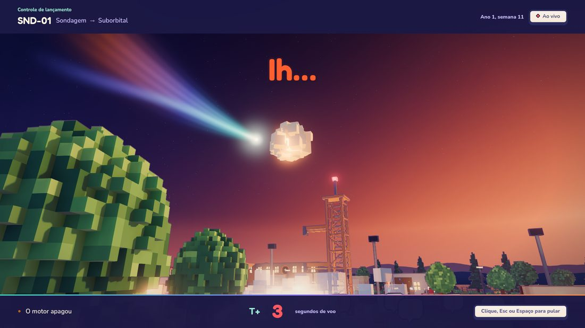

Depois do lançamento, a missão entra em **operação** no mapa: um satélite de comunicação opera 26 semanas, um telescópio 52, um rover 16, a missão ao cometa 30. Toda semana os instrumentos produzem dados, o gravador guarda, a antena baixa o que der e a ciência entra. A **rede de antenas** do campus multiplica tudo: antena pequena do campus, estação terrestre, anel de três estações e, no nível máximo, antenas de espaço profundo.

De vez em quando aparece uma **decisão de operação**: gravador quase cheio, falha numa roda de reação, tempestade solar, alerta de detrito, noite lunar chegando, poeira nos painéis, jatos do cometa, carga útil no oceano ou uma nave saudável além da vida útil. Cada uma tem duas ou três escolhas com efeito claro ("sem dados por 2 semanas, sem risco").

## A avaliação e os jornais

Quando o desenvolvimento termina e o foguete voa, vem a **Avaliação da missão**: a nota do projeto, as barras, os resultados (dinheiro, reputação, hype, pontos de pesquisa, XP) e o que dizem os jornais. São quatro, cada um com seu viés:

| Jornal | Tipo | Gosta de | Exemplo de manchete boa |
| --- | --- | --- | --- |
| **O Eco da Cauda** | popular | novidade, "primeiros", tripuladas, hype | "Tocas inteiras ficaram acordadas para ver." |
| **Revista Órbita** | técnica | engenharia, margens, poucos defeitos | "Margens limpas, integração caprichada. Trabalho de manual." |
| **Boletim da Coma** | científico | ciência que chegou ao solo | "Os instrumentos valeram cada grama que pesaram." |
| **Folha do Contribuinte** | dinheiro público | custo por resultado, contratos | "Um caso raro de dinheiro público bem gasto." |

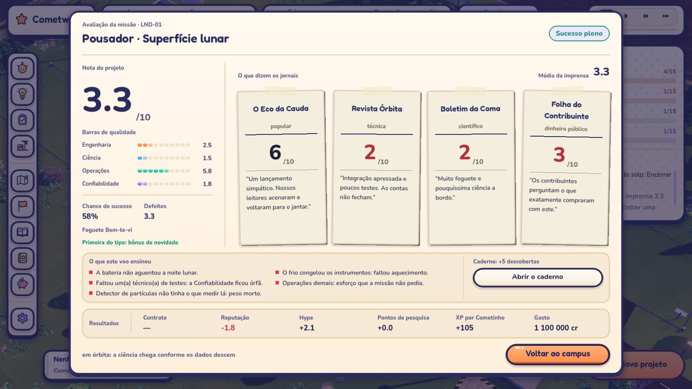

O bloco **O que este voo ensinou** lista até cinco lições, sempre concretas: "O frio congelou os instrumentos: faltou aquecimento", "Detector de partículas foi a estrela da missão", "Faltou controle de voo na equipe: as Operações ficaram órfãs", "Lugar certo, missão certa: o cliente aprovou."

## O Caderno de descobertas

"O que a agência já aprendeu." O caderno guarda, por tipo de missão: a **proporção ideal** das barras (revelada depois de 2 voos daquele tipo, ou por uma pesquisa de laboratório), as **faixas de alavanca** que acertam, os **destinos** com a compatibilidade descoberta, a nota de cada **instrumento** em cada lugar ([[star]] ótimo, bom, peso morto, não serve) e o **ambiente** de cada destino.

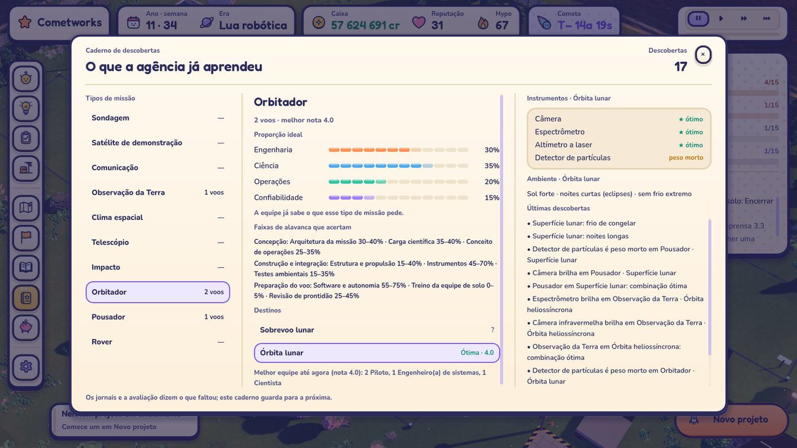

É o substituto do tutorial: "Os jornais e a avaliação dizem o que faltou; este caderno guarda para a próxima."

## A tripulação no dia a dia

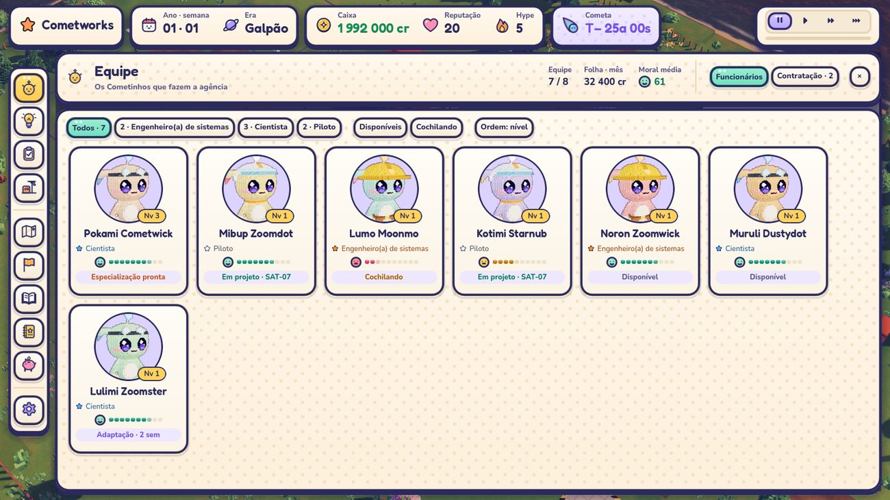 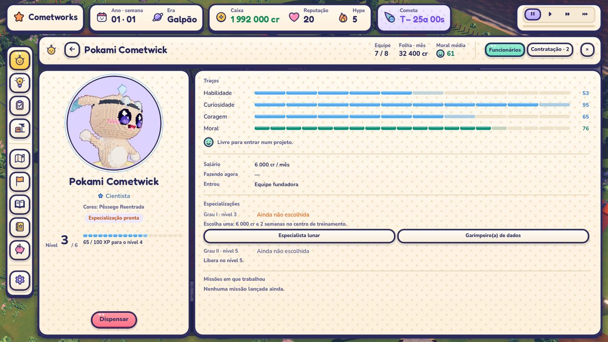

- **Contratação.** Todo mês chegam 3 candidatos, com dois traços escondidos até a contratação. Contratar custa dois salários e o Cometinho leva 2 semanas para se adaptar. A sede limita o tamanho da equipe (8, 12 e 16 nos níveis 1 a 3).
- **Traços.** Habilidade (multiplica os pontos), curiosidade (descobertas e palpites) e coragem (risco nas tripuladas e moral depois de falhas).
- **Níveis.** De 1 a 6, com 100 de XP por nível; cada nível dá +8% de pontos. Especializações nos níveis 3 e 5 (capítulo 3).
- **Moral (0 a 100).** Começa em 75. Sobe com sucesso (+8), resultado excepcional (+12) e subida de nível (+6); cai com falha (−12), salário atrasado (−10) e mais de 8 semanas seguidas de trabalho.
- **Cochilos.** Abaixo de 30 de moral, o Cometinho tira um cochilo no campus e não produz naquela semana. Dá para ver: ele senta no chão e dorme.
- **Salário.** 4 000 cr por mês na base, +25% por nível, vezes o multiplicador da profissão (piloto ganha 1,3×).

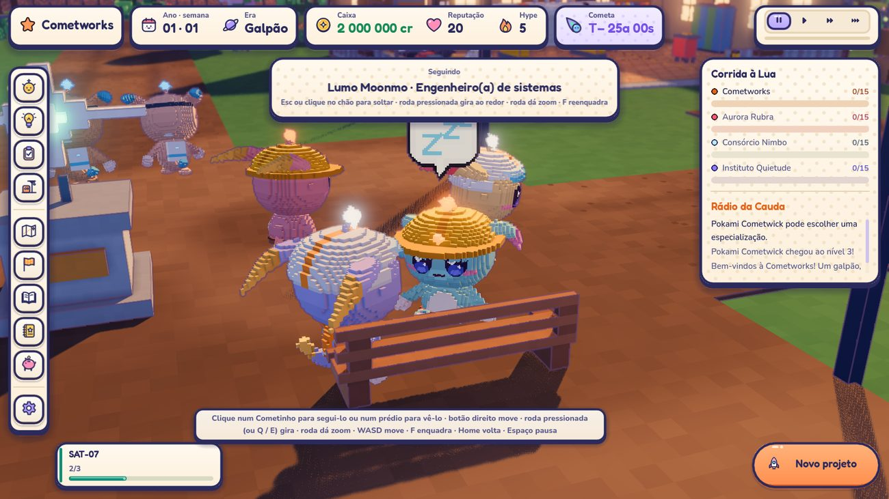

## Pesquisa, contratos e dinheiro

**Pesquisa.** Pesquisadores no laboratório produzem pontos de pesquisa (PP) toda semana, e metade da ciência que as missões baixam também vira PP. São 30 tecnologias, 6 por era, em nove ramos (capítulo 6). Uma tecnologia pronta pode ser **licenciada** a uma rival por dinheiro na hora; a rival ganha a tecnologia e corre um pouco mais rápido.

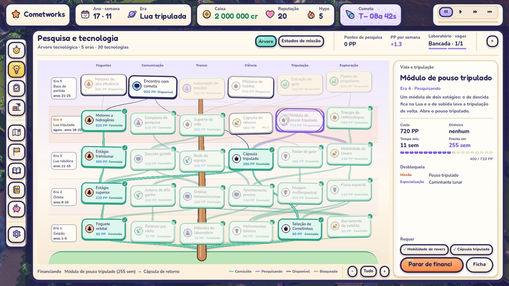

**Contratos.** Além do quadro de missões, existe o quadro de contratos clássico: de 3 a 6 ofertas por mês, de sete clientes (três do governo, quatro comerciais) e desafios Space Apps. Cada contrato pede notas mínimas em certas barras. Nota 8 ou mais rende +25% de bônus; falha ou atraso custam 30% de multa e reputação. As rivais podem assinar ofertas comerciais antes de você.

**Dinheiro.** A agência começa com **300 mil cr**, reputação 20 e hype 5.

| Entra | Como |
| --- | --- |
| Orçamento do governo | todo começo de ano, a partir do ano 2: base da era (400 mil, 900 mil, 1,6 mi, 2,4 mi, 3,2 mi; × a receita da dificuldade) × (0,5 + reputação/100) × (1 + 5% por marco conquistado) |
| Contratos e pedidos | pagamento na entrega, bônus por nota |
| Doações do público | todo mês, hype × 400 cr (o hype cai 3% ao mês) |
| Licenças de tecnologia | venda de tecnologia às rivais |
| Prêmios de marco | o primeiro leva o prêmio inteiro; os seguintes, 30% |
| Empréstimo | depois de três fins de mês no vermelho, o governo oferece: 200 mil × fator da era, em 24 parcelas a 1% ao mês |

Sai: salários, manutenção dos prédios (2% do custo por mês), projetos (6 000 cr por semana de desenvolvimento, vezes o fator da era), lançamentos (o preço da unidade do foguete) e multas.

**Falência.** Existe uma linha abaixo de zero: −600 mil cr no Normal (−900 mil no Fácil, −400 mil no Difícil), vezes um fator da era (1; 2,2; 3; 4,5; 6,5), porque os orçamentos crescem. Na metade do caminho até ela o HUD avisa ("Caixa · falência perto", em vermelho, com a moeda pulsando), a Rádio da Cauda dá a notícia e o Vovô Halleyzinho aparece com uma lição. O primeiro mês que fecha além da linha traz um **empréstimo de emergência**, uma vez só: cobre a dívida e deixa um colchão de 40% da linha, em 24 parcelas a 1,5% ao mês, com uma tela que explica os termos e o prazo. Se outro mês fechar além da linha, ou se a agência fechar 6 meses seguidos além da metade da linha antes de quitar (calote), é falência: o jogo termina com a pontuação, o que aconteceu, uma palavra do Vovô, "Tentar de novo" e "Menu principal", e a carreira fica guardada nos recordes. Salvamentos antigos começam com o empréstimo de emergência sem usar.

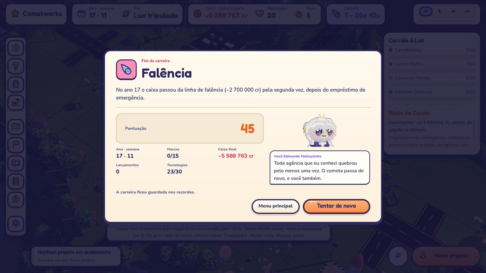

## O campus e as cinco eras

O campus é a tela principal: uma ilha voxel com o mar em volta, Cometinhos andando pelas ruas entre os prédios e um ciclo de dia e noite. Ele começa com **sede, galpão de montagem e plataforma de lançamento**. Os outros lotes são comprados e construídos, e cada prédio tem três níveis.

| Prédio | Para que serve |
| --- | --- |
| Sede | limite de funcionários, contratos simultâneos e contratação |
| Galpão de montagem | altura e massa máximas dos foguetes; projetos em paralelo |
| Plataforma de lançamento | lançamentos por mês e a maior família de foguete (há lote para uma segunda) |
| Laboratório de P&D | vagas de pesquisadores e pontos de pesquisa por semana |
| Centro de controle | missões ativas ao mesmo tempo; decisões melhores em voo |
| Rede de antenas | multiplica o downlink de todas as missões |
| Centro de treinamento | especializações, XP mais rápido e treino de pilotos |
| Fábrica | produção em série: unidades repetidas mais baratas e rápidas |

As eras andam com o calendário, uma a cada cinco anos, e o campus muda de cara junto: ruas de terra viram asfalto, a grama fica mais aparada, cercas de madeira dão lugar a grades e postes de luz, e os prédios trocam de visual.

| Era | Anos | Nome | Foco |
| --- | --- | --- | --- |
| 1 | 1 a 5 | Galpão | aprender a lançar: sondagem e o primeiro satélite |
| 2 | 6 a 10 | Órbita | serviços em órbita, telescópio, o primeiro Cometinho no espaço |
| 3 | 11 a 15 | Lua robótica | chegar à Lua sem tripulação; achar o gelo |
| 4 | 16 a 20 | Lua tripulada | levar Cometinhos à Lua e trazer amostras |
| 5 | 21 a 25 | Base de partida | base, propelente lunar e a missão ao cometa |

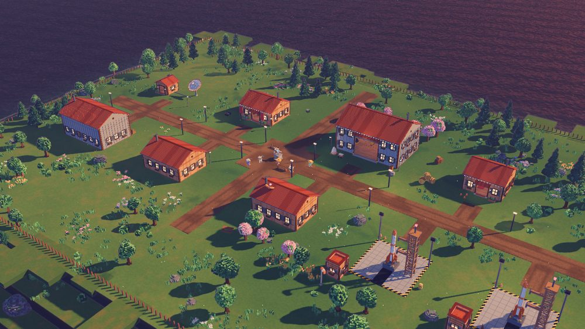 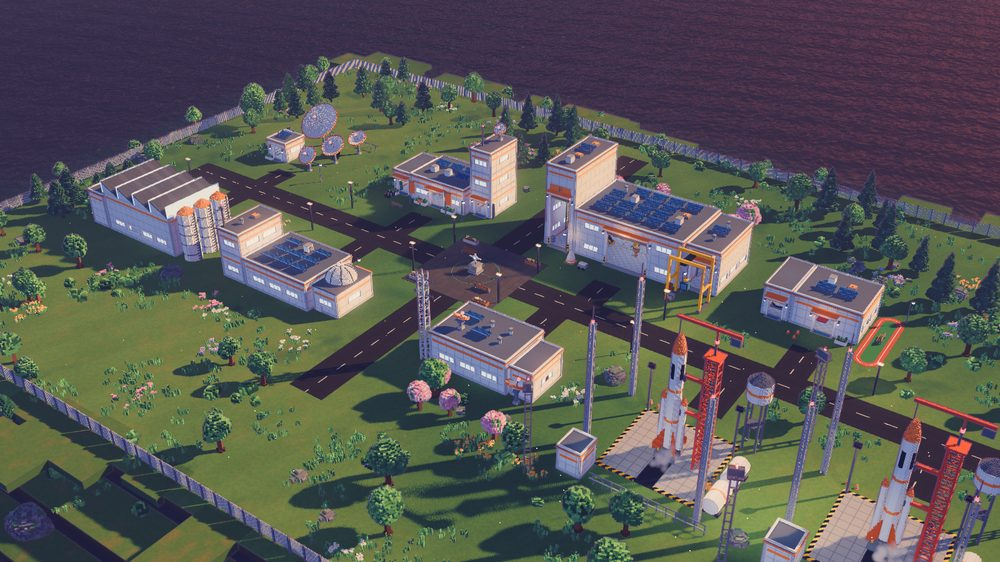 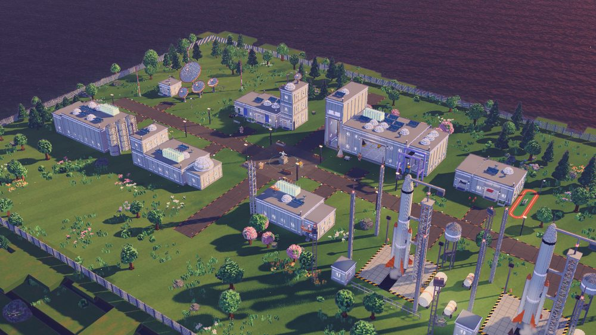

## O Eco da Cauda

"Os boatos mais confiáveis da cauda desde o ano 1." Preço: um cristal de gelo. Previsão do tempo: gelado, com chance de lançamentos.

O jornal abre na tela quando alguém conquista um marco (ou tropeça tentando). A capa traz a manchete, uma linha fina, uma frase da direção ("Fizemos com um galpão e muito café."), uma caixinha **Ciência de verdade** com o fato real do marco e o placar da corrida. Quando quem conquista é uma rival, a provocação dela vai junto.

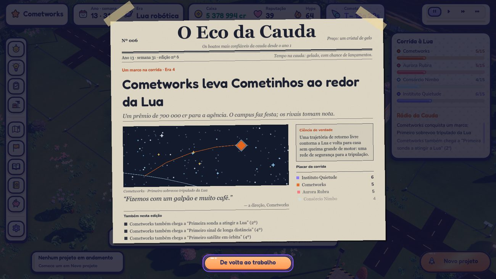 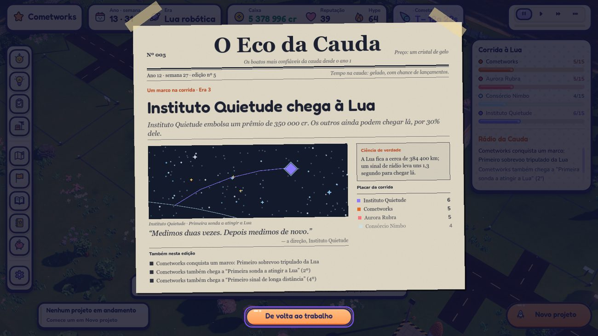

::: chapter
numero: 5
titulo: As missões
cor: rosa
imagem: img/cap5_lancamento.jpg
icone: rocket
---
São 27 pedidos, do primeiro salto suborbital ao toque na Mãe-Gelo. Cada um conta uma história real e esconde uma solução.

As caixas lilás entregam o jogo. Elas existem para a equipe testar, balancear e apresentar. Não mostre para quem vai jogar!
:::

## Como ler as fichas

Cada ficha tem o **tipo** (o chip colorido), a **era** em que o pedido começa a aparecer, um gancho de uma linha, **o pedido** como o jogo escreve, a **recompensa** e **a ciência por trás**, com a fonte que a gente conferiu. Embaixo, a caixa lilás **Como resolver**:

- **Destino** e **tipo de missão**: o ideal do cliente (100%) e o que também ajuda, com o peso entre parênteses. O que não aparece não responde à pergunta.
- **Precisa levar**: os módulos sem os quais o serviço não sai.
- **Proporção do cliente**: quando o cliente tem prioridades próprias, diferentes das do tipo de missão (ENG, CIÊ, OPE e CONF).
- **Cuidado**: a pegadinha do destino ou do pedido.

A recompensa listada é a da era do pedido. Ela é recalculada pela era em que o pedido aparece no quadro, então um pedido antigo que só surge mais tarde paga mais.

## Era 1 · Galpão

::: mission
titulo: Tocar a borda do céu
tipo: sonho
era: 1
gancho: O primeiro sonho da equipe: subir até onde o azul vira preto e voltar contando.
pedido: Subir, sentir como é o ar no caminho e trazer os números de volta.
recompensa: cerca de 50 mil cr · +1 de reputação · 15 PP · +3 de hype · prazo de 16 semanas
ciencia: Foguetes de sondagem nunca entram em órbita: sobem, passam de 5 a 20 minutos no espaço e caem de volta. A NASA ainda usa esse tipo de voo para estudar a alta atmosfera, porque é barato e rápido.
fonte: Ficha "Foguetes de sondagem da NASA" · nasa.gov/soundingrockets/overview
destino: Suborbital (ideal)
missao: Sondagem (ideal)
leva: Pacote de sensores
cuidado: A sondagem vive de bateria: um pacote de sensores e uma bateria pequena bastam. Esta é a missão-tutorial da campanha.
:::

::: mission
titulo: Uma foto da curvatura
tipo: contrato
era: 1
gancho: Uma emissora quer mostrar a Terra vista lá de cima no jornal da noite.
pedido: Imagens nítidas da Terra vista do espaço para o jornal da noite.
recompensa: cerca de 75 mil cr · +1 de reputação · 10 PP · +4 de hype · prazo de 20 semanas · cliente Eco da Cauda Mídia
ciencia: Em 1946, uma câmera presa a um foguete fotografou a Terra de mais de 100 km de altura, uma das primeiras fotos do planeta visto do espaço. Para isso não precisa de órbita: só de alguns minutos lá no alto e de algo que volte inteiro.
fonte: História do pedido; voo suborbital na ficha "Foguetes de sondagem da NASA"
destino: Suborbital (ideal)
missao: Sondagem (ideal)
leva: Câmera
cuidado: A câmera produz muitos dados; numa sondagem curta, um gravador ajuda a não perder nada.
:::

::: mission
titulo: A dança da aurora
tipo: ciencia
era: 1
gancho: Atravessar uma aurora por dentro e entender por que o céu dança.
pedido: Atravessar uma aurora e voltar com a medida que explica a dança.
recompensa: cerca de 65 mil cr · +1,5 de reputação · 30 PP · prazo de 20 semanas
ciencia: As auroras acendem o céu quando partículas vindas do Sol chacoalham o campo magnético da Terra. A NASA lança foguetes de sondagem do Alasca direto para dentro delas, para medir em poucos minutos como o campo se torce.
fonte: Ficha "Foguetes de sondagem da NASA" · nasa.gov/soundingrockets/overview
destino: Suborbital (ideal)
missao: Sondagem (ideal)
leva: Magnetômetro (pesquisa Instrumentos básicos)
cuidado: A câmera até ajuda lá em cima, mas sem magnetômetro o pedido não sai. "Como o campo se torce" é a pista.
:::

::: mission
titulo: Um bipe em órbita
tipo: corrida
era: 1
gancho: O primeiro satélite Cometinho: não importa o que ele faz, importa que funcione.
pedido: Pôr em órbita um satélite que todo mundo possa ouvir.
recompensa: cerca de 135 mil cr · +2 de reputação · 15 PP · +6 de hype · prazo de 30 semanas · vale o marco "Primeiro satélite em órbita"
ciencia: Em 4 de outubro de 1957, a União Soviética lançou o Sputnik, o primeiro satélite artificial: uns 83 kg, uma volta na Terra a cada 90 minutos e só um "bip-bip" no rádio, que o mundo inteiro parou para ouvir.
fonte: Ficha "Sputnik 1" · nasa.gov/history/65-years-ago-sputnik-ushers-in-the-space-age
destino: Órbita baixa (ideal), Órbita heliossíncrona (70%)
missao: Satélite de demonstração (ideal)
leva: nada obrigatório; um rádio-farol resolve
proporcao: ENG 35 · CIÊ 5 · OPE 25 · CONF 35
cuidado: Ninguém liga para ciência aqui. Instrumento demais é peso e custo à toa; capriche em Engenharia e Confiabilidade.
:::

::: mission
titulo: Retrato da Terra
tipo: contrato
era: 1
gancho: Uma empresa de mapas quer fotos de cima toda semana para atualizar estradas e rios.
pedido: Fotografar a Terra de órbita, com frequência.
recompensa: cerca de 150 mil cr · +1 de reputação · 10 PP · +2 de hype · prazo de 30 semanas · cliente Mapa Vivo Imagens
ciencia: O Landsat 1, lançado em 23 de julho de 1972 com o nome ERTS-1, foi a primeira missão de satélite dedicada a monitorar as superfícies terrestres. Desde então, a série Landsat mostra como a Terra muda vista do alto.
fonte: Ficha "Landsat 1" · science.nasa.gov/mission/landsat-1
destino: Órbita baixa (ideal), Órbita heliossíncrona (ideal)
missao: Satélite de demonstração (ideal) ou Observação da Terra (ideal)
leva: Câmera
cuidado: "Ela paga por imagens, não por bipes." Na era 1, a órbita baixa é o caminho; a heliossíncrona chega com a pesquisa da era 2.
:::

## Era 2 · Órbita

::: mission
titulo: O cinturão invisível
tipo: ciencia
era: 2
gancho: Medir os cinturões de radiação que cercam a Terra, como o primeiro satélite americano fez.
pedido: Medir a radiação que cerca a Terra.
recompensa: cerca de 240 mil cr · +2 de reputação · 50 PP · +2 de hype · prazo de 32 semanas
ciencia: O Explorer 1, primeiro satélite dos EUA, subiu em 31 de janeiro de 1958 com um detector de raios cósmicos. Os dados levaram James Van Allen a descobrir cinturões de radiação em volta da Terra, presos pelo campo magnético.
fonte: Ficha "Explorer 1" · jpl.nasa.gov/missions/explorer-1
destino: Órbita baixa (ideal), Órbita geoestacionária (70%)
missao: Satélite de demonstração (ideal) ou Clima espacial (ideal)
leva: Detector de partículas (pesquisa Física espacial)
cuidado: "Câmeras não enxergam o que procuramos." Numa missão de clima espacial, a câmera é peso morto.
:::

::: mission
titulo: Vigia de queimadas
tipo: spaceapps
era: 2
gancho: Achar o fogo quando ele ainda é pequeno, mesmo debaixo da fumaça.
pedido: Achar focos de calor todos os dias, no mesmo horário.
recompensa: cerca de 380 mil cr · +2 de reputação · 40 PP · +3 de hype · prazo de 34 semanas
ciencia: Queimadas crescem em horas. Um satélite em órbita heliossíncrona passa sobre o mesmo lugar sempre na mesma hora local, e uma câmera infravermelha enxerga o calor do fogo ativo mesmo através da fumaça. A NASA publica esses focos de calor todos os dias.
fonte: Dados abertos: NASA FIRMS (focos de fogo ativo)
destino: Órbita heliossíncrona (ideal), Órbita baixa (60%)
missao: Observação da Terra (ideal)
leva: Câmera infravermelha (pesquisa Imagem multiespectral)
cuidado: "Sempre na mesma hora do dia para comparar" aponta para a heliossíncrona, que também tem noites bem curtas: pouca bateria basta.
:::

::: mission
titulo: Ar limpo nas cidades
tipo: spaceapps
era: 2
gancho: O ar das cidades muda de hora em hora. Alguém precisa olhar sem piscar.
pedido: Medir os gases do ar das cidades ao longo do dia.
recompensa: cerca de 380 mil cr · +2 de reputação · 40 PP · +3 de hype · prazo de 34 semanas
ciencia: Gases como o dióxido de nitrogênio absorvem a luz do Sol em cores próprias, uma "impressão digital" que um espectrômetro lê de lá de cima. A missão TEMPO, da NASA, observa a América do Norte de hora em hora a partir de uma órbita geoestacionária.
fonte: Dados abertos: NASA Earthdata (qualidade do ar)
destino: Órbita geoestacionária (ideal), Órbita heliossíncrona (80%), Órbita baixa (70%)
missao: Observação da Terra (ideal)
leva: Espectrômetro (pesquisa Imagem multiespectral)
cuidado: Observação da Terra em geoestacionária tem compatibilidade ruim (×0,75), mas é o que o cliente quer: "de hora em hora, sem tirar os olhos". Um bom dilema para o caderno.
:::

::: mission
titulo: Alerta de tempestade solar
tipo: spaceapps
era: 2
gancho: Um alarme que avisa a Terra minutos antes da tempestade chegar.
pedido: Avisar a Terra antes que a tempestade chegue.
recompensa: cerca de 455 mil cr · +2 de reputação · 50 PP · +3 de hype · prazo de 36 semanas
ciencia: Explosões do Sol podem atrapalhar satélites, rádio e redes elétricas. Naves de alerta sentem o vento solar e o campo magnético que ele carrega antes que cheguem à Terra, e os operadores protegem suas naves a tempo.
fonte: Dados abertos: NOAA Space Weather Prediction Center
destino: Órbita geoestacionária (ideal), Órbita heliossíncrona (60%)
missao: Clima espacial (ideal)
leva: Detector de partículas e Magnetômetro
proporcao: ENG 25 · CIÊ 35 · OPE 15 · CONF 25
cuidado: "Um alarme que falha não serve para nada": a Confiabilidade pesa mais do que num clima espacial comum.
:::

::: mission
titulo: TV para todo mundo
tipo: contrato
era: 2
gancho: Jogo ao vivo no país inteiro, sem ninguém precisar girar a antena de casa.
pedido: Levar o sinal ao país inteiro, o dia todo.
recompensa: cerca de 455 mil cr · +1 de reputação · 10 PP · +2 de hype · prazo de 34 semanas · cliente Cauda Telecom
ciencia: O Syncom 2, lançado em 26 de julho de 1963, foi o primeiro satélite geossíncrono e mostrou que as comunicações por esse tipo de satélite funcionam. Lá em cima, a uns 35 786 km, o satélite dá uma volta por dia e parece parado no céu.
fonte: Ficha "Syncom 2" · nssdc.gsfc.nasa.gov (1963-031A)
destino: Órbita geoestacionária (ideal), Órbita baixa (50%)
missao: Comunicação (ideal)
leva: uma antena média ou o refletor grande (exigência do tipo Comunicação)
proporcao: ENG 25 · CIÊ 5 · OPE 45 · CONF 25
cuidado: "Aqui conta sinal forte e operação sem falhas, não ciência." Equipe com controladores de voo.
:::

::: mission
titulo: Lavouras com sede
tipo: contrato
era: 2
gancho: Descobrir quais plantações sofrem antes que as folhas amarelem.
pedido: Mapear a saúde das plantações no país inteiro.
recompensa: cerca de 380 mil cr · +1,5 de reputação · 25 PP · +1 de hype · prazo de 34 semanas · cliente Serviço de Tempo e Clima
ciencia: Plantas saudáveis refletem muita luz logo além do vermelho, que nossos olhos não veem. Comparando essa luz com a vermelha, dá para saber de longe quais lavouras estão com sede. Os dados do Landsat são usados assim há décadas.
fonte: Ficha "Landsat 1" · science.nasa.gov/mission/landsat-1
destino: Órbita heliossíncrona (ideal), Órbita baixa (70%)
missao: Observação da Terra (ideal)
leva: Câmera infravermelha
cuidado: Câmera comum vê só o verde; o pedido fala de "luz que nossos olhos não veem".
:::

::: mission
titulo: Acima das nuvens
tipo: ciencia
era: 2
gancho: Ver galáxias distantes e descobrir do que as estrelas são feitas.
pedido: Um observatório que enxergue longe e diga do que as estrelas são feitas.
recompensa: cerca de 605 mil cr · +2,5 de reputação · 70 PP · +4 de hype · prazo de 44 semanas
ciencia: Daqui de baixo, o ar tremido borra as estrelas. Desde o lançamento, em 24 de abril de 1990, o Telescópio Espacial Hubble observa acima da atmosfera e mudou nossa compreensão do universo, inclusive separando a luz das galáxias em cores.
fonte: Ficha "Telescópio Espacial Hubble" · science.nasa.gov/mission/hubble
destino: Órbita geoestacionária (ideal), Órbita baixa (90%), Órbita heliossíncrona (90%)
missao: Telescópio (ideal)
leva: Câmera e Espectrômetro
cuidado: "Ver e entender": um instrumento só não basta. Telescópio é a missão mais científica da era (CIÊ 50%).
:::

## Era 3 · Lua robótica

::: mission
titulo: Gelo na sombra eterna
tipo: ciencia
era: 3
gancho: Provar que existe água nas crateras escuras da Lua: o combustível da volta para casa.
pedido: Provar que há água nas crateras escuras da Lua.
recompensa: cerca de 755 mil cr · +3 de reputação · 90 PP · +4 de hype · prazo de 40 semanas
ciencia: Em 9 de outubro de 2009, o estágio Centaur da LCROSS colidiu com a cratera Cabeus, no polo sul lunar, e os instrumentos analisaram a nuvem que subiu. A missão revelou água perto do polo sul da Lua.
fonte: Ficha "LCROSS" · science.nasa.gov/mission/lcross
destino: Polo lunar (ideal), Órbita lunar (70%)
missao: Impacto (ideal), Rover (90%), Pousador (80%), Orbitador (70%)
leva: Espectrômetro
cuidado: O impacto vive de bateria e dura pouco; a pista é a própria LCROSS. Vale o marco "Gelo polar confirmado" com sucesso pleno.
:::

::: mission
titulo: A Lua treme?
tipo: ciencia
era: 3
gancho: Escutar a Lua por semanas, e sobreviver à noite lunar para contar.
pedido: Escutar os tremores da Lua e atravessar a noite lunar.
recompensa: cerca de 1,1 mi cr · +2,5 de reputação · 80 PP · +3 de hype · prazo de 42 semanas
ciencia: As missões Apollo deixaram na Lua instrumentos que a sentiram tremer. Lá, a noite dura cerca de 14 dias terrestres e a temperatura cai abaixo de −130 °C: sem aquecimento e energia guardada, nada acorda de manhã.
fonte: Ficha "Apollo 11" · nasa.gov/mission/apollo-11
destino: Superfície lunar (ideal), Polo lunar (70%)
missao: Pousador (ideal), Rover (60%)
leva: Sismômetro (pesquisa Descida guiada)
cuidado: Este pedido ensina o ambiente da superfície lunar: noite longa e frio. Leve RTG, ou aquecedores e muita bateria.
:::

::: mission
titulo: O lado que ninguém viu
tipo: corrida
era: 3
gancho: Ver com os próprios olhos o lado da Lua que nunca aparece daqui.
pedido: Fotografar o lado oculto da Lua.
recompensa: cerca de 795 mil cr · +2 de reputação · 40 PP · +6 de hype · prazo de 40 semanas
ciencia: A Lua mostra sempre a mesma face porque está em rotação sincronizada. Em 1959, a sonda Luna 3 contornou a Lua e fez as primeiras fotos do lado oculto, que não é escuro: recebe tanta luz do Sol quanto o lado visível.
fonte: História do pedido e fato do marco "Primeira foto do lado oculto"
destino: Órbita lunar (ideal), Sobrevoo lunar (90%)
missao: Orbitador (ideal)
leva: Câmera
cuidado: "De perto e por bastante tempo": órbita, não um sobrevoo rápido. Vale o marco "Primeira foto do lado oculto".
:::

::: mission
titulo: Mapa de relevo da Lua
tipo: contrato
era: 3
gancho: Uma mineradora quer saber a altura de cada morro antes de mandar as máquinas.
pedido: Um mapa 3D da Lua, com fotos e alturas.
recompensa: cerca de 1,05 mi cr · +1,5 de reputação · 50 PP · +2 de hype · prazo de 44 semanas · cliente Regolito & Cia.
ciencia: Lançado em 18 de junho de 2009, o LRO mapeou a superfície da Lua e é a missão em órbita lunar mais duradoura da história. Ele mede o relevo disparando pulsos de laser e cronometrando a volta.
fonte: Ficha "Lunar Reconnaissance Orbiter" · science.nasa.gov/mission/lro
destino: Órbita lunar (ideal)
missao: Orbitador (ideal)
leva: Altímetro a laser e Câmera
cuidado: "Fotos sozinhas enganam: sombras parecem buracos." Só câmera não basta.
:::

::: mission
titulo: Pousar sem quebrar
tipo: corrida
era: 3
gancho: Antes de mandar alguém, descobrir se o chão da Lua aguenta uma nave.
pedido: Pousar com suavidade e mostrar o chão onde pousou.
recompensa: cerca de 1,1 mi cr · +2,5 de reputação · 40 PP · +7 de hype · prazo de 44 semanas
ciencia: A Surveyor 1 pousou na Lua em 2 de junho de 1966, o primeiro pouso suave dos EUA, e transmitiu 11 240 imagens do solo. Sem ar, não há paraquedas: o módulo freia com o motor até o chão.
fonte: Ficha "Surveyor 1" · nssdc.gsfc.nasa.gov (1966-045A)
destino: Superfície lunar (ideal), Polo lunar (60%)
missao: Pousador (ideal)
leva: Câmera
proporcao: ENG 40 · CIÊ 10 · OPE 15 · CONF 35
cuidado: "O Comitê só quer uma coisa: chegar inteiro." Confiabilidade alta. Vale o marco "Primeiro pouso robótico".
:::

::: mission
titulo: Geólogo sobre rodas
tipo: ciencia
era: 3
gancho: Um explorador que ande de rocha em rocha e diga do que cada uma é feita.
pedido: Percorrer a Lua e descobrir do que suas rochas são feitas.
recompensa: cerca de 1,4 mi cr · +2,5 de reputação · 90 PP · +4 de hype · prazo de 48 semanas
ciencia: Em 17 de novembro de 1970, a sonda soviética Luna 17 pousou o Lunokhod 1, o primeiro robô móvel controlado a distância na Lua. Projetado para 90 dias, ele percorreu o Mare Imbrium por 11 meses.
fonte: Ficha "Lunokhod 1" · science.nasa.gov (APOD de 20/04/1997)
destino: Superfície lunar (ideal), Polo lunar (80%)
missao: Rover (ideal), Pousador (60%)
leva: Câmera e Espectrômetro
cuidado: "Do que cada uma é feita, e não só como ela parece": espectrômetro. E a noite lunar continua lá.
:::

::: mission
titulo: Enchentes sob as nuvens
tipo: spaceapps
era: 3
gancho: Ver a água onde as nuvens não deixam ninguém ver.
pedido: Mapear as áreas alagadas mesmo com o céu fechado.
recompensa: cerca de 630 mil cr · +2 de reputação · 45 PP · +3 de hype · prazo de 36 semanas
ciencia: Quando chove forte por dias, as nuvens cobrem justamente as áreas que alagam. Um radar manda o próprio "grito" de ondas de rádio e ouve o eco: enxerga através das nuvens, de dia e de noite.
fonte: Dados abertos: NASA Earthdata (água e umidade do solo)
destino: Órbita heliossíncrona (ideal), Órbita baixa (70%)
missao: Observação da Terra (ideal)
leva: Radar (pesquisa Radar de gelo)
cuidado: O radar gasta 40 W. Painéis no corpo não dão conta: asas solares.
:::

::: mission
titulo: O gelo do mar
tipo: spaceapps
era: 3
gancho: O gelo dos polos está ficando mais fino, e a área dele não conta a história toda.
pedido: Medir a espessura do gelo marinho nos dois polos.
recompensa: cerca de 630 mil cr · +2 de reputação · 45 PP · +3 de hype · prazo de 36 semanas
ciencia: A NASA mede a espessura do gelo marinho disparando pulsos de laser e medindo a altura do gelo acima da água. Só uma órbita que passa sobre os polos cobre a Terra inteira.
fonte: História do pedido (tema recorrente do Space Apps: gelo marinho)
destino: Órbita heliossíncrona (ideal), Órbita baixa (50%)
missao: Observação da Terra (ideal)
leva: Altímetro a laser
cuidado: "Os dois polos" pede órbita polar: a heliossíncrona é quase polar.
:::

## Era 4 · Lua tripulada

::: mission
titulo: Nascer da Terra
tipo: corrida
era: 4
gancho: Cometinhos dando a volta na Lua e trazendo a foto mais bonita de todas.
pedido: Levar uma tripulação ao redor da Lua e trazer a foto.
recompensa: cerca de 1,9 mi cr · +3 de reputação · 40 PP · +9 de hype · prazo de 50 semanas
ciencia: Lançados em 21 de dezembro de 1968, Frank Borman, James Lovell e William Anders, da Apollo 8, foram os primeiros humanos a orbitar a Lua e os primeiros a ver um nascer da Terra. A foto que fizeram virou uma das imagens mais famosas do século.
fonte: Ficha "Apollo 8" · nasa.gov/mission/apollo-8
destino: Sobrevoo lunar (ideal), Órbita lunar (90%)
missao: Voo tripulado (ideal)
leva: Câmera
proporcao: ENG 30 · CIÊ 5 · OPE 25 · CONF 40
cuidado: "Com gente a bordo, nada pode falhar." Piloto obrigatório. Vale o marco "Primeiro sobrevoo tripulado da Lua".
:::

::: mission
titulo: Pedaços da Lua
tipo: ciencia
era: 4
gancho: Ninguém trouxe nada dos polos, onde o gelo pode estar misturado ao solo.
pedido: Trazer para a Terra amostras do subsolo lunar.
recompensa: cerca de 2,3 mi cr · +3 de reputação · 120 PP · +5 de hype · prazo de 52 semanas
ciencia: Entre 1969 e 1972, seis missões Apollo trouxeram 382 kg de material lunar: 2 200 amostras de seis locais, estudadas até hoje. Nenhuma delas veio das regiões polares.
fonte: Ficha "Amostras lunares da Apollo" · curator.jsc.nasa.gov/lunar
destino: Polo lunar (ideal), Superfície lunar (90%)
missao: Retorno de amostra (ideal), Pouso tripulado (80%)
leva: Broca
cuidado: "De debaixo da superfície" é a broca. No polo, o Sol bate fraco nos painéis.
:::

::: mission
titulo: Pegadas na poeira
tipo: corrida
era: 4
gancho: Os primeiros passos Cometinhos na Lua, e um presente científico que fica lá trabalhando.
pedido: Pousar Cometinhos na Lua, deixar um experimento e voltar.
recompensa: cerca de 2,7 mi cr · +4 de reputação · 60 PP · +12 de hype · prazo de 60 semanas
ciencia: A Apollo 11 pousou na Lua em 20 de julho de 1969. Armstrong e Aldrin ficaram 22 horas na superfície, enquanto Michael Collins pilotava o módulo de comando, e deixaram experimentos que continuaram mandando dados depois da partida.
fonte: Ficha "Apollo 11" · nasa.gov/mission/apollo-11
destino: Superfície lunar (ideal), Polo lunar (80%)
missao: Pouso tripulado (ideal)
leva: Sismômetro
proporcao: ENG 30 · CIÊ 10 · OPE 20 · CONF 40
cuidado: "Uma lembrança que fique escutando o chão" é o sismômetro. A tripulação precisa voltar: Confiabilidade lá em cima. Vale o marco "Primeiro pouso tripulado".
:::

::: mission
titulo: Garimpeiro de gelo
tipo: contrato
era: 4
gancho: A mineradora quer saber onde cavar no polo sul, e quanto gelo tem lá embaixo.
pedido: Encontrar gelo sob o solo polar e medir quanto há.
recompensa: cerca de 2,5 mi cr · +1,5 de reputação · 70 PP · +3 de hype · prazo de 52 semanas · cliente Regolito & Cia.
ciencia: Perto do polo sul da Lua, o Sol passa rente ao horizonte e as sombras são longas e geladas. Algumas crateras nunca veem o Sol, e o gelo de água pode ficar guardado nelas por bilhões de anos.
fonte: História do pedido; fato do marco "Gelo polar confirmado"
destino: Polo lunar (ideal)
missao: Rover (ideal), Pousador (70%)
leva: Radar e Broca
cuidado: Este pedido ensina o ambiente do polo: Sol fraco, sombras frias. "Ninguém quer um robô parado esperando a luz": RTG.
:::

## Era 5 · Base de partida

::: mission
titulo: Do gelo ao combustível
tipo: contrato
era: 5
gancho: Uma planta-piloto no polo sul: o primeiro passo do posto de partida para o cometa.
pedido: Extrair gelo lunar e provar que dá para usar.
recompensa: cerca de 3,9 mi cr · +3 de reputação · 80 PP · +5 de hype · prazo de 56 semanas · cliente Programa Espacial Nacional
ciencia: O gelo lunar pode virar água para beber, oxigênio para respirar e propelente de foguete: a eletrólise separa a água em hidrogênio e oxigênio. Com o Artemis, a NASA planeja uma base perto do polo sul lunar para uma presença humana duradoura.
fonte: Ficha "Artemis" · nasa.gov/humans-in-space/artemis
destino: Polo lunar (ideal)
missao: Planta de propelente (ISRU) (ideal)
leva: Broca e Espectrômetro
cuidado: "Tire o gelo do chão e confira o que tirou": broca para tirar, espectrômetro para conferir.
:::

::: mission
titulo: Acampamento base
tipo: corrida
era: 5
gancho: O primeiro módulo de base no polo, e uma base que não fala com casa é uma base perdida.
pedido: Instalar no polo um módulo de base que fale sempre com a Terra.
recompensa: cerca de 4,1 mi cr · +4 de reputação · 60 PP · +10 de hype · prazo de 60 semanas
ciencia: O programa Artemis planeja uma presença duradoura perto do polo sul da Lua. De lá, a Terra fica baixa no horizonte e às vezes some atrás do relevo, então um retransmissor ajuda a manter contato.
fonte: Ficha "Artemis" · nasa.gov/humans-in-space/artemis
destino: Polo lunar (ideal), Superfície lunar (70%)
missao: Módulo de base (ideal)
leva: Retransmissor, além de antena média ou refletor (exigência do tipo)
proporcao: ENG 40 · CIÊ 5 · OPE 20 · CONF 35
cuidado: "O polo quase nunca enxerga a Terra direito" é a pista do retransmissor. Vale o marco "Primeiro módulo de base".
:::

::: mission
titulo: Voltar para casa
tipo: sonho
era: 5
gancho: O sonho de todo Cometinho: tocar a Mãe-Gelo.
pedido: Chegar à Mãe-Gelo, estudá-la e tocar o seu gelo.
recompensa: cerca de 4,1 mi cr · +5 de reputação · 150 PP · +15 de hype · prazo de 70 semanas · e o final do cometa
ciencia: Em 12 de novembro de 2014, o módulo Philae, da missão Rosetta, fez o primeiro pouso suave num cometa, o 67P/Churyumov-Gerasimenko. Caiu na sombra, e a bateria durou cerca de 60 horas.
fonte: Ficha "Rosetta e Philae" · jpl.nasa.gov (pouso do Philae)
destino: Cometa Mãe-Gelo (ideal)
missao: Missão ao cometa (ideal)
leva: Câmera, Espectrômetro e Broca ("ver, entender e tocar")
cuidado: O pedido ensina o ambiente do cometa: Sol fraco, frio e escuro, como o Philae descobriu. Leve RTG ou aquecimento, e o refletor grande: o cometa está a 4,5 milhões de km. Precisa da pesquisa Encontro com cometa, só abre nos dois últimos anos (quando a Mãe-Gelo chega perto) e tem que dar certo antes do fim do ano 25.
:::

### Um pedido novo para discutir

::: mission
titulo: Pálido Ponto Azul (proposta)
tipo: sonho
era: 5
gancho: No caminho para a Mãe-Gelo, virar a câmera para trás e fotografar a casa que a gente está deixando.
pedido: Fotografar a Terra de muito longe, no caminho para o cometa.
recompensa: proposta: pouco dinheiro, +10 de hype e uma carta do Carlito Sagão para cada Cometinho da equipe
ciencia: Em 1990, a Voyager 1 virou a câmera para trás, a pedido de Carl Sagan, e fotografou a Terra a uns 6 bilhões de km: um pontinho azul num raio de sol. A foto virou um lembrete de como o nosso planeta é pequeno e precioso.
fonte: Proposta da equipe; ainda não está em data/tycoon/briefings.json
destino: Cometa Mãe-Gelo (ideal)
missao: Missão ao cometa (ideal)
leva: Câmera
cuidado: Proposta de mecânica: o pedido aparece junto com "Voltar para casa" e pode ser cumprido pela mesma missão, se ela levar câmera e o refletor grande. Narrado pelo Carlito Sagão.
:::

::: chapter
numero: 6
titulo: Pesquisa, foguetes e instrumentos
cor: manteiga
imagem: img/cap6_plataformas.jpg
icone: research
---
A caixa de ferramentas da agência: as 30 tecnologias, os destinos com o Δv de cada um, os 16 tipos de missão, as peças do foguete e os 22 módulos de carga.

É o capítulo para consultar com o jogo aberto do lado.
:::

## A árvore de pesquisa

Seis tecnologias por era, em nove ramos. Dá para pesquisar uma era à frente da atual, desde que os pré-requisitos estejam prontos. Custos em pontos de pesquisa (PP) e semanas.

Na tela, a árvore cresce de baixo para cima: a era 1 nas raízes, cada era uma faixa acima da outra, e da esquerda para a direita os galhos (Foguetes, Comunicação, o Tronco com as tecnologias de laboratório, Ciência, Tripulação, Exploração). Cada pré-requisito é um galho do cartão de baixo até o de cima. As posições saem dos pré-requisitos (`tree` em `data/tycoon/research.json`; uma tecnologia pode fixar a sua com `tree_pos`), então tecnologia nova entra sozinha. Galhos prontos ficam verdes e crescem quando a pesquisa termina, o galho da pesquisa em andamento corre com seiva colorida, as disponíveis pulsam, a que está sendo pesquisada tem um anel de progresso e faíscas, e as eras fora de alcance ficam na névoa. Passar o mouse acende o caminho de pré-requisitos; clicar mostra a ficha ao lado (custo, tempo, previsão, o que abre, o que pede) com Financiar / Pôr na fila; roda do mouse aproxima e arrastar move.

| Era | Tecnologia | Ramo | Custo | O que abre |
| --- | --- | --- | --- | --- |
| 1 | Foguete orbital | Propulsão | 90 PP · 4 sem | órbita baixa; estágio Falcão, superior Kestrel-V, 2 sólidos, Coifa P |
| 1 | Barramento de satélite | Estruturas | 80 PP · 4 sem | Satélite de demonstração; bateria grande |
| 1 | Rastreio por rádio | Comunicação | 70 PP · 4 sem | antena omni; downlink +10% |
| 1 | Instrumentos básicos | Instrumentos | 80 PP · 4 sem | magnetômetro |
| 1 | Seleção de Cometinhos | Tripulação | 90 PP · 5 sem | especialização Piloto de testes |
| 1 | Métodos de laboratório | Operações | 70 PP · 4 sem | pesquisa +10%; revela a proporção da Sondagem |
| 2 | Estágio superior religável | Propulsão | 220 PP · 6 sem | órbita geoestacionária; Harpia, Falcão-V, tanques alongados, 4 sólidos, Coifa M |
| 2 | Órbitas heliossíncronas | Aviônica | 180 PP · 6 sem | órbita heliossíncrona (e o ambiente dela); aviônica autônoma; asas solares |
| 2 | Antena de alto ganho | Comunicação | 200 PP · 6 sem | Comunicação; antena média |
| 2 | Imagem multiespectral | Instrumentos | 200 PP · 6 sem | Observação da Terra; câmera infravermelha; espectrômetro |
| 2 | Física espacial | Instrumentos | 190 PP · 6 sem | Clima espacial; detector de partículas |
| 2 | Apontamento preciso | Aviônica | 240 PP · 7 sem | Telescópio; asas solares |
| 3 | Estágio translunar | Propulsão | 400 PP · 8 sem | sobrevoo e órbita lunar; Orbitador; Metano-R, 2 laterais líquidos, Coifa G |
| 3 | Descida guiada | Aviônica | 420 PP · 8 sem | superfície lunar; Impacto e Pousador; pouso propulsivo; sismômetro, broca, aquecedores |
| 3 | Rede de espaço profundo | Comunicação | 360 PP · 8 sem | refletor grande, retransmissor; Mestre de antenas; downlink +25% |
| 3 | Radar de gelo | Instrumentos | 380 PP · 8 sem | polo lunar (e o ambiente dele); radar; altímetro a laser |
| 3 | Mobilidade de rovers | Estruturas | 440 PP · 9 sem | Rover; Especialista lunar |
| 3 | Cápsula tripulada | Tripulação | 380 PP · 8 sem | Voo tripulado (órbita baixa; para ir além, Suporte de vida) |
| 4 | Motores a hidrogênio | Propulsão | 620 PP · 10 sem | Hidra-68 e Hidra-5 |
| 4 | Complexo de pesquisa | Operações | 520 PP · 9 sem | pesquisa +15%; +1 contrato simultâneo; revela Orbitador e Pousador |
| 4 | Suporte de vida | Tripulação | 580 PP · 10 sem | voos tripulados à Lua; especialização Médico(a) de voo |
| 4 | Cápsula de retorno | Estruturas | 600 PP · 10 sem | Retorno de amostra |
| 4 | Energia de radioisótopos | Energia | 560 PP · 10 sem | RTG; revela o ambiente da superfície lunar |
| 4 | Módulo de pouso tripulado | Tripulação | 720 PP · 11 sem | Pouso tripulado; Caminhante lunar |
| 5 | Motores de alta eficiência | Propulsão | 900 PP · 12 sem | motores de vácuo e iônico (no hangar) |
| 5 | Encontro com cometa | Aviônica | 900 PP · 12 sem | Missão ao cometa e o cometa (e o ambiente dele); Navegador(a) de cometas |
| 5 | Módulos de habitat | Tripulação | 820 PP · 12 sem | Módulo de base |
| 5 | Extração de gelo | ISRU | 780 PP · 12 sem | Minerador(a) de gelo |
| 5 | Planta de propelente | ISRU | 860 PP · 12 sem | Planta de propelente (ISRU) |
| 5 | Automação de missões | Operações | 760 PP · 12 sem | pesquisa +10%; +1 contrato; Diretor(a) de missão; revela Módulo de base e ISRU |

## Os destinos

| Destino | Era | Δv do foguete | Distância | O ambiente (o que o jogo esconde até voar) |
| --- | --- | --- | --- | --- |
| Suborbital | 1 | 2,0 km/s | ~110 km | sem noite; contato o tempo todo |
| Órbita baixa | 1 | 9,4 km/s | ~450 km | um eclipse a cada volta; contato em janelas curtas |
| Órbita heliossíncrona | 2 | 9,8 km/s | ~700 km | **noite curtíssima** (escondida) |
| Órbita geoestacionária | 2 | 13,3 km/s | 35 786 km | contato o dia todo, sinal fraco |
| Sobrevoo lunar | 3 | 12,5 km/s | 384 400 km | quase sempre ao Sol |
| Órbita lunar | 3 | 13,4 km/s | 384 400 km | eclipses mais longos |
| Superfície lunar | 3 | 15,1 km/s | 384 400 km | **noite de duas semanas e frio** (escondidos) |
| Polo lunar | 3 | 15,3 km/s | 384 400 km | **Sol fraco e baixo, noites longas, frio** (escondidos) |
| Cometa Mãe-Gelo | 5 | 16,5 km/s | ~4,5 milhões de km | **Sol a 40%, frio, noites** (escondidos); sinal fraquíssimo |

O Δv vem do mapa de Δv do nosso catálogo de peças: superfície até a órbita baixa 9,4 km/s, +2,44 até a transferência geoestacionária, +1,5 para circularizar, +3,1 para ir à Lua, +0,9 para entrar em órbita lunar e +1,7 para pousar.

## Os tipos de missão

::: box spoiler A proporção ideal é segredo do jogo
A coluna ENG/CIÊ/OPE/CONF é a proporção ideal escondida de cada tipo, a que o caderno revela depois de dois voos. Os clientes de alguns pedidos têm a própria (capítulo 5).
:::

| Tipo | Era | ENG/CIÊ/OPE/CONF | Semanas | Tamanho | Foguete | Opera | Combina com |
| --- | --- | --- | --- | --- | --- | --- | --- |
| Sondagem | 1 | 40/20/15/25 | 3 | 0,5 | sondagem | voo curto | Suborbital [[star]] |
| Satélite de demonstração | 1 | 40/10/25/25 | 5 | 0,8 | leve | 8 sem | Órbita baixa [[star]], heliossíncrona |
| Comunicação | 2 | 30/5/40/25 | 6 | 1,0 | leve | 26 sem | Geoestacionária [[star]], baixa |
| Observação da Terra | 2 | 25/35/25/15 | 6 | 1,0 | leve | 26 sem | Heliossíncrona [[star]], baixa |
| Clima espacial | 2 | 25/40/20/15 | 7 | 1,1 | leve | 26 sem | Geoestacionária [[star]], heliossíncrona |
| Telescópio | 2 | 20/50/15/15 | 10 | 1,6 | médio | 52 sem | Geoestacionária [[star]], baixa, heliossíncrona |
| Impacto | 3 | 35/30/20/15 | 7 | 1,2 | médio | 4 sem | Polo lunar [[star]], superfície |
| Orbitador | 3 | 30/35/20/15 | 8 | 1,4 | pesado | 26 sem | Órbita lunar [[star]] |
| Pousador | 3 | 40/20/15/25 | 9 | 1,8 | lunar | 12 sem | Superfície [[star]], polo |
| Rover | 3 | 35/30/20/15 | 10 | 2,0 | lunar | 16 sem | Polo [[star]], superfície |
| Voo tripulado | 4 | 30/5/30/35 | 10 | 2,0 | pesado | 2 sem | Sobrevoo lunar [[star]], órbita baixa, órbita lunar |
| Pouso tripulado | 4 | 30/10/25/35 | 14 | 2,6 | lunar | 3 sem | Superfície [[star]], polo |
| Retorno de amostra | 4 | 35/30/15/20 | 12 | 2,2 | lunar | 8 sem | Polo [[star]], superfície |
| Módulo de base | 5 | 40/10/20/30 | 12 | 2,5 | lunar | 52 sem | Polo [[star]], superfície |
| Planta de propelente (ISRU) | 5 | 40/25/15/20 | 12 | 2,4 | lunar | 52 sem | Polo [[star]] |
| Missão ao cometa | 5 | 30/20/25/25 | 16 | 3,0 | lunar | 30 sem | Cometa [[star]] |

O tamanho mexe em tudo: na equipe ideal (tamanho × 4), na massa de módulos que a nave aguenta (70 kg por tamanho), na energia que o barramento gasta (8 W por tamanho) e na recompensa.

## O foguete peça por peça

| Encaixe | Opções (e quando abrem) |
| --- | --- |
| Estágio principal | **Kestrel** (início; Δv 2,4, para sondagem) · **Falcão** (Foguete orbital; 7,2 km/s, 1,2 t) · **Harpia** (Estágio superior; 8,0 km/s, 6 t) · **Metano-R** (Estágio translunar; 8,6 km/s, 20 t) · **Hidra-68** (Motores a hidrogênio; 9,2 km/s, 40 t) |
| Estágio superior | nenhum · **Kestrel-V** (+2,8 km/s) · **Falcão-V** (+4,6) · **Hidra-5** (+6,8) |
| Tanques | curtos (−10% de Δv, mais baratos) · padrão · alongados (+12% de Δv, +25% de carga) |
| Propulsores laterais | nenhum · 2 sólidos (+0,8 km/s, carga ×1,4) · 4 sólidos (+1,3, ×1,8) · 2 laterais líquidos (+1,8, ×2,2) |
| Coifa | ogiva simples (missões até tamanho 0,6) · Coifa P (1,6) · Coifa M (2,4) · Coifa G (3,2) |
| Aviônica | básica (98,5%) · redundante (99,5%) · autônoma (99,9%; Órbitas heliossíncronas) |
| Recuperação | descartável · paraquedas (devolve 30% do custo) · pouso propulsivo (devolve 60%, carga −15%; Descida guiada) |

As contas: **Δv = (principal + superior) × tanques + laterais**, e **carga = principal × tanques × laterais × recuperação**. A classe do lançamento sai da carga: sondagem (até 0,5 t), leve (2,5 t), médio (8 t), pesado (25 t) e lunar.

## Famílias e confiança

Cada desenho vira uma família com nome de passarinho. A confiança de uma família estreante é de 90% (94% se o mesmo estágio principal já voou bem noutra família), sobe 2 pontos por voo bem-sucedido até 100% e cai 6 numa falha. Unidades repetidas ficam 4% mais baratas a cada voo (até 80% do preço) e montam em 60% do tempo depois do primeiro voo. A fábrica corta mais: até −20% de custo e −30% de tempo no nível 3.

**Trocar de foguete às vésperas de um marco é um risco de verdade**, e o jogo mostra isso na Revisão de projeto como a linha "Família nova".

## Os 22 módulos de carga

| Módulo | Tipo | Massa | Energia | Dados ou efeito | Custo | Libera |
| --- | --- | --- | --- | --- | --- | --- |
| Pacote de sensores | instrumento | 4 kg | 3 W | 1 Gb/sem | 3 mil | início |
| Câmera | instrumento | 8 kg | 6 W | 4 Gb/sem | 10 mil | início |
| Magnetômetro | instrumento | 3 kg | 2 W | 0,5 Gb/sem | 6 mil | Instrumentos básicos |
| Câmera infravermelha | instrumento | 12 kg | 10 W | 5 Gb/sem | 18 mil | Imagem multiespectral |
| Espectrômetro | instrumento | 14 kg | 12 W | 3 Gb/sem | 22 mil | Imagem multiespectral |
| Detector de partículas | instrumento | 6 kg | 5 W | 1 Gb/sem | 12 mil | Física espacial |
| Radar | instrumento | 30 kg | 40 W | 6 Gb/sem | 40 mil | Radar de gelo |
| Altímetro a laser | instrumento | 12 kg | 18 W | 3 Gb/sem | 26 mil | Radar de gelo |
| Sismômetro | instrumento (só no chão) | 10 kg | 4 W | 0,5 Gb/sem | 14 mil | Descida guiada |
| Broca | instrumento (só no chão) | 25 kg | 30 W | 0,5 Gb/sem | 30 mil | Descida guiada |
| Bateria | energia | 3 kg | guarda 30 | para o escuro | 2 mil | início |
| Bateria grande | energia | 10 kg | guarda 120 | 4× a reserva | 8 mil | Barramento de satélite |
| Painéis no corpo | energia | 4 kg | +25 W | modestos | 5 mil | início |
| Asas solares | energia | 12 kg | +70 W | seguem o Sol | 15 mil | Órbitas heliossíncronas |
| RTG | energia | 30 kg | +45 W | energia e calor dia e noite | 60 mil | Energia de radioisótopos |
| Rádio-farol | antena | 1 kg | 1 W | sinal ×0,5 | 1 mil | início |
| Antena omni | antena | 2 kg | 3 W | sinal ×1,0 | 4 mil | Rastreio por rádio |
| Antena média | antena | 8 kg | 10 W | sinal ×2,2 | 15 mil | Antena de alto ganho |
| Refletor grande | antena | 18 kg | 20 W | sinal ×4,0 | 35 mil | Rede de espaço profundo |
| Retransmissor | comunicação | 15 kg | 12 W | contato ×1,8 | 30 mil | Rede de espaço profundo |
| Aquecedores e mantas | térmico | 5 kg | 8 W à noite | aquece | 6 mil | Descida guiada |
| Gravador de dados | dados | 3 kg | 2 W | +30 Gb | 3 mil | início |

A nave leva **uma antena só** (rádio-farol, omni, média ou refletor). Comunicação e Módulo de base exigem antena média ou refletor.

::: box spoiler Onde cada instrumento brilha
- **Pacote de sensores:** ótimo no suborbital; quase inútil no resto.
- **Câmera:** ótima no suborbital, em órbita baixa e heliossíncrona, na Lua (sobrevoo, órbita e superfície) e no cometa. Peso morto numa missão de clima espacial.
- **Magnetômetro:** ótimo no suborbital e na geoestacionária.
- **Câmera infravermelha:** ótima na heliossíncrona e no polo lunar.
- **Espectrômetro:** ótimo na heliossíncrona, na geoestacionária, na órbita lunar, na superfície, no polo e no cometa.
- **Detector de partículas:** ótimo em órbita baixa e na geoestacionária.
- **Radar:** ótimo na heliossíncrona e no polo; **não serve** no suborbital nem na geoestacionária.
- **Altímetro a laser:** ótimo na heliossíncrona e na órbita lunar; não serve na geoestacionária.
- **Sismômetro e broca:** só funcionam pousados. Sismômetro brilha na superfície lunar; broca, no polo e no cometa.
:::

::: chapter
numero: 7
titulo: A corrida e os finais
cor: vermelho
imagem: img/cap7_cometa.jpg
icone: race
---
Enquanto você monta a agência, três rivais correm atrás dos mesmos quinze marcos. E o relógio do cometa não para.

Aqui estão os marcos, como as rivais se comportam, os dois finais e a conta da pontuação final.
:::

## Os 15 marcos

"Quinze marcos entre o galpão e a Mãe-Gelo." O primeiro a conquistar um marco leva o prêmio inteiro, a reputação e o hype; quem chega depois recebe 30% do prêmio e metade do resto. Perder um marco nunca fecha o jogo: a meta final continua aberta para todo mundo.

| # | Marco | Era | Prêmio | Rep / hype | Como conquistar | Rivais tentam |
| --- | --- | --- | --- | --- | --- | --- |
| 1 | Primeiro voo suborbital | 1 | 50 mil | +3 / +10 | lançar uma Sondagem suborbital | anos 1 a 4 |
| 2 | Primeiro satélite em órbita | 1 | 200 mil | +6 / +20 | lançar qualquer missão para órbita baixa, heliossíncrona ou geoestacionária | 2 a 6 |
| 3 | Primeiro sinal de longa distância | 2 | 150 mil | +3 / +8 | concluir comunicação, clima espacial ou telescópio na geoestacionária, ou qualquer missão no sobrevoo ou órbita lunar | 5 a 10 |
| 4 | Primeiro Cometinho no espaço | 2 | 300 mil | +8 / +30 | lançar um voo ou pouso tripulado | 6 a 11 |
| 5 | Primeiro Cometinho em órbita | 2 | 400 mil | +8 / +25 | concluir um voo tripulado em órbita baixa ou na Lua | 7 a 12 |
| 6 | Primeira sonda a atingir a Lua | 3 | 350 mil | +6 / +20 | lançar impacto, orbitador, pousador ou rover para a Lua | 10 a 14 |
| 7 | Primeira foto do lado oculto | 3 | 250 mil | +4 / +15 | concluir um orbitador em órbita ou sobrevoo lunar | 11 a 15 |
| 8 | Primeiro pouso robótico | 3 | 500 mil | +8 / +20 | concluir pousador ou rover na superfície ou no polo | 11 a 16 |
| 9 | Gelo polar confirmado | 3 | 400 mil | +6 / +15 | concluir impacto, pousador, rover ou orbitador no polo, com sucesso pleno | 12 a 17 |
| 10 | Primeiro sobrevoo tripulado da Lua | 4 | 700 mil | +10 / +35 | concluir um voo tripulado no sobrevoo ou na órbita lunar | 15 a 20 |
| 11 | Primeiro pouso tripulado | 4 | 1,2 mi | +15 / +50 | concluir um pouso tripulado | 16 a 22 |
| 12 | Primeiro módulo de base | 5 | 800 mil | +8 / +20 | lançar um módulo de base | 20 a 24 |
| 13 | Primeiro propelente feito na Lua | 5 | 900 mil | +8 / +20 | concluir uma missão ISRU | 21 a 25 |
| 14 | Base de partida operacional | 5 | 1,5 mi | +15 / +40 | ter os marcos 12 e 13 e concluir base ou ISRU na Lua com sucesso pleno | 22 a 25 |
| 15 | Encontro com a Mãe-Gelo | 5 | vitória | +200 pontos | concluir a missão ao cometa | 24 a 25 |

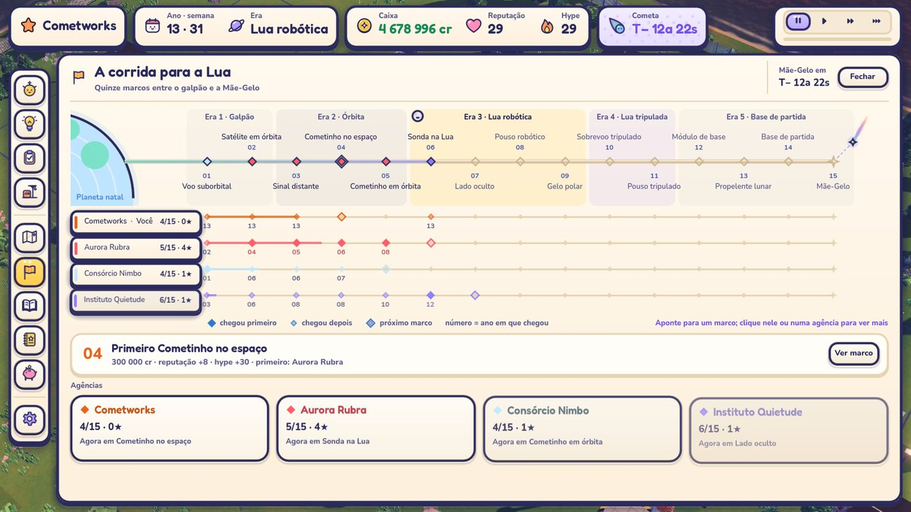

Cada marco tem um fato de **Ciência de verdade** que aparece no jornal. Alguns favoritos: "Na órbita a tripulação flutua não porque a gravidade sumiu, mas porque ela e a nave caem juntas ao redor do planeta." "A gravidade da Lua é cerca de um sexto da terrestre: cada passo na Lua vira um pulinho." "Cometas são sobras do nascimento do Sistema Solar: gelo, poeira e rocha."

## Como as rivais jogam

As rivais seguem os marcos em ordem. Todo mês, cada uma tem uma chance de tentar o próximo:

- **Chance de tentar:** 4,5% × capacidade × ritmo × (multiplicador nos tripulados) ÷ dificuldade do marco, mais um empurrão quando ela está atrás da líder e outro perto do fim dos anos plausíveis (×1,6 no último ano, ×2,6 quando já está atrasada).
- **Chance de falhar uma tentativa:** 50% × (1 − confiabilidade) × ousadia. Na prática: **Aurora 37,5%**, **Nimbo 8%**, **Quietude 1,5%**. Cada falha custa meses de atraso e pode virar manchete ("Fogos, mas nada de marco").
- **Crescimento:** cada marco conquistado aumenta a capacidade da rival (5% no primeiro, 2% nos seguintes). Licenciar tecnologia para ela também.
- **Desistência:** se um marco passa um ano além do último ano plausível, a rival "engaveta o programa" e segue para o próximo.

O resultado é uma personalidade que dá para sentir: a Aurora sai na frente, tropeça e se levanta, e costuma levar os tripulados; o Nimbo é constante, mas enrola com gente a bordo; o Quietude demora a começar e quase nunca erra, e por isso fica perigoso no fim.

## O final do cometa

No fim do ano 25 a Mãe-Gelo passa pelo Sol ("A Mãe-Gelo passa pelo Sol. A corrida acabou."). Se a sua agência concluiu a missão ao cometa a tempo, os Cometinhos fazem contato, a cauda dela acende o céu do campus e a frase final aparece: **"Casa não é um lugar no céu. É chegar lá juntos."**

A tela seguinte mostra a fila das agências, cada uma com "encontrou o cometa" ou "ficou para trás", e o resumo: "25 anos · 15 marcos · 4 agências".

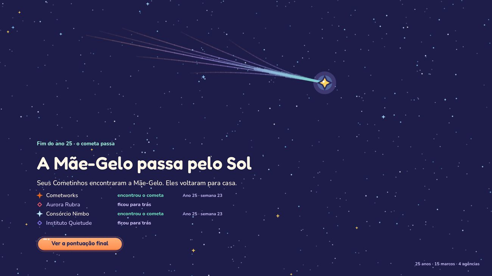 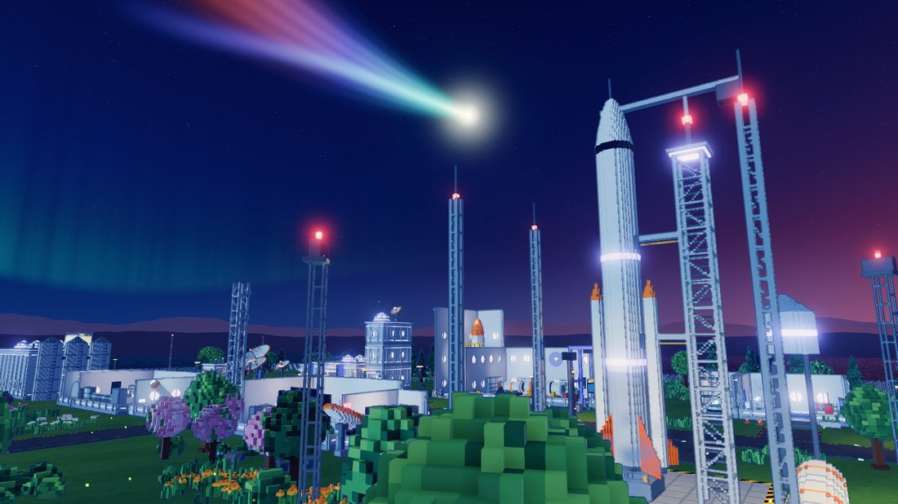

## O final agridoce

Se a agência não chegou, a campanha termina do mesmo jeito, no fim do ano 25, com o final "Até a próxima, Mãe-Gelo": fungada, abraço, um pacote inteiro de biscoitos e a promessa de estar pronto na próxima passagem. "Seus Cometinhos viram a Mãe-Gelo passar. Na próxima, eles vão junto."

É de propósito que esse final não é uma tela de derrota. Ninguém perde o carinho dos Cometinhos por ter chegado tarde.

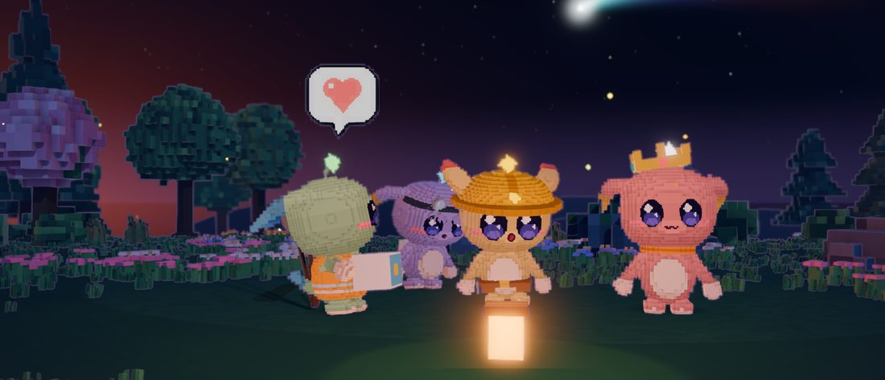 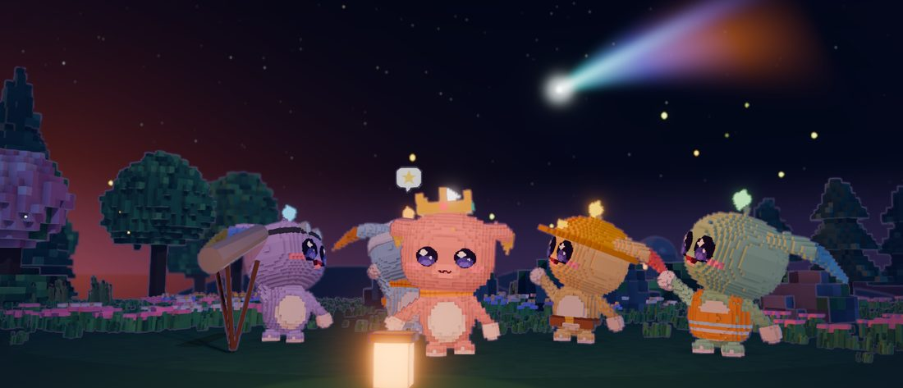

## A pontuação final

"Relatório da campanha · 25 anos." A pontuação vai de 0 a 1000, mais o bônus do encontro:

| Parte | Pontos | Como conta |
| --- | --- | --- |
| Marcos | 300 | marcos conquistados (primeiro lugar vale 1, os outros 0,3) sobre 15 |
| Ciência baixada | 250 | toda a ciência que chegou ao solo, sobre uma referência de 3 000 |
| Reputação | 150 | a média dos últimos 5 anos, sobre 100 |
| Dinheiro em caixa | 100 | o caixa final, sobre 5 milhões de cr |
| Cometinhos | 100 | a soma dos níveis da equipe, sobre 40 |
| Primeiros lugares | 100 | quantos marcos você levou primeiro, sobre 8 |
| Encontro com a Mãe-Gelo | +200 | bônus de quem chegou ao cometa |

A tela mostra a sua colocação entre as quatro agências e a lista dos seus marcos.

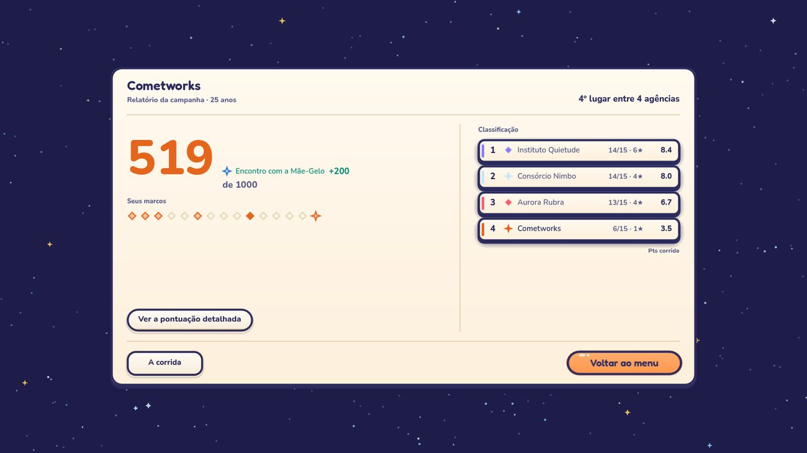

::: chapter
numero: 8
titulo: Arte, som e tom
cor: violeta
imagem: img/cap8_terra.jpg
icone: palette
---
O Cometworks tem uma cara e uma voz. Este capítulo é o guia para que tudo o que a gente acrescentar continue parecendo do mesmo jogo.

Voxel com contorno de desenho, papel de caderno com bolinhas, sons de caixinha de música e Cometinhos que se levam a sério demais.
:::

## O visual: voxel com contorno de desenho

O mundo inteiro é voxel: campus, foguetes, planetas, árvores, os próprios Cometinhos. Tudo passa por um estilo cartoon (luz em degraus e contorno escuro), com opção de desligar o estilo e os contornos nas configurações de imagem. O céu do campus muda com o dia: pôr do sol pêssego, noite azul-marinho, e o cometa sempre ali, riscando o céu.

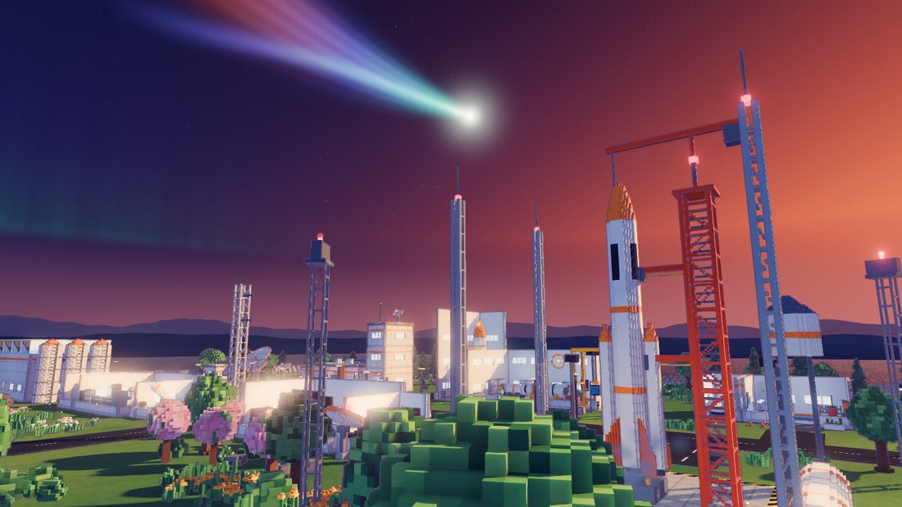 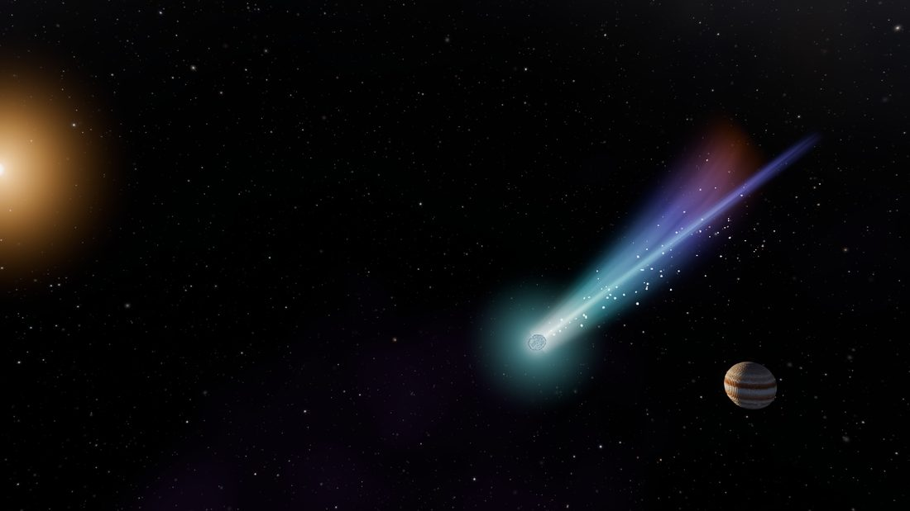

## Como desenhar um Cometinho

::: gallery six
img/c_hero.webp | Acenando
img/c_think.webp | Pensando
img/c_hammer.webp | Engenharia
img/c_clipboard.webp | Controle
img/c_scan.webp | Ciência
img/c_sleep.webp | Cochilando
:::

- **Silhueta:** cabeça redonda enorme (uns 55% da altura), corpinho de bala de goma, bracinhos com patinhas de luva e pés de feijão.
- **Marcas da espécie:** duas **orelhas-cauda** compridas que esvoaçam para trás (pontas na cor das "pontinhas"), a **lâmpada-estrela** de quatro pontas na antena (na cor da profissão), uma caudinha, três sardas-estrela na testa, barriga creme, bochechas rosadas e olhos enormes com dois brilhos.
- **Não é humano, não é emprestado.** Sem nariz, sem cabelo, sem mãos humanas. Nada de óculos de um olho só sobre corpo de cápsula, bonequinho verde de traje ou feijão de visor.
- **Voxel, mas macio.** Formas arredondadas, voxels pequenos no rosto para os olhos ficarem lisos.
- **Legível de longe.** Cabeça grande, antena brilhando, barriga contrastando, objetos enormes (martelo, scanner, caixa).
- **Personalidade:** curiosos, corajosos, falantes (conversam em pares com balõezinhos), prestativos e dorminhocos.

## A paleta

A interface usa tinta azul-marinho sobre papel creme, com cores de bala nos destaques. Os tokens moram em `ui/cometworks_palette.gd`.

| Token | Cor | Uso |
| --- | --- | --- |
| Tinta | {{#2b2a5c}} `#2b2a5c` | textos e contornos |
| Papel | {{#fff9ef}} `#fff9ef` | painéis |
| Poço | {{#f6ead6}} `#f6ead6` | trilhos e campos |
| Pêssego | {{#ff9a5c}} `#ff9a5c` | botões principais, calor |
| Manteiga | {{#ffd25c}} `#ffd25c` | destaques, a pílula do logo |
| Menta (aurora) | {{#6fe0be}} `#6fe0be` | sucesso, operações |
| Gelo de cometa | {{#7cc8ff}} `#7cc8ff` | ciência, céu |
| Lilás | {{#b39cff}} `#b39cff` | pesquisa, confiabilidade |
| Rosa | {{#ff8fb8}} `#ff8fb8` | carinho, sonhos |

As quatro barras têm cores fixas em qualquer tela: **Engenharia** {{#ff8f50}} laranja, **Ciência** {{#4fa9f0}} azul, **Operações** {{#2fc4a0}} verde-água e **Confiabilidade** {{#9b7cff}} violeta. A cauda do cometa é sempre a mesma faixa: menta, lilás, pêssego.

## As fontes

Todas com licença aberta (OFL) e embutidas no jogo, em `ui/fonts/`:

- **Fredoka** para títulos, números e botões: redondinha e gordinha.
- **Nunito** para textos: macia e fácil de ler.
- **Bricolage Grotesque** no logo COMETWORKS, com a estrela no lugar do O e a cauda aurora saindo dela.

Este documento usa as mesmas três.

## A interface de adesivo

A interface parece um álbum de figurinhas: **painéis de papel creme com bolinhas, contorno de tinta azul-marinho e um "lábio" grosso embaixo**, como um adesivo colado. Os botões são teclas de bala, gordinhas, que afundam quando apertadas. As telas abrem em páginas, com abas e trilha de navegação ("Equipe › Pipoca"), e o Esc sobe um nível.

Regras rápidas:

- Tudo o que é visual mora em cenas `.tscn` editáveis; os scripts só preenchem dados e duplicam modelos que já estão na cena.
- Texto na tela sempre por chave de tradução, em português e inglês.
- A interface é calma; quem pula e exagera são os Cometinhos.
- Ícones gordinhos com contorno de tinta (os mesmos deste documento), nunca emoji.

## O som

Todo som do jogo é **sintetizado do zero em código**, sem amostras e sem downloads, pelo `tools/build_audio.py`. Cada som tem uma semente fixa, então rodar o script de novo dá exatamente os mesmos arquivos. A licença dos sons fica tão limpa quanto a do código.

| Pasta | O que tem |
| --- | --- |
| `ui/` | passar o mouse, clique, voltar, abrir e fechar, chaves, negado, dinheiro, notícia |
| `music/` | tema do menu, música do campus em loop, vinhetas de marco e do final |
| `ambience/` | dia (passarinhos), noite (grilos), o silêncio do espaço, marteladas do galpão |
| `voice/` | os balbucios dos Cometinhos: feliz, pergunta, surpresa, triste... |
| `launch/` | contagem, ignição, ronco do motor, soluço, falha, torcida, "ownn" da plateia, sinos de resultado |

A paleta é macia: ruído filtrado, kalimba, marimba e celesta, colchões quentes de sintetizador, vozinhas de formante para os Cometinhos, pássaros e grilos de mentira. Os loops fecham sem emenda. O que toca quando, com volume e variação, fica na biblioteca editável `assets/audio/cw_sound_library.tres`. O jogador controla volume geral, música e efeitos.

## O tom de voz

**Leve e caloroso.** Os Cometinhos comemoram lançamentos, choram falhas com balõezinhos e mandam cartinhas para casa. **O humor nunca zomba da ciência; zomba dos Cometinhos, que se levam a sério demais.**

| Situação | Assim | Assim não |
| --- | --- | --- |
| Falha no lançamento | "O motor tossiu e desistiu. A equipe está triste, mas toda falha ensina algo." | "Missão fracassada. Tente novamente." |
| Dica | "Fulana avisa: a noite na superfície lunar é bem mais longa do que em órbita." | "Erro: energia insuficiente." |
| Rival | "Medimos duas vezes. Depois medimos de novo." | qualquer coisa que humilhe |
| Fato | "A gravidade da Lua é cerca de um sexto da terrestre: cada passo vira um pulinho." | um número sem contexto |
| Jornal | "Tempo na cauda: gelado, com chance de lançamentos." | humor que precise de explicação |

## Regras para conteúdo novo

Antes de pôr qualquer coisa nova no jogo (pedido, fala, notícia, Lenda, ficha), passe por esta lista:

1. **É aconchegante?** Ninguém é humilhado, ninguém se machuca de verdade. Falha é tropeço, nunca tragédia.
2. **A ciência está certa?** Todo fato real precisa de fonte conferida (de preferência NASA, JPL ou NOAA). Na enciclopédia, ficha sem fonte fica `verified: false` e não aparece.
3. **Ensina sem dar a resposta?** O pedido conta a situação e esconde a solução; a pista mora na história.
4. **Respeita a lore?** A Mãe-Gelo, os 25 anos, primeiro a Lua.
5. **Respeita as pessoas reais?** Homenagem, nunca piada; nada de política; nenhuma frase inventada atribuída a alguém de verdade.
6. **Funciona nas duas línguas?** Toda chave nova vai para o CSV em português e inglês.
7. **Tem consequência visível?** Se uma escolha não muda nenhum número, barra ou Cometinho, ela ainda não está pronta.

::: chapter
numero: 9
titulo: O que vem por aí
cor: nuvem
imagem: img/cap9_saturno.jpg
icone: map
---
O que já funciona, o que falta e o que a gente quer fazer depois. Sem enfeite: é a nossa lista de verdade.

No fim, o apêndice com os atalhos do menu de dev, que salva vidas na hora de testar e de apresentar.
:::

## O roteiro honesto

**Já funciona hoje:** o campus com as cinco eras, o criador de líder, a equipe com profissões, níveis, moral, cochilos e especializações, os 27 pedidos com solução escondida, o planejador de carga com os seis medidores, o projetista de foguetes, as três fases de desenvolvimento, a Revisão de projeto, a cinemática de lançamento, a operação no mapa com decisões, a avaliação com os quatro jornais, o Caderno de descobertas, a pesquisa, os contratos, as finanças, a corrida com três rivais, o Eco da Cauda, as cenas de abertura e dos dois finais, a pontuação, o modo feira, salvamento e o menu de dev.

**O que falta**, por ordem de prioridade:

| Prioridade | Item | O que significa |
| --- | --- | --- |
| 1 | Build jogável | exportar para Windows, testar em máquinas que não são as nossas, salvamentos prontos no começo de cada era para a apresentação |
| 2 | Balanceamento | primeira rodada feita com a simulação (abaixo); falta jogar à mão e decidir as perguntas |
| 3 | Lendas no jogo | contratações lendárias, mentores e líderes rivais (abaixo) |
| 4 | Hangar e voo | passar o hangar e o voo para o visual de adesivo e ligar com o tycoon |
| 5 | Ideias do GDD | multijogador no mesmo computador e mais pedidos Space Apps (os níveis de dificuldade já entraram) |

## As Lendas no jogo

Um caminho possível, que aproveita o que já existe:

1. **Dados.** Um `data/tycoon/legends.json` com cada Lenda: tipo (contratação, mentor ou líder), era de chegada, profissão, visual (cores, chapéu, objeto) e efeitos. Muitos efeitos já existem em `crew.json` (`crew_risk`, `points_ops`, `defects`, `research`, `team_xp`...); os outros pedem chaves novas, como os riscos da Revisão de projeto e o hype por câmera.
2. **Contratações lendárias.** Aparecem uma vez no mercado, num cartão dourado, com a especialização única já pronta.
3. **Mentores.** Entram como mais uma fonte de palpites no pedido (as mesmas falas de "A equipe comenta"), com retrato e nome.
4. **Líderes rivais.** Retrato no quadro da corrida e frases próprias no Eco da Cauda (`i18n/tycoon_race_strings.csv`).
5. **Enciclopédia.** A caixinha "Quem inspirou" vira uma ficha nova, com fonte conferida, como as fichas de missão.
6. **Arte.** Cada Lenda ganha um chapéu ou objeto próprio no criador de visual (o boné-hélice do Albertinho já está lá!).
7. **Revisão.** Antes de publicar fora do hackathon, a gente revisa juntos os nomes-homenagem e, com mais cuidado, as fichas de pessoas vivas.

## Balanceamento

A primeira rodada foi feita com `tests/sim_campaign.gd`: um robô joga campanhas inteiras de 25 anos pelos mesmos comandos das telas (pesquisa, prédios, contratação, especializações, contratos, pedidos, projetos com sliders, empréstimos) e imprime dinheiro por era, expectativa da imprensa contra os pontos das equipes, os marcos das rivais e o tempo do modo feira. São quatro jogadores: **bom** (até 3 projetos, os melhores sliders), **mediano** (até 2, sliders razoáveis), **feira** (um projeto por vez, só age quando o jogo pausaria) e **moedor** (pega todo contrato que paga, para achar exploits). Roda com `godot --headless --path . --script res://tests/sim_campaign.gd -- seeds=4 bots=average,fair diff=normal`.

O que mudou, e por quê:

- **Ritmo das eras.** A Cápsula tripulada desceu para a era 3 (pesquisável a partir da era 2, depois do Estágio superior): o jogador mediano agora pega "Primeiro Cometinho no espaço" e "em órbita" no ano 8 a 10, perto das rivais (ano 8), e não mais no ano 12 a 15. Voos tripulados à Lua pedem Suporte de vida (era 4), então o sobrevoo tripulado continua sendo coisa da era 4. O Complexo de pesquisa foi para a era 4 para manter seis tecnologias por era. O código conta cinco anos por era (1 a 5, 6 a 10, ...); o GDD fala em 1 a 4, 5 a 9, ... com seis anos na última. Mantivemos cinco: 25 anos fecham certinho.
- **A Mãe-Gelo.** Antes, o jogador encontrava o cometa no ano 17 a 19, sem corrida nenhuma. Agora o cometa só fica ao alcance nos últimos dois anos (`approach_weeks` em `missions.json`), com uma notícia quando chega perto. O jogador mediano chega no ano 24; o Quietude chega no ano 25 em 1 a 3 de cada 4 campanhas, mas não passou na frente de um jogador mediano.
- **Expectativa da imprensa.** A curva era 60, 140, 260, 420, 600: uma equipe ideal fazia só 25% a 35% do esperado nas eras 4 e 5, as notas caíam para 4 e a reputação ia a zero. Agora é **60, 140, 200, 260, 320**: a equipe ideal fica perto de 65% a 85% do esperado em todas as eras.
- **Hype.** O hype não tinha teto nos lançamentos e passava de 300, e as doações (400 cr por ponto por mês) viravam uma máquina de dinheiro para quem lançava sondagens sem parar. Agora fica entre 0 e 100, como a corrida já fazia. O moedor, que antes terminava a era 1 com 2,8 mi, agora quebra: lançar 90 sondagens por era não paga mais.
- **Orçamento do governo nas eras finais.** Com a reputação saudável, o dinheiro sobrava demais no fim (100 mi no ano 25). O orçamento das eras 3 a 5 baixou de 1,8 / 3,2 / 5 mi para 1,6 / 2,4 / 3,2 mi por ano. Ainda sobra (o mediano termina com 60 a 70 mi): fica como pergunta abaixo.
- **Especializações sem efeito.** Médico(a) de voo, Caminhante lunar, Navegador(a) de cometas, Minerador(a) de gelo e Diretor(a) de missão ganharam efeito (tabela do capítulo 3). E várias especializações antigas que só tinham texto (Mãos firmes, Líder de integração, Caçador(a) de defeitos, Especialista lunar, Garimpeiro(a) de dados, Mestre de antenas, Especialista em criogenia, Polímata) agora mexem nas regras de verdade.
- **Dificuldade.** Fácil, Normal e Difícil na aba Agência do criador de líder (só numa carreira nova; o modo feira joga no Normal). Uma tabela, `data/tycoon/difficulty.json`, escala caixa inicial, receitas, expectativa da imprensa e velocidade das rivais (×0,8 e ×1,2, como no apêndice do GDD). Fica no salvamento; salvamentos antigos jogam no Normal.

Números da simulação (4 campanhas por jogador, mediana):

| | Antes | Depois |
| --- | --- | --- |
| Caixa do mediano no fim de cada era | 1,5 / 3,3 / 5,9 / 4,9 / 13,8 mi | 1,4 / 3,5 / 13,4 / 34,8 / 66,6 mi |
| Reputação do mediano no fim das eras 3, 4 e 5 | 48 / 0 / 1 | 97 / 86 / 47 |
| Pontos ÷ esperado (mediano), eras 1 a 5 | 0,77 / 0,65 / 0,33 / 0,20 / 0,15 | 0,79 / 0,75 / 0,65 / 0,47 / 0,39 |
| Primeiro Cometinho no espaço (mediano) | ano 12 | ano 8 |
| Encontro com a Mãe-Gelo (mediano) | ano 17 | ano 24 |
| Falhas da Aurora | 40% das tentativas | 34% a 45% (o mesmo 37,5% de projeto) |
| Pontuação final (mediano, Fácil / Normal / Difícil) | 917 (Normal) | 1115 / 1116 / 1017 |

**Modo feira.** O relógio sozinho já dá 1.300 s (21,7 min). O robô da feira faz uns 65 projetos, e cada projeto custa umas 4 a 5 paradas (escolher, três fases, revisão, lançamento): a estimativa fica em 2 h 15. Para caber em 40 a 60 minutos, quem apresenta pode fazer uns 20 projetos, ou começar de um salvamento de era.

**Falência.** A simulação ganhou um quinto robô, o **gastador** (gasta até o zero sem reserva, constrói e contrata no crédito e pega todo empréstimo), e conta avisos, empréstimos de emergência e falências. A linha ficou em −600 mil × fator da era no Normal, com a era 2 em ×2,2 (a era em que o robô bom mais aperta). "Mais perto da linha" é o menor caixa ÷ a linha da época (−1 = em cima dela).

| Normal | Campanhas | Mais perto da linha (mediana / pior) | Avisados | Empréstimo de emergência | Falência |
| --- | --- | --- | --- | --- | --- |
| mediano | 8 | −0,28 / −0,66 | 2 | 0 | 0 |
| feira | 4 | −0,33 / −0,81 | 1 | 0 | 0 |
| bom | 4 | −0,39 / −1,00 | 2 | 1 (ano 9) | 0 |
| moedor | 4 | −0,98 / −1,10 | 4 | 3 (anos 5, 8, 8) | 3 (anos 7, 9, 9) |
| gastador | 4 | −1,06 / −1,10 | 4 | 4 (anos 3, 5, 5, 5) | 4 (anos 4, 6, 7, 7) |

No Fácil (linha −900 mil) o mediano nem chega perto (pior −0,04) e o gastador ainda quebra em 3 de 4; no Difícil (linha −400 mil) o mediano é avisado em 3 de 4 campanhas (pior −0,75), sem empréstimo de emergência, e o gastador quebra em todas, entre os anos 4 e 7. A pontuação final do mediano não mudou (1 086 no Normal).

Perguntas para o time:

- A Aurora falha em 37,5% das tentativas (na prática 34% a 45%, porque o elástico a faz tentar mais quando está atrás). Divertido nas manchetes; frustrante nunca, porque a falha só atrasa ela.
- As rivais parecem lentas contra um jogador competente: o mediano termina em primeiro em todas as campanhas no Normal e o robô bom pega 12 a 15 marcos. O Difícil (rivais ×1,2) aperta, mas talvez o Normal mereça rivais um pouco mais rápidas.
- O dinheiro do fim ainda sobra muito (o placar só conta até 5 mi). Baixar mais o orçamento das eras 4 e 5, ou dar onde gastar (prédios de nível 4, megaprojetos)?
- A equipe sobe de nível rápido: média de nível 5 já na era 2. Talvez 150 de XP por nível depois do 3.
- Uma agência no vermelho podia ficar anos assim, emprestando de novo. Agora existe falência (abaixo), em todas as dificuldades, com a linha mais funda no Fácil.
- O modo feira não corta nada do jogo: dá para reduzir as paradas (manter os sliders da fase anterior, revisão automática) se a apresentação precisar.

## Hangar e voo

O hangar de montagem e o voo com mapa e cônicas vêm do MARGIN, o projeto de onde o Cometworks nasceu. O tycoon usa a matemática deles (Δv, catálogo de peças, mapa do sistema solar), e os dois agora abrem dentro do campus: o hangar monta o foguete de uma missão e "Pilotar o lançamento" leva esse foguete à plataforma.

O voo pilotado também ganhou o papel creme com bolinhas. À esquerda fica o cartão da missão (o que alcançar, uma barrinha de progresso e um "Faça agora" com uma instrução simples para cada momento do voo) e o painel de voo com números grandes: altitude, velocidade, o Δv que sobra nos tanques contra o que a missão ainda pede, e os pontos mais alto e mais baixo da órbita. Os estágios são adesivos coloridos com o combustível de cada um, e a tecla de estágio diz o que vai acontecer ("Ignição!", "Soltar estágio"). Na primeira vez, balõezinhos de dica mostram a alavanca do motor, a ignição, a curva para o leste, a hora de soltar um estágio vazio e o mapa; o jogo lembra quais já foram vistas (dá para revê-las pelo F1). O mapa tem cônicas em cores de bala num céu azul-marinho macio, com etiquetas de papel em linguagem simples ("Mais alto", "Encontra a Lua"), e o fim do voo é um cartão calmo que, numa missão, devolve o jogador para a avaliação no campus.

## Build jogável

- Exportação para Windows, com o menu de dev desligado (ele só aparece no editor e em builds de debug).
- Modo feira testado do galpão ao cometa.
- Salvamentos de demonstração no começo de cada era.
- Português e inglês conferidos tela por tela.
- Um roteiro de apresentação de cinco minutos, com os atalhos abaixo à mão.

Como está hoje:

- **Exportar.** O `export_presets.cfg` já tem o preset "Windows Desktop" (release, nome Cometworks, ícone do projeto, sem `tests/`, `docs/`, `tools/` e o addon do editor). Falta só instalar os modelos de exportação do Godot 4.6.3 (no editor: Editor › Gerenciar modelos de exportação › Baixar e instalar; o editor .NET procura em `export_templates/4.6.3.stable.mono`). Depois: `godot --headless --path . --export-release "Windows Desktop" ../MARGIN-build/Cometworks.exe`.
- **Menu de dev.** Só existe no editor e em builds de debug (`OS.is_debug_build()`); a exportação release sai sem ele. O `tests/test_dev_menu.gd` confere.
- **Demonstração.** O menu principal tem a entrada **Demonstração**, com uma campanha pronta no começo de cada era e um começo no modo feira (`data/demo_saves/`). Elas saem de uma campanha jogada de verdade por um piloto automático; depois de mudar regras, dados ou o formato do save, gere de novo com `godot --headless --path . --script res://tools/make_demo_saves.gd` e confira com `tests/test_demo_saves.gd`.
- **Português e inglês.** O `tests/test_i18n.gd` confere todas as chaves dos CSVs, das cenas, dos scripts e dos dados, e abre o menu, o criador de líder, todas as telas do campus e o hangar nas duas línguas procurando chave crua, texto em inglês na tela em português (e o contrário) e sobrenome de Cometinho em inglês.
- **Roteiro.** Em `docs/roteiro_apresentacao.md`.

## Apêndice: menu de dev

Uma janelinha flutuante para testar rápido, em qualquer cena. Não pausa o jogo (a não ser que você aperte Pausar) e só aparece em builds de debug e no editor. Para forçar numa exportação, ligue `cometworks/dev/enabled` nas configurações do projeto.

| Tecla | O que faz |
| --- | --- |
| **F1** | abre e fecha o menu (onde a cena não usa F1; no hangar e no voo, F1 é a ajuda) |
| **F12** | abre e fecha o menu em qualquer cena |
| **'** | abre e fecha (a tecla abaixo do Esc no ABNT2; a crase no teclado americano) |

| Aba | Atalhos que mais ajudam |
| --- | --- |
| **Geral** | desempenho; ir para menu, nova campanha, campanha direta, modo feira, hangar, voo de teste; velocidade do motor de 0,25× a 8×; estilo cartoon e contornos; áudio; screenshot |
| **Campanha** | dinheiro ±100 mil ou +1 mi, reputação e hype ±5; +1 semana, mês ou ano; turbo ×1 a ×16; pular para a era 1 a 5; cometa em 2 semanas ou agora; construir tudo; toda a pesquisa; contratar, moral máxima, subir todos de nível; aceitar contrato; tomar o próximo marco; dia e noite; salvar e carregar |
| **Projetos** | concluir a fase ou o desenvolvimento; abrir a Revisão de projeto; forçar o próximo lançamento (sucesso, parcial ou falha); lançar um teste agora; revelar todo o caderno; abrir o quadro de missões; gerar qualquer pedido de `briefings.json` no topo do quadro; rever a cinemática; liberar todas as peças |
| **Cenas** | tocar a abertura, a abertura curta, o final com o cometa e o final perdido; pular a cena; esquecer as vistas |
| **Telas** | abrir qualquer tela da HUD pelo nome; jornal, final, placar |
| **Cometinhos** | ações, emotes, expressões e reações; criar uma multidão extra; ver a grade de caminhada |
| **Log** | colisões visíveis, modos de desenho, últimos avisos e erros |

::: box dica Roteiro de demonstração em dois minutos
Campanha direta › **Projetos › gerar pedido** "Tocar a borda do céu" › aceitar, montar e lançar › **Projetos › próximo lançamento: sucesso** › **Campanha › tomar o próximo marco** para mostrar o Eco da Cauda › **Campanha › era 5** › **Cenas › final com o cometa**.
:::

::: page credits
## Créditos

::: gallery
img/c_kaua.webp | Kauã
img/c_helena.webp | Helena
img/c_joao.webp | João Lucas
img/c_ryan.webp | Ryan
:::

O Cometworks é feito por **Kauã, Helena, João Lucas e Ryan** para o NASA Space Apps Challenge 2026, em Godot 4.6, a partir do MARGIN, o nosso jogo de montagem e voo de foguetes.

**Fontes de dados e de fatos.** As fichas de missão citam páginas da NASA, do JPL e do NSSDC, conferidas em novembro de 2026; os desafios Space Apps apontam para NASA FIRMS, NASA Earthdata e o Space Weather Prediction Center da NOAA. As caixinhas "Quem inspirou" usam só fatos amplamente documentados.

**Fontes tipográficas.** Fredoka, Nunito, Bricolage Grotesque e IBM Plex Mono, todas sob a SIL Open Font License.

**Sem marcas oficiais dentro do jogo.** Missões reais aparecem como referência histórica, sem logotipos.

{.wide}

::: quote
icone: heart
quem: a última fala do jogo
---
"Casa não é um lugar no céu. É chegar lá juntos."
:::
:::
